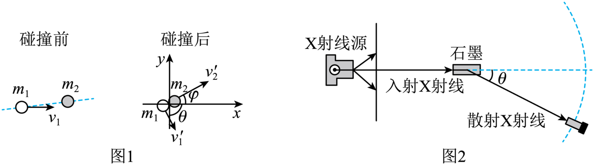

# Physics - 题目 2242

**ID**: 731a559f18c0489388494ed9298a690a
**年级**: Grade 11
**难度**: Medium-Hard
**题型**: Calculation

## 题目
动量守恒定律是一个独立的实验定律，它适用于目前为止物理学研究的一切领域。​​​​​​​‌运用动量守恒定律解决二维问题时，可以在相互垂直的x、y两个方向上分别研究。（1）如图1所示，质量分别为 $m{{}_{1}}$ 、 $m{{}_{2}}$ 的球1和球2构成的系统，不考虑系统的外力作用。球1以速度 $v{{}_{1}}$ （方向沿x轴正向）与静止的球2碰撞，若速度 $v{{}_{1}}$ 不在两球球心的连线上，碰撞之后两球的速度 $v^{′}{{{}_{1}}}$ 、 $v^{′}{{{}_{2}}}$ 都会偏离 $v{{}_{1}}$ 的方向，偏角分别为 $θ$ 和 $φ$ ，且 $v{{}_{1}}$ 、 $m{{}_{1}}$ 、 $m{{}_{2}}$ 、 $θ$ 、 $φ$ 均已知。a．请写出计算 $v^{′}{{{}_{1}}}$ 、 $v^{′}{{{}_{2}}}$ 的大小时主要依据的关系式；b．请分析说明球1对球2的平均作用力 $F$ 的方向。（2）如图2所示，美国物理学家康普顿及其团队将X射线入射到石墨上，发现被石墨散射的X射线中除了有与入射波长相同的成分外，还有与入射波长不同的成分。我国物理学家吴有训在此项研究中也做出了突出贡献，因此物理学界也把这一效应称为“康普顿﹣吴效应”。由于这一现象很难用经典电磁理论解释，所以康普顿提出光子不仅有能量，也具有动量，光子的动量 $p$ 与其对应的波长 $λ$ 之间的关系为 $p=\frac {h}{λ}$ （ $h$ 为普朗克常量）。进一步研究表明X射线的散射实质是单个光子与单个电子发生碰撞的结果。由于电子的速度远小于光的速度，可认为电子在碰撞前是静止的。现探测到散射X射线的波长不同于入射X射线的波长，请你构建一个合理的相互作用模型，解决以下问题：a．请定型分析散射后X射线的波长 $λ^{′}$ 与入射X射线的波长 $λ$ 的大小关系；b．若已知入射X射线的波长为 $λ$ ，散射后X射线的波长为 $λ^{′}$ 。设散射X射线相对入射方向的偏转角为 $θ$ 。求 $θ=\frac {π}{2}$ 时电子获得的动量。

## 解答

1. （1）a．以碰撞后x轴、y轴为正方向，分别列出两轴的动量守恒表达式。
2. x轴有
3. $m{{}_{1}}v{{}_{1}}=m{{}_{1}}v^{′}{{{}_{1}}}{\cos}θ+m{{}_{2}}v^{′}{{{}_{2}}}{\cos}φ{\rm \mathit{y}}$ 轴有
4. $m{{}_{2}}v^{′}{{{}_{2}}}\sin φ-m{{}_{1}}v^{′}{{{}_{1}}}\sin θ=0$
5. b．对球2，根据动量定理得
6. $FΔt=m{{}_{2}}v^{′}{{{}_{2}}}-0$
7. 可知， $F$ 的方向与 $v^{′}{{{}_{2}}}$ 相同，与水平方向夹角为 $φ$ 。
8. （2）a．依题意，建立如（1）中的碰撞模型。
9. 入射X射线的光子能量为
10. $E=h\frac {c}{λ}$
11. 散射后X射线的光子能量为
12. $E^{′}=h\frac {c}{λ^{′}}$
13. 设碰撞后电子的动能为 $E{{}_{{\rm{e}}}}$ ，碰撞中可能存在的能量损失为 $\Delta E{{}_{损}}$ 。根据能量守恒定律得
14. $E=E^{′}+E{{}_{{\rm{e}}}}+ΔE{{}_{损}}$
15. 可知
16. $E>E^{′}$
17. 即
18. $h\frac {c}{λ}>h\frac {c}{λ^{′}}$
19. 则有
20. $λ<λ^{′}$
21. b．设散射后电子获得的动量为 $p{{}_{{\rm{e}}}}$ ，方向与X射线入射方向夹角为 $φ$ ，由（1）结论可知，入射方向有
22. $\frac {h}{λ}=p{{}_{{\rm{e}}}}{\cos}φ+\frac {h}{λ^{′}}{\cos}θ$
23. 垂直方向有
24. $0=p{{}_{{\rm{e}}}}\sin φ-\frac {h}{λ^{′}}\sin θ$
25. 代入 $θ=\frac {π}{2}$ ，解得
26. $p{{}_{{\rm{e}}}}=h\sqrt {\frac {1}{λ{^{2}}}+\frac {1}{λ^{′}{{^{2}}}}}$

## 知识点

**中文**:
  - 核反应的反应方程及能量计算

**English**:
  - Nuclear Reaction Equations and Energy Calculation

---
