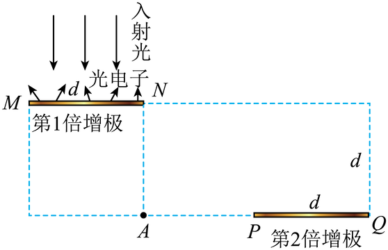

# Physics - 题目 1283

**ID**: 75752b936c3e41d6963a8ca44c2f9090
**年级**: Grade 11
**难度**: Medium-Hard
**题型**: Calculation

## 题目
光电倍增管可将光信号转化为电信号并逐级放大。​​​​​​​‌现只研究其第1、2倍增极，其结构如图所示。两倍增极平行且长度均为d，垂直距离为d，过第1倍增极右端N作垂线与第2倍增极延长线交于A点，A到第二倍增极左端P的距离为d。当入射光照射到第1倍增极的上表面时，逸出大量速度不同的光电子，在空间加垂直纸面的匀强磁场，可使更多的光电子打到第2倍增极的上表面，从而激发出更多的电子，实现信号放大。已知第1倍增极金属的逸出功为W，入射光的光子动量为p，光电子电荷量为e、质量为m，普朗克常量为h，真空中的光速为c，仅考虑光电子在纸面内运动，倍增级间电势差引起的电场可忽略，不计光电子的重力。（1）求从第1倍增极的上表面逸出光电子的最大动量 $p^{′}{{{}_{{\rm{m}}}}}$ 。（2）若施加垂直纸面方向的匀强磁场（未画出），仅考虑从第1倍增极的上表面垂直逸出，且初动能为 $E{{}_{0}}$ 的光电子，为确保有光电子到达第2倍增极的上表面，求：①匀强磁场的方向（“垂直纸面向内”或“垂直纸面向外”）；②磁感应强度B的大小范围。（3）磁感应强度大小恒为 $B^{′}=\frac {\sqrt {2mE{{}_{0}}}}{2ed}{\rm ，\mathit{AP}}$ 距离介于d~2d之间，求初动能为 $E{{}_{0}}$ 的光电子从第1倍增极上表面到达第2倍增极上表面的最长时间。

## 解答

1. （1）光电子逸出的最大初动能 $E{{}_{{\rm{k}}{\rm{m}}}}=hν-W$ ，
2. 又 $ν=\frac {c}{λ}$ ， $p=\frac {h}{λ}$ ，
3. 得 $E{{}_{{\rm{k}}{\rm{m}}}}=pc-W$ ，
4. 光电子逸出的最大动量 $p^{′}{{{}_{{\rm{m}}}}}=\sqrt {2mE{{}_{{\rm{k}}}}}$  ，
5. 解得 $p^{′}{{{}_{{\rm{m}}}}}=\sqrt {2m\left ({pc-W}\right )}$ 。
6. （2）①根据题意可知，匀强磁场的方向垂直纸面向内，
7. ②临界1： $M$ 点逸出的光电子到达 $Q$ ，根据几何关系有 $r{{}_{1}}=\sqrt {{\left({3d-r{{}_{1}}}\right)^{2}}+d{^{2}}}$  ，
8. 得 $r{{}_{1}}=\frac {5}{3}d$    ，
9. 根据洛伦兹力提供向心力有 $evB{{}_{1}}=m\frac {v{^{2}}}{r{{}_{1}}}$ ，
10. 又 $\frac {1}{2}mv{^{2}}=E{{}_{0}}$ ，
11. 联立得 $B{{}_{1}}=\frac {3}{5}\frac {\sqrt {2mE{{}_{0}}}}{ed}$ ，
12. 临界2： $N$ 点逸出的光电子到达 $P$ ，根据几何关系有 $r{{}_{2}}=\sqrt {{\left({d-r{{}_{2}}}\right)^{2}}+d{^{2}}}$  ，
13. 得 $r{{}_{2}}=d$   ，
14. 根据洛伦兹力提供向心力有 $evB{{}_{2}}=m\frac {v{^{2}}}{r{{}_{2}}}$ ，
15. 又 $\frac {1}{2}mv{^{2}}=E{{}_{0}}$ ，
16. 联立得 $B{{}_{2}}=\frac {\sqrt {2mE{{}_{0}}}}{ed}$ ，
17. 故磁感应强度大小 $B$ 的范围为 $\frac {3\sqrt {2mE{{}_{0}}}}{5ed}⩽B⩽\frac {\sqrt {2mE{{}_{0}}}}{ed}$ 。
18. （3）根据洛伦兹力提供向心力有 $evB^{′}=m\frac {v{^{2}}}{R}$ ，
19. 又 $R=2d$ ，
20. 考虑到达 $PQ$ 的光电子圆心角最大，即轨迹与 $PQ$ 相切，根据几何关系可知圆心角 $θ=300{}\degree $
21. 故最长时间 $t=\frac {5}{6}T$ ，
22. 又 $T=\frac {2πR}{v}$ ，
23. 解得 $t=\frac {10πd}{3}\sqrt {\frac {m}{2E{{}_{0}}}}$ 。

## 知识点

**中文**:
  - 光电效应规律的综合应用
  - 带电粒子在有界磁场中运动的临界极值问题

**English**:
  - Comprehensive Application of Photoelectric Effect
  - Critical Extremum Problems in Bounded Magnetic Fields

---
