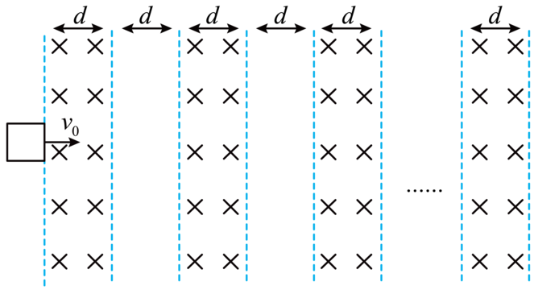

# Physics - 题目 2369

**ID**: 758c47e747e74b9cb58906a10f399f6a
**年级**: Grade 11
**难度**: Medium-Hard
**题型**: Calculation

## 题目
光滑水平桌面上等间距的分布着竖直向下的匀强磁场，如图为其俯视图。​​​​​​​‌磁感应强度的大小 $B=0.5{\rm{T}}$ 。每一个磁场区域的宽度以及相邻磁场区域的间距均为 $d=0.8 \mathrm{m}$ 。现有一边长为 $l=0.2{\rm{m}}$ 、质量为 $m=0.2{\rm{k}}{\rm{g}}$ 、电阻为 $R=0.02\Omega $ 的正方形金属线框以 $v{{}_{0}}=5.2{\rm{m}}/{\rm{s}}$ 的初速度垂直于最左侧磁场边界进入磁场，运动过程中线框始终在水平桌面内。求：（1）线框刚开始进入最左侧磁场时，所受安培力的大小；（2）线框穿过前2个磁场区域过程中产生的焦耳热；（3）线框运动的最大距离。

## 解答

1. （1）线框刚进入磁场区域时，产生的电动势为 $E=Blv{{}_{0}}$ ，此时回路中的感应电流 $I=\frac {E}{R}$ ，安培力为 $F=IBl$ ，联立解得 $F=2.6{\rm{N}}$ 。
2. （2）设线框刚好离开第2个磁场时的水平速度的大小为v_{1}，线框穿过2个磁场的过程，根据动量定理可得 $-B\bar I{{}_{1}}lt{{}_{1}}=mv{{}_{1}}-mv{{}_{0}}$ ，又由 $q=\bar I{{}_{1}}t=\frac {4Bl{^{2}}}{R}$ ，联立解得 $v{{}_{1}}=3.2{\rm{m}}/{\rm{s}}$ ，根据功能关系可得 $Q=\frac {1}{2}mv{{}_{0}^{2}}-\frac {1}{2}mv{{}_{1}^{2}}=1.68{\rm{J}}$ 。
3. （3）设线框在安培力作用下移动的距离为x，则全程由动能定理得 $-B\bar Ilt=0-mv{{}_{0}}$ ， $q=\bar It=\frac {Blx}{R}$ ，联立解得 $x=2.08{\rm{m}}$ ，每通过一个磁场区域，有安培力作用下移动的距离是 $2l$ ，则通过的磁场区域个数为 $n=\frac {x}{2l}=5.2$ ，说明线框完全通过5个磁场区域，第6个进入一部分线框，则线框运动的最大距离 $s=2d\times 5+(5.2-5)\times 2l=8.08{\rm{m}}$ 。

## 知识点

**中文**:
  - 线框模型

**English**:
  - Wire Frame Model

---
