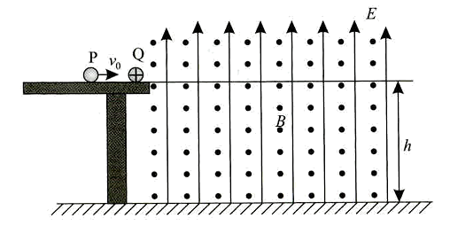

# Physics - 题目 2928

**ID**: 7594f606bd25452fbcb06748ca869a56
**年级**: Grade 11
**难度**: Medium-Hard
**题型**: Calculation

## 题目
如图所示，光滑绝缘的水平桌面离地面高为h，桌面边缘处静止放置一个质量为m、电荷量为 $+q$ 的小球Q，桌面边缘右侧有竖直向上的匀强电场和水平向外的匀强磁场，电场强度 $E=\frac {mg}{q}$ 、磁感应强度为B。​​​​​​​‌桌面上有另一质量为 $\frac {1}{2}m$ 的绝缘球P以速度 $v{{}_{0}}=\frac {3qBh}{m}$ 与小球Q发生弹性正碰（Q的电荷量不变），碰后小球Q进入复合场区域，忽略空气阻力且不考虑运动电荷对电场、磁场的影响，桌面左侧足够长，重力加速度为g。求：（1）碰后瞬间小球Q的速度大小 $v{{}_{{\rm{Q}}}}$ ；（2）小球Q第一次落地前在复合场中运动的时间 $t$ ；（3）小球Q第一次落地时与小球P的水平距离。

## 解答

1. （1）两球发生弹性碰撞，由动量守恒定律和能量守恒定律有  $\frac {m}{2}v{{}_{0}}=\frac {m}{2}v{{}_{1}}+mv$ ，  $\frac {1}{2}\cdot \frac {m}{2}v{{}_{0}^{2}}=\frac {1}{2}\cdot \frac {m}{2}v{{}_{1}^{2}}+\frac {1}{2}mv{^{2}}$
2. 解得  $v{{}_{1}}=-\frac {qBh}{m}$  ， $v{{}_{{\rm{Q}}}}=v=\frac {2qBh}{m}$
3. （2）小球 Q 在复合场中的运动过程中，对小球 Q 进行受力分析，受竖直向上的电场力、竖直向下的重力和洛伦兹力，由于  $F{{}_{电}}=Eq=mg$
4. 则小球 Q 在洛伦兹力作用下做匀速圆周运动，则有  $qvB=m\frac {v{^{2}}}{r}$
5. 解得  $r=\frac {mv}{qB}=2h$
6. 画出小球 Q 的运动轨迹，如图所示
7. 
8. 由几何关系有 ${\rm{c}}{\rm{o}}{\rm{s}}θ=\frac {r-h}{r}=\frac {1}{2}$
9. 解得 $θ=60{^{\circ }}$
10. 小球 Q 在复合场中的运动时间  $t=\frac {60{^{\circ }}}{360{^{\circ }}}\cdot \frac {2πr}{v}=\frac {πm}{3qB}$
11. （3）设小球Q第一次落地点与桌面右边缘的水平距离为 $x{{}_{{\rm{Q}}}}$ ，由（2）中小球Q运动的几何关系可得 $x{{}_{{\rm{Q}}}}=r\cdot {\rm{s}}{\rm{i}}{\rm{n}}60{^{\circ }}=\sqrt {3}h$
12. 时间t内，小球P向左做匀速直线运动，位移 $x{{}_{P}}=\left |{v{{}_{P}}}\right |\cdot t=\frac {qBh}{m}\cdot \frac {πm}{3qB}=\frac {π}{3}h$
13. ，此时两者水平间距 $x=x{{}_{P}}+x{{}_{Q}}=\left ({\sqrt {3}+\frac {π}{3}}\right )h$

## 知识点

**中文**:
  - 带电粒子在叠加场中的运动

**English**:
  - Motion in Superimposed Fields

---
