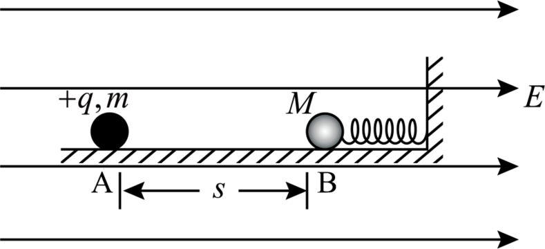

# Physics - 题目 2213

**ID**: 75e9e5e2c3064fa19d3c74b117651766
**年级**: Grade 11
**难度**: Medium-Hard
**题型**: Calculation

## 题目
如图所示，劲度系数为 $k$ 的轻弹簧放在光滑绝缘的水平面上，左端连着绝缘小球B，右端连在固定板上，整个装置处在电场强度大小为 $E$ 、方向水平向右的匀强电场中。​​​​​​​‌现把一质量为 $m$ 、带电荷量为 $+q$ 的小球A，从与小球B距离 $s$ 处自由释放，小球A与小球B发生正碰，碰撞中无机械能损失，且小球A的电荷量始终不变。已知小球B的质量 $M=3m$ ，小球B被碰后做周期性运动，其运动周期 $T=2π\sqrt {\frac {M}{k}}$ （小球A、B均可视为质点，重力加速度大小为 $g$ ）。(1)画出刚释放后瞬间小球A的受力分析图；(2)求小球A与小球B相碰前，小球A的速度大小；(3)求两小球第一次碰撞后瞬间，小球A的速度 $v{{}_{1}}$ 和小球B的速度 $v{{}_{2}}$ ；(4)要使小球A与小球B第二次仍在小球B的初始位置迎面相碰，求弹簧劲度系数 $k$ 的可能取值。

## 解答

1. （1）刚释放后瞬间小球A受到重力、支持力与电场力作用，如图所示
2. 
3. （2）设小球A与小球B碰撞前瞬间的速度为根据动能定理有 $qE\cdot s=\frac {1}{2}mv{{}_{0}}{^{2}}$
4. 解得 $v{{}_{0}}=\sqrt {\frac {2qEs}{m}}$
5. （3）由于碰撞过程极短，可以认为系统满足动量守恒，则有 $mv{{}_{0}}=mv{{}_{1}}+Mv{{}_{2}}$
6. 由题知碰撞过程中无机械能损失，则有 $\frac {1}{2}mv{{}_{0}^{2}}=\frac {1}{2}mv{{}_{1}^{2}}+\frac {1}{2}Mv{{}_{2}^{2}}$
7. 解得 $v{{}_{1}}=-\frac {1}{2}\sqrt {\frac {2qEs}{m}}$
8. 负号表示方向向左
9. $v{{}_{2}}=\frac {1}{2}\sqrt {\frac {2qEs}{m}}$
10. 方向向右。
11. （4）要使小球A与小球B第二次迎面碰撞仍发生在原位置，则小球A重新回到原位置所用的时间 $t$ 满足 $t=\left ({n+\frac {1}{2}}\right )T$ （n=0，1，2，3…）
12. 小球A在电场中受电场力作用向左做减速运动至速度为0后又向右做加速运动，根据牛顿第二定律有 $qE=ma$
13. 根据运动学规律有 $-\left |{v{{}_{1}}}\right |=\left |{v{{}_{1}}}\right |-at$
14. 根据题意有 $T=2π\sqrt {\frac {M}{k}}$
15. 解得 $k=\frac {3π{^{2}}qE(2n+1){^{2}}}{2s}$ （n=0，1，2，3…）

## 知识点

**中文**:
  - 求解弹性碰撞问题

**English**:
  - Solving Elastic Collision Problems

---
