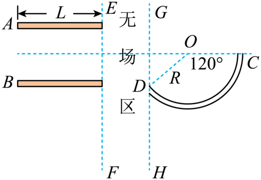

# Physics - 题目 2462

**ID**: 7c7076a08365495c88e4d5aedbc3cc1a
**年级**: Grade 11
**难度**: Medium-Hard
**题型**: Calculation

## 题目
如图所示，EF与GH间为一无场区．无场区左侧A、B为相距为d、板长为L的水平放置的平行金属板，两板上加某一电压从而在板间形成一匀强电场，其中A为正极板．无场区右侧为一点电荷Q形成的电场，点电荷的位置O为圆弧形细圆管CD的圆心，圆弧半径为R，圆心角为120°，O、C在两板间的中心线上，D位于GH上．一个质量为m、电荷量为q的带正电粒子以初速度v_{0}沿两板间的中心线射入匀强电场，粒子出匀强电场经无场区后恰能进入细圆管，并做与管壁无相互挤压的匀速圆周运动．（不计粒子的重力、管的粗细）求：（1）O处点电荷的电性和电荷量；​​​​​​​‌（2）两金属板间所加的电压．

## 解答

1. （1）粒子进入圆管后受到点电荷Q的库仑力做匀速圆周运动，粒子带正电，则知O处点电荷带负电．由几何关系知，粒子在D点速度方向与水平方向夹角为30°，进入D点时速度为： $v=\frac {v{{}_{0}}}{\cos 30{}\degree }=\frac {2\sqrt {3}}{{3}}v{{}_{0}}$  …①，
2. 
3. 在细圆管中做与管壁无相互挤压的匀速圆周运动，故Q带负电且满足 $k\frac {Qq}{R{^{2}}}=m\frac {v{^{2}}}{R}$ …②，
4. 由①②得： $Q=\frac {4mv{{}_{0}}{^{2}}R}{3kq}$   。
5. （2）粒子射出电场时速度方向与水平方向成30°，
6. tan  ${\rm 30°=}\frac {v{{}_{y}}}{v{{}_{0}}}$  …③
7. v_{y}=at…④
8. $a=\frac {qU}{md}$  …⑤
9. $t=\frac {L}{v{{}_{0}}}$  …⑥
10. 由③④⑤⑥得： $U=\frac {mdv{{}_{0}}{^{2}}\tan 30{}\degree }{qL}=\frac {\sqrt {3}mdv{{}_{0}}{^{2}}}{{3qL}}$   。

## 知识点

**中文**:
  - 带电粒子在匀强电场中的运动
  - 带电粒子在点电荷电场中的运动

**English**:
  - Motion in Uniform Electric Field
  - Motion in Point Charge Field

---
