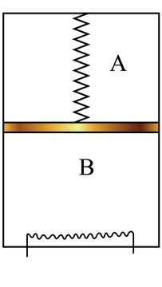

# Physics - 题目 1902

**ID**: 7cc0816c04e54fdaa328c176e99acdb5
**年级**: Grade 11
**难度**: Medium-Hard
**题型**: Calculation

## 题目
如图所示，高度为 $2L=40{\rm{c}}{\rm{m}}$ 的封闭气缸竖直固定在水平面上，气缸的侧壁和下底面为绝热材料，顶部的材料导热性能良好。​​​​​​​‌横截面积为 $S=100{\rm{c}}{\rm{m}}{^{{{2}}}}$ 的绝热活塞用轻弹簧与气缸顶端连接，活塞的密封性良好，厚度不计，平衡时弹簧刚好处于原长且活塞位于气缸的正中央，此时上侧气体A的压强为 $p{{}_{0}}=1.0\times 10{^{5}}{\rm{P}}{\rm{a}}$ 。现用电热丝对下侧气体B缓慢加热。已知活塞的质量为 $m\mathrm{=}50{\rm{k}}{\rm{g}}$ ，重力加速度为 $g=10{\rm{m}}/{\rm{s}}{^{2}}$ ，环境温度保持不变，气体可视为理想气体。（1）求加热前气体B的压强；（2）当气体B的热力学温度缓慢升高到原来的 $\frac {125}{72}$ 时，活塞上升了5cm，求弹簧的劲度系数k。

## 解答

1. （1）对活塞进行受力分析可知，由于平衡时弹簧刚好处于原长，所以活塞只受到重力、气体A施加的向下的压力以及气体B施加的向上的支持力的作用，对活塞列平衡方程有 $p{{}_{{\rm{B}}}}S=mg+p{{}_{0}}S$
2. 代入数据解得 $p{{}_{{\rm{B}}}}=\frac {mg+p{{}_{0}}S}{S}=1.5\times 10{^{5}}{\rm{P}}{\rm{a}}$
3. （2）设初始状态上侧气体的体积为 $V{{}_{{\rm{A}}}}$ ，下侧气体的体积为 $V{{}_{{\rm{B}}}}$ ，则有 $V{{}_{{\rm{A}}}}=V{{}_{{\rm{B}}}}=LS=0.2\times 100\times 10{^{-4}}=2\times 10{^{-3}}{\rm{m}}{^{3}}$
4. 气体 ${\rm{B}}$ 的温度升高到原来的 $\frac {125}{72}$ 时，活塞上升5cm，设上侧气体的体积变为 $V{{}_{{\rm{A}}{{1}}}}$ ，则有 $V{{}_{{\rm{A}}{{1}}}}=S\left ({L-h}\right )=100\times 10{^{-4}}\times \left ({0.2-0.05}\right )=1.5\times 10{^{-3}}{\rm{m}}{^{3}}$
5. 设下侧气体的体积变为 $V{{}_{{\rm{B}}{{1}}}}$ ，则有 $V{{}_{{\rm{B}}{{1}}}}=S\left ({L+h}\right )=100\times 10{^{-4}}\times \left ({0.2+0.05}\right )=2.5\times 10{^{-3}}{\rm{m}}{^{3}}$
6. 气体 $\mathrm{A}$ 做等温变化，由玻意耳定律得 $p{{}_{0}}V{{}_{{\rm{A}}}}=p{{}_{{\rm{A}}{{1}}}}V{{}_{{\rm{A}}{{1}}}}$
7. 解得 $p{{}_{{\rm{A}}{{1}}}}=\frac {p{{}_{0}}V{{}_{{\rm{A}}}}}{V{{}_{{\rm{A}}{{1}}}}}=\frac {1.0\times 10{^{-5}}\times 2\times 10{^{-3}}}{1.5\times 10{^{-3}}}=\frac {4}{3}\times 10{^{5}}{\rm{P}}{\rm{a}}$
8. 设升温前气体 ${\rm{B}}$ 的温度为 $T{{}_{0}}$ ，对气体 ${\rm{B}}$ 列理想气体状态方程有 $\frac {p{{}_{{\rm{B}}}}V{{}_{{\rm{B}}}}}{T{{}_{0}}}=\frac {p{{}_{{\rm{B}}{{1}}}}V{{}_{{\rm{B}}{{1}}}}}{\frac {125}{72}T{{}_{0}}}$
9. 解得 $p{{}_{{\rm{B}}{{1}}}}=\frac {p{{}_{{\rm{B}}}}V{{}_{{\rm{B}}}}\frac {125}{72}T{{}_{0}}}{V{{}_{{\rm{B}}{{1}}}}T{{}_{0}}}=\frac {1.5\times 10{^{5}}\times 2\times 10{^{-3}}\times \frac {125}{72}T{{}_{0}}}{2.5\times 10{^{-3}}T{{}_{0}}}=\frac {25}{12}\times 10{^{5}}{\rm{P}}{\rm{a}}$
10. 对活塞受力分析，如图所示
11. 
12. 根据平衡条件知 $p{{}_{{\rm{B}}{{1}}}}S=k\frac {L}{4}+p{{}_{{\rm{A}}{{1}}}}S+mg$
13. 解得弹簧的劲度系数 $k=5000{\rm{N}}/{\rm{m}}$

## 知识点

**中文**:
  - 利用理想状态方程解决问题
  - 气体等温变化与玻意耳定律

**English**:
  - Problem Solving using Ideal Gas Law
  - Isothermal Change and Boyle's Law

---
