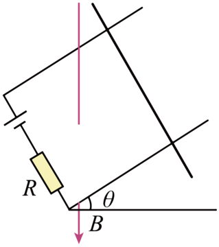

# Physics - 题目 2408

**ID**: 7e16a4c01d584bf9b7301f83ea5573af
**年级**: Grade 11
**难度**: Medium-Hard
**题型**: Calculation

## 题目
如图所示，电阻不计的平行金属导轨倾角为 $θ$ ，间距为L，处在竖直向下的匀强磁场中，导轨中接入电动势为E、内电阻为r的直流电源，外电路中除电阻R外其余电阻不计。​​​​​​​‌质量为m、长度L电阻不计的导体棒静止在轨道上，与轨道垂直。(1)若导轨光滑，求磁感应强度为B(2)若导轨与导体棒摩擦因数为 $μ$ （ $μ<{\tan}θ$ ，最大静摩擦力等于滑动摩擦力），求磁感应强度B的取值范围

## 解答

1. （1）对导体棒受力分析，正交分解如图所示
2. 
3. 受力平衡得 $mg\sin θ=F{\cos}θ$ ，导体棒所受安培力为 $F=BIL$ ，有闭合回路欧姆定律可得导体棒中的电流为 $I=\frac {E}{R+r}$ ，得磁感应强度大小为 $B=\frac {mg(R+r){\tan}θ}{EL}$
4. （2）当摩擦力等于最大静摩擦力，方向沿导轨向上时，安培力 $F{{}_{1}}$ 最小，所以磁感应强度 $B{{}_{1}}$ 最小，根据受力平衡有，沿导轨方向 $mg\sin θ=F{{}_{1}}{\cos}θ+μF{{}_{{\rm{N}}}}$ ，垂直导轨方向 $F{{}_{{\rm{N}}}}=mg{\cos}θ+F{{}_{1}}\sin θ$ ，此时导体棒所受的安培力大小为 $F{{}_{1}}=B{{}_{1}}IL$ ，联立解得磁感应强度的最小值为 $B{{}_{1}}=\frac {(mg\sin θ-{\rm μm}g{\cos}θ)(R+r)}{LE({\cos}θ+μ\sin θ)}$ ，当摩擦力等于最大静摩擦力，方向沿导轨向下时，安培力 $F{{}_{2}}$ 最大，所以磁感应强度 $B{{}_{2}}$ 最大，根据受力平衡有，沿导轨方向 $mg\sin θ+μF{{}_{{\rm{N}}}}=F{{}_{2}}{\cos}θ$ ，垂直导轨方向 $F{{}_{{\rm{N}}}}=mg{\cos}θ+F{{}_{2}}\sin θ$ ，此时导体棒所受的安培力大小为 $F{{}_{2}}=B{{}_{2}}IL$ ，联立解得磁感应强度的最大值为 $B{{}_{2}}=\frac {(mg\sin θ+{\rm μm}g{\cos}θ)(R+r)}{LE({\cos}θ-μ\sin θ)}$ ，综上所述，磁感应强度的取值范围为 $\frac {(mg\sin θ-{\rm μm}g{\cos}θ)(R+r)}{LE({\cos}θ+μ\sin θ)}⩽B⩽\frac {(mg\sin θ+{\rm μm}g{\cos}θ)(R+r)}{LE({\cos}θ-μ\sin θ)}$

## 知识点

**中文**:
  - 安培力作用下的平衡问题

**English**:
  - Equilibrium under Ampere Force

---
