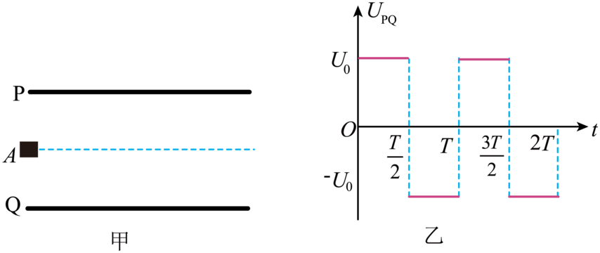

# Physics - 题目 2073

**ID**: 7ec2ab98c9304abd9b2a718d09d8495b
**年级**: Grade 11
**难度**: Medium-Hard
**题型**: Calculation

## 题目
如图甲所示，真空中水平放置两块长度为 $2d$ 的平行金属板 $P、Q$ ，两板间距为 $d$ ，两板间加上如图乙所示最大电压为 $U{{}_{0}}$ 且周期性变化的电压。​​​​​​​‌在两板间中线的左端处有一粒子源 $A$ ，自 $t=0$ 时刻开始连续释放初速度大小为 $v{{}_{0}}$ 、方向平行于金属板的相同带电粒子， $t=0$ 时刻释放的粒子恰好从 $Q$ 板右侧边缘离开电场。已知电场变化周期 $T=\frac {2d}{v{{}_{0}}}$ ，粒子质量为 $m$ ，不计粒子重力及相互间的作用力，求：（结果用 $m$ 、 $v{{}_{0}}$ 、 $d$ 、 $U{{}_{0}}$ 表示）（1）粒子的电荷量 $q$ 为多少？（2） $t=\frac {T}{4}$ 时刻进入的粒子，离开电场时的速度大小和方向？并大致画出它在平行金属板中的运动轨迹。（3） $t=\frac {3T}{8}$ 时刻进入的粒子，离开电场时的速度大小和离开电场时的位置？

## 解答

1. （1）粒子在沿平行金属板方向做匀速直线运动，则粒子在电场中运动的时间为 $t=\frac {2d}{v{{}_{0}}}=T$
2. 沿垂直金属板方向，做匀变速直线运动，根据牛顿第二定律 $q\frac {U{{}_{0}}}{d}=ma$
3. 解得 $a=\frac {qU{{}_{0}}}{md}$
4. 由图乙可知，沿垂直金属板方向，粒子在 $0\sim \frac {T}{2}$ 时间内做匀加速，在 $\frac {T}{2}\sim T$ 时间内做匀减速直线运动，所以根据 $t=0$ 时刻释放的粒子恰好从Q板右侧边缘离开电场可得 $2\times \frac {1}{2}a\cdot (\frac {T}{2}){^{2}}=\frac {d}{2}$
5. 联立，解得 $q=\frac {mv{{}_{0}^{2}}}{2U{{}_{0}}}$
6. （2）根据题意可知， $t=\frac {T}{4}$ 时刻进入的粒子，在垂直金属板方向的 $v{{}_{y}}-t$ 图像为
7. 
8. 粒子在 $\frac {5T}{4}$ 时刻离开电场，此时 $v{{}_{y}}=0$
9. 即离开电场时的速度大小为 $v{{}_{0}}$ ，方向水平向右。粒子在平行金属板中运动的轨迹大致为
10. 
11. （3）根据题意可知， $t=\frac {3T}{8}$ 时刻进入的粒子，在垂直金属板方向的 $v{{}_{y}}-t$ 图像为
12. 
13. 粒子在 $\frac {11T}{8}$ 时刻离开电场，此时 $v{{}_{y}}=0$
14. 即离开电场时的速度大小为 $v{{}_{0}}$ ，偏转位移大小为 $y=2\times \frac {1}{2}a(\frac {T}{2}-\frac {T}{8}){^{2}}-2\times \frac {1}{2}a(\frac {T}{2}-\frac {3T}{8}){^{2}}=\frac {1}{8}aT{^{2}}$
15. 联立，解得 $y=\frac {d}{4}$
16. 即从中线右端上方 $\frac {d}{4}$ 处离开电场。

## 知识点

**中文**:
  - 带电粒子在交变电场中的运动

**English**:
  - Motion in Alternating Electric Field

---
