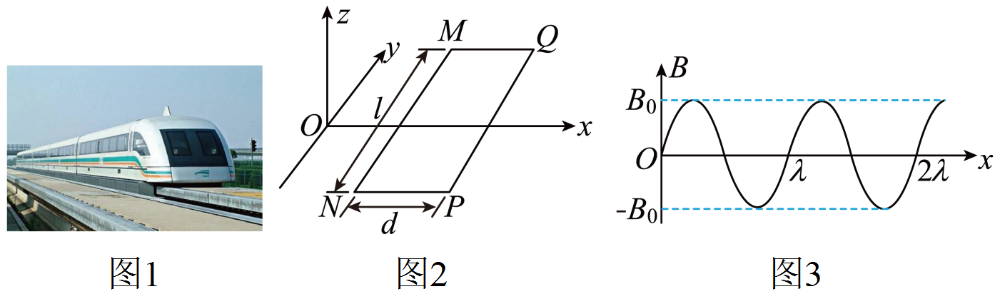

# Physics - 题目 2819

**ID**: 80b03390dd454d288445d3b90c4d304f
**年级**: Grade 11
**难度**: Medium-Hard
**题型**: Calculation

## 题目
如图1所示为高温超导磁悬浮列车，是一种高速低耗的新型交通工具，它的驱动系统可简化为如图2所示的模型。​​​​​​​‌固定在列车下端的动力绕组视为一个匝数为N的矩形纯电阻金属框，电阻为 $R{\rm ，}$ 金属框置于 $xOy$ 平面内，长为 $L$ 的 $MN$ 边平行于 $y$ 轴，宽为 $d$ 的 $NP$ 边平行于 $x$ 轴。列车轨道沿 $Ox$ 方向、轨道区域内存在垂直于金属框平面的磁场，磁感应强度 $B$ 沿 $y$ 轴向大小相同，沿 $Ox$ 方向按正弦规律分布，其空间间隔为 $λ{\rm ，}$ 最大值为 $B{{}_{0}}{\rm ，}$ 如图3所示。整个磁场以速度 $v{{}_{0}}$ 沿 $Ox$ 方向匀速平移，使列车获得 $Ox$ 方向的驱动力，为使驱动效果最佳 ${\rm ，}λ$ 与 $d$ 之间需满足特定关系。求：${\rm （1）}λ$ 的最大值（用d表示）；（2）某时刻列车速度为 $v{{}_{1}}{\rm ，}$ 列车可能受到的最大驱动力；（3）实际上的驱动力是周期性变化的，但只要 $λ$ 足够小，我们感受不到这种变化，即一个周期内，驱动力的冲量和阻力的冲量抵消。若列车受到的阻力与速度的大小成正比，比例系数为 $k{\rm ，}$ 则列车的最终速度 $v{{}_{2}}$ 为多大？

## 解答

1. （1）MN、PQ应位于磁场中磁感应强度同为最大值 $B{{}_{0}}$ 且反向的地方，这导致框中电流最强，受到的安培力最大。因此d应为 $\frac {λ}{2}$ 的奇数倍，即
2. $λ=\frac {2d}{2k+1}$ （ $k\in {\mathbf{N}}$ ）
3. $k=0$ 时 ${\rm ，}λ{{}_{m}}=2d$
4. （2）金属框中的感应电动势大小
5. $E=2NB{{}_{0}}L\left ({v{{}_{0}}-v{{}_{1}}}\right )$
6. 根据闭合电路欧姆定律
7. $I=\frac {2NB{{}_{0}}L\left ({v{{}_{0}}-v{{}_{1}}}\right )}{R}$
8. 列车驱动力
9. $F=2NB{{}_{0}}IL=\frac {4N{^{2}}B{{}_{0}^{2}}L{^{2}}\left ({v{{}_{0}}-v{{}_{1}}}\right )}{R}$
10. （3）MN、PQ位于磁场中的磁感应强度总是大小相同、方向相反的，周期性变化的，可以写成
11. $B=B{{}_{0}}{\rm{s}}{\rm{i}}{\rm{n}}\left ({ωt}\right )$
12. 列车驱动力
13. $F=2BIL=\frac {4B{^{2}}L{^{2}}\left ({v{{}_{0}}-v{{}_{2}}}\right )}{R}=\frac {4N{^{2}}B{{}_{0}^{2}}L{^{2}}\left ({v{{}_{0}}-v{{}_{2}}}\right )}{R}{\rm{s}}{\rm{i}}{\rm{n}}{^{2}}\left ({ωt}\right )$
14. 一个周期内驱动力的冲量与阻力的冲量大小相等，方向相反。与交流电的瞬时值和有效值进行类比，驱动力关于时间的“有效值”等于阻力的大小
15. $f=\frac {F{{}_{{\rm{m}}}}}{2}=\frac {2N{^{2}}B{{}_{0}^{2}}L{^{2}}\left ({v{{}_{0}}-v{{}_{2}}}\right )}{R}=kv{{}_{2}}$
16. 解得
17. $v{{}_{2}}=\frac {2N{^{2}}B{{}_{0}^{2}}L{^{2}}v{{}_{0}}}{2N{^{2}}B{{}_{0}^{2}}L{^{2}}+kR}$

## 知识点

**中文**:
  - 交变电流的峰值和有效值
  - 导体切割磁感线产生感应电动势（电流）的分析与计算

**English**:
  - Peak and RMS Values of AC
  - Analysis and Calculation of Cutting Magnetic Field Lines

---
