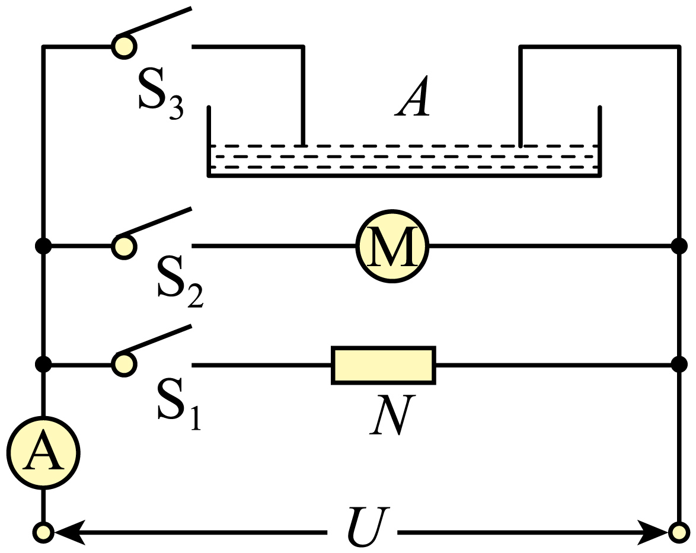

# Physics - 题目 690

**ID**: 817a4777f72f472a8169715527d223de
**年级**: Grade 11
**难度**: Medium-Hard
**题型**: Calculation

## 题目
如图所示，A为电解槽， $M$  为电动机，N为电炉子，恒定电压U＝12V，电解槽内阻R_{A}＝2Ω，当S_{1}闭合，S_{2}、S_{3}断开时，电流表示数为6A；​​​​​​​‌当S_{2}闭合，S_{1}、S_{3}断开时，电流表示数为5A，且电动机输出功率为35W；当S_{3}闭合，S_{1}、S_{2}断开时，电流表示数为4A．求：(1)电炉子的电阻及发热功率；(2)电动机的内阻；(3)在电解槽工作时，电能转化为化学能的功率为多少．

## 解答

1. 试题分析：（1）电炉子为纯电阻元件，由欧姆定律 $I=\frac {U}{R}$ ，得 $R=\frac {U}{I{{}_{1}}}=2Ω$ ，其发热功率为： $P{{}_{R}}=UI{{}_{1}}=12\times 6{{ }}{\rm{W}}{\rm{=}}{{7}}{{2}}{{ }}{\rm{W}}$
2. （2）电动机为非纯电阻元件，由能量守恒定律得 $UI{{}_{2}}=I{{}_{2}}{^{2}}r{{}_{M}}+P{{}_{输出}}$ ，所以 $r{{}_{M}}=\frac {UI{{}_{{{2}}}}-P{{}_{输出}}}{I{{}_{{{2}}}^{{{2}}}}}=1Ω$
3. （3）电解槽工作时，由能量守恒定律得： $P{{}_{化}}=UI{{}_{3}}-I{{}_{3}}{^{2}}r{{}_{A}}=16{{ }}{\rm{W}}$
4. 考点：闭合电路欧姆定律

## 知识点

**中文**:
  - 非纯电阻电路中的电功、电功率和电热

**English**:
  - Work, Power, and Heat in Non-Pure Resistive Circuits

---
