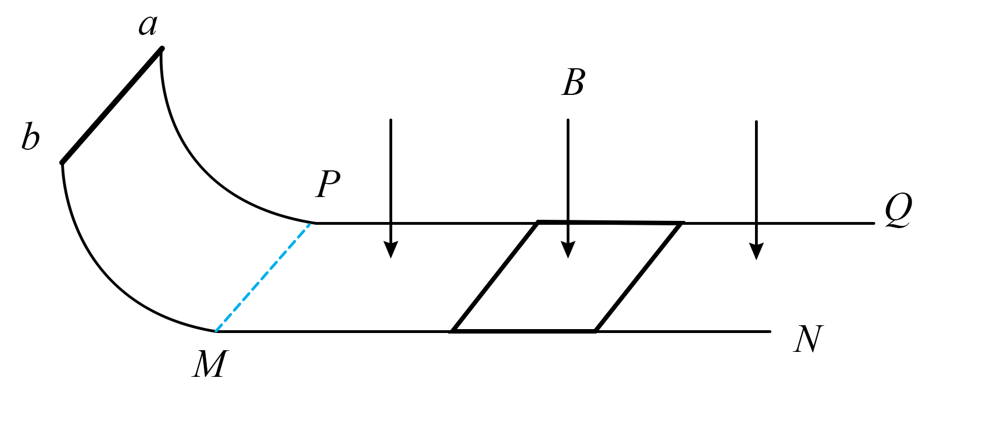

# Physics - 题目 680

**ID**: 823e4fc1b7694efa8136ab86dccd6382
**年级**: Grade 11
**难度**: Medium-Hard
**题型**: Calculation

## 题目
如图所示，两足够长平行金属直导轨MN、PQ的间距为 $L=0.2{\rm{m}}$ ，固定在同一水平面内，直导轨在左端M、P点分别与两条竖直固定、半径为 $L=0.2{\rm{m}}$ 的 $\frac {1}{4}$ 圆弧导轨相切。​​​​​​​‌MP连线与直导轨垂直，其左侧无磁场，右侧存在磁感应强度大小为 $B=1{\rm{T}}$ ，方向竖直向下的匀强磁场。长为 $L=0.2{\rm{m}}$ ，质量为 $m=0.01{\rm{k}}{\rm{g}}$ 、电阻为 $R{{}_{1}}=1Ω$ 的金属棒ab跨放在两圆弧导轨的最高点。质量为 $M=0.04{\rm{k}}{\rm{g}}$ 、电阻为 $R{{}_{2}}=4Ω$ 的均匀金属丝制成一个边长为 $L=0.2{\rm{m}}$ 的正方形线框，水平放置在两直导轨上，其中心到两直导轨的距离相等。忽略导轨的电阻、所有摩擦以及金属线框的可能形变，金属棒、金属线框均与导轨始终接触良好，重力加速度大小为g。现将金属棒ab由静止释放，求(1)ab刚越过MP时产生的感应电动势大小；(2)金属线框刚开始运动时的加速度大小；(3)为使ab在整个运动过程中不与金属线框接触，金属线框中心初始位置到MP的最小距离。

## 解答

1. （1）对金属棒ab由静止释放到刚越过MP的过程，由动能定理可得 $mgL=\frac {1}{2}mv{{}_{0}}{^{2}}$ ，
2. 解得 $v{{}_{0}}=\sqrt {2gL}=2{\rm m}/{\rm s}$ ，
3. 则ab刚越过MP时产生的感应电动势大小为 $E=BLv{{}_{0}}=0.4{\rm V}$ 。
4. （2）正方形线框有两条边与两直导轨重合，线框接入电路的电阻为 $R{{}_{并}}=\frac {\frac {1}{4}R{{}_{2}}\times \frac {1}{4}R{{}_{2}}}{\frac {1}{4}R{{}_{2}}+\frac {1}{4}R{{}_{2}}}=0.5\Omega $ ，
5. 由闭合电路的欧姆定律得 $I=\frac {E}{R{{}_{1}}+R{{}_{并}}}=\frac {4}{15}{\rm A}$ ，
6. 线框刚开始运动时的加速度大小为 $a=\frac {BIL}{M}$ ，
7. 解得 $a=\frac {4}{3}{\rm m}/{\rm s}{^{2}}$ 。
8. （3）ab在整个运动过程中不与金属线框接触，则金属棒与线框恰好不接触时一起匀速运动；ab从越过MP到开始匀速，金属棒和线框受到的安培力大小相等、方向相反，水平方向动量守恒。取向右为正方向，根据动量守恒定律可得 $mv{{}_{0}}=\left ({m+M}\right )v{^{^{′}}}$ ，
9. 解得最终共同速度大小为 $v{^{^{′}}}=0.4{\rm m}/{\rm s}$ ，
10. 取向右为正方向，对线框根据动量定理可得 $\sum \mathop{F{{}_{安}}\Delta t}=Mv{^{^{′}}}-0$ ，
11. 即 $\frac {B{^{2}}L{^{2}}}{R{{}_{1}}+R{{}_{并}}}\sum \mathop{v\Delta t}=Mv{^{^{′}}}$ ，
12. 由 $\sum \mathop{v}t=\Delta x$ ，解得 $\Delta x=0.6{\rm m}$ ，
13. 则金属线框中心初始位置到MP的最小距离 $x=\Delta x+\frac {1}{2}L=0.7{\rm m}$ 。

## 知识点

**中文**:
  - 线框模型

**English**:
  - Wire Frame Model

---
