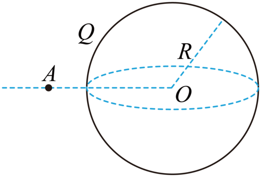

# Physics - 题目 1548

**ID**: 8414cc26e5b94d10a2a7a279190a7e98
**年级**: Grade 11
**难度**: Medium-Hard
**题型**: Calculation

## 题目
如图所示，一个半径为 $R$ 的不导电薄球壳均匀带正电，电荷量为 $Q$ 。​​​​​​​‌它在球外某点产生场强的方向沿球心 $O$ 与此点的连线向外。将它在空间某点产生场强的大小用 $E$ 表示，则其电场强度在空间的分布可表示为： $E=\begin{cases}0&\left ({r<R}\right )\\k\frac {Q}{r{^{2}}}&\left ({r\geqslant R}\right )\end{cases}$ ，其中 $r$ 为空间某点到球心 $O$ 的距离， $k$ 为静电力常量。（1）在如图所示球壳外的一点 $A$ 处放置一个带正电、电荷量为 $q$ 的试探电荷，已知点 $A$ 到球心 $O$ 的距离为 $l$ ，求：a．试探电荷所受电场力的大小 $F{{}_{A}}$ ；b．若将该试探电荷从 $A$ 点向远离球心的方向移动一段非常小的距离 $ΔR$ ，求电势能的变化量 $ΔE{{}_{{\rm{p}}}}$ （球壳上电荷的分布不会发生变化）。（2）球壳表面上的电荷之间也有着相互作用的静电力，因而球壳自身就具有能量，称为静电能。已知半径为 $R$ ，电荷量为 $Q$ 的均匀带电薄球壳，所具有的静电能的表达式为 $E{{}_{{\rm{p}}}}=k\frac {Q{^{2}}}{2R}$ （以无穷远为电势零点）。a．请分析并说明带正电球壳表面单位面积上电荷所受电场力的方向；b．将球壳表面单位面积上电荷所受电场力的大小用 $f$ 表示，请根据电场力做功与电势能变化的关系 $W=-ΔE{{}_{{\rm{p}}}}$ ，推导出 $f=k\frac {Q{^{2}}}{8πR{^{4}}}$ 。

## 解答

1. （1）a．试探电荷所受电场力的大小为
2. $F{{}_{A}}=qE{{}_{A}}=k\frac {Qq}{l{^{2}}}$
3. b．试探电荷移动一段非常小的距离 $ΔR$ ，可认为电场力没有变化，则电势能的变化量
4. $ΔE{{}_{{\rm{p}}}}=-W=-F{{}_{A}}\times ΔR=-\frac {kQqΔR}{l{^{2}}}$
5. （2）a．球壳表面上任一无限小处的电荷可以看做点电荷，以该点电荷与球心的连线为对称轴，则球壳表面上的其他任意电荷都有其对称电荷；所以该点电荷受到其他电荷的所有静电斥力也是关于该对称轴完全对称的，根据力的合成可知，该点电荷受到的总的静电斥力沿着球心到该点电荷的连线方向。则带正电球壳表面单位面积上电荷所受电场力的方向沿着球心到该面积中心的连线方向上。
6. b．球壳表面积为
7. $S=4πR{^{2}}$
8. 所以球壳表面单位面积上电荷的电势能为
9. $E{{}_{{\rm{p}}}}{^{\prime }}=\frac {k\frac {Q{^{2}}}{2R}}{4πR{^{2}}}=\frac {kQ{^{2}}}{8πR{^{3}}}$
10. 单位面积上电荷所受电场力用 $f$ 表示，设电荷沿着与球心的连线方向远离球心发生了一段极小的位移 $Δ{\rm{x}}$ ，则根据电场力做功与电势能变化的关系 $W=-ΔE{{}_{{\rm{p}}}}$ 可得
11. $f\times Δx=\frac {kQ{^{2}}}{8πR{^{3}}}-\frac {kQ{^{2}}}{8π(R+Δx){^{3}}}$
12. 整理可得
13. $f=\frac {kQ{^{2}}}{Δx}(\frac {1}{8πR{^{3}}}-\frac {1}{8π(R+Δx){^{3}}})=kQ{^{2}}\times \frac {R{^{2}}+3RΔx+Δx{^{2}}}{8πR{^{3}}(R+Δx){^{3}}}$
14. 当 $Δ{\rm{x}}$ 趋近于零时，上式即简化为
15. $f=\frac {kQ{^{2}}}{8πR{^{4}}}$

## 知识点

**中文**:
  - 带电体在库仑力作用下的平衡问题
  - 电势能与静电力做功

**English**:
  - Equilibrium under Coulomb Force
  - Electric Potential Energy and Work Done by Electrostatic Force

---
