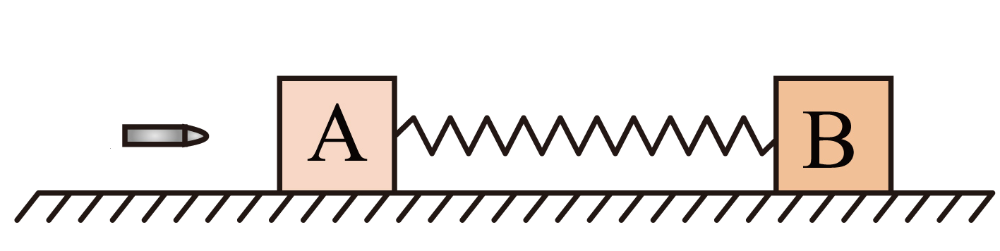

# Physics - 题目 986

**ID**: 8444a40881fb47609778cae7e7f66b98
**年级**: Grade 11
**难度**: Medium-Hard
**题型**: Calculation

## 题目
如图所示，一轻质弹簧两端连着物体A和B，静止在光滑的水平面上，一水平速度为v_{0}的子弹射中物体A并嵌在其中（子弹与物体A的作用时间极短，可忽略不计）。​​​​​​​‌已知子弹的质量是m，物体A和B的质量相同均为2m。弹簧始终在弹性限度内，求：（1）子弹射入物体A后瞬间，物体A获得的速度大小；（2）之后的运动过程中，弹簧的最大弹性势能。

## 解答

1. （1）子弹射入A的过程中，子弹和A组成的系统动量守恒 $mv{{}_{0}}=(m+2m)v$
2. 解得 $v=\frac {1}{3}v{{}_{0}}$
3. （2）弹簧压缩到最短时，子弹和A、B物体速度相等，设为v_{1}，对子弹、物体A、物体B组成的系统动量守恒 $mv{{}_{0}}=(m+2m+2m)v{{}_{1}}$
4. 解得 $v{{}_{1}}=\frac {1}{5}v{{}_{0}}$
5. 弹簧压缩到最短时，弹簧的弹性势能最大为 $E{{}_{{\rm{p}}}}=\frac {1}{2}(m+2m)v{^{2}}-\frac {1}{2}(m+2m+2m)v{{}_{1}^{2}}$
6. 解得 $E{{}_{{\rm{p}}}}=\frac {1}{15}mv{{}_{0}^{2}}$

## 知识点

**中文**:
  - 动量守恒与弹簧相结合
  - 子弹-木块模型

**English**:
  - Momentum Conservation with Springs
  - Bullet-Block Model

---
