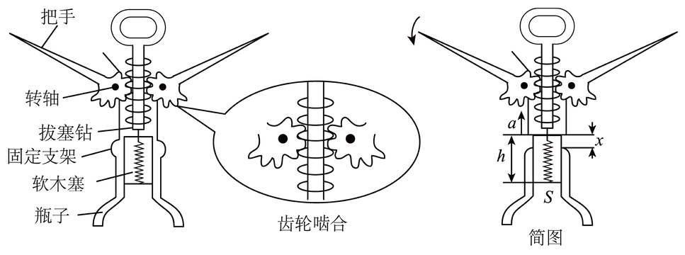

# Physics - 题目 2386

**ID**: 847f426f751542469cd3d8e8e45b744b
**年级**: Grade 11
**难度**: Medium-Hard
**题型**: Calculation

## 题目
如图所示，用开瓶器取出紧塞在瓶口的软木塞时，先将拔塞钻旋入木塞内，随后下压把手，使齿轮绕固定支架上的转轴转动，通过齿轮啮合，带动与木塞相固定的拔塞钻向上运动。​​​​​​​‌从0时刻开始，顶部与瓶口齐平的木塞从静止开始向上做匀加速直线运动，木塞所受摩擦力f随位移大小x的变化关系为 $f=f{{}_{0}}\left ({1-\frac {x}{h}}\right )$ ，其中 $f{{}_{0}}$ 为常量，h为圆柱形木塞的高，木塞质量为m，底面积为S，加速度为a，齿轮半径为r，重力加速度为g，瓶外气压减瓶内气压为 $Δp$ 且近似不变，瓶子始终静止在桌面上。（提示：可用 $f-x$ 图线下的“面积”表示f所做的功）求：（1）木塞离开瓶口的瞬间，齿轮的角速度 $ω$ 。（2）拔塞的全过程，拔塞钻对木塞做的功W。（3）拔塞过程中，拔塞钻对木塞作用力的瞬时功率P随时间t变化的表达式。

## 解答

1. （1）木塞的末速度等于齿轮线速度，对木塞，根据运动学公式 $v{^{2}}=2ah$
2. 根据角速度和线速度的关系 $v=ωr$
3. 联立可得 $ω=\frac {\sqrt {2ah}}{r}$
4. （2）根据题意画出木塞摩擦力与运动距离的关系图如图所示
5. 
6. 可得摩擦力对木塞所做的功为 $W{{}_{{\rm{f}}}}=-\frac {1}{2}f{{}_{0}}h$
7. 对木塞，根据动能定理 $W+W{{}_{{\rm{f}}}}-mgh-ΔpSh=\frac {1}{2}mv{^{2}}-0$
8. 解得 $W=mah+mgh+\frac {1}{2}f{{}_{0}}h+ΔpSh$
9. （3）设开瓶器对木塞的作用力为 $F$ ，对木塞，根据牛顿第二定律 $F-mg-f-ΔpS=ma$
10. 速度 $v=at$
11. 位移 $x=\frac {1}{2}at{^{2}}$
12. 开瓶器的功率 $P=Fv$
13. 联立可得 $P=magt+ma{^{2}}t+ΔpSat+f{{}_{0}}at-\frac {f{{}_{0}}a{^{2}}}{2h}\times t{^{3}}$

## 知识点

**中文**:
  - 两类动力学问题
  - 功率的计算和估算
  - 应用动能定理求解多阶段、多过程问题

**English**:
  - Two Types of Dynamics Problems
  - Calculation and Estimation of Power
  - Multi-stage/Multi-process Problems

---
