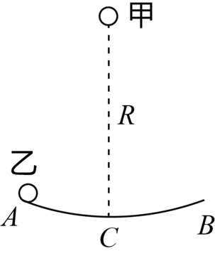

# Physics - 题目 2394

**ID**: 888e85010e674385bde06903ba910b84
**年级**: Grade 11
**难度**: Medium-Hard
**题型**: Calculation

## 题目
如图所示，ACB为光滑弧形槽，弧形槽半径为R，C为弧形槽最低点，R≫ $\overset ⌢{{AB}}$ .​​​​​​​‌甲球从弧形槽的圆心处自由下落，乙球从A点由静止释放，问：(空气阻力不计)(1)两球第1次到达C点的时间之比；(2)若在弧形槽的最低点C的正上方h处由静止释放小球甲，让其自由下落，同时将乙球从弧形槽左侧由静止释放，欲使甲、乙两球在弧形槽最低点C处相遇，则甲球下落的高度h是多少？

## 解答

1. (1)甲球做自由落体运动，由R＝ $\frac {1}{2}$gt_{1}^{2}，所以t_{1}＝ $\sqrt {\frac {2R}{g}}$
2. 乙球沿圆弧做简谐运动(由于 $\overset ⌢{{AC}}$ ≪R，可认为摆角θ＜5°).此运动与一个摆长为R的单摆运动模型相同，故此等效摆长为R，因此乙球第1次到达C处的时间为t_{2}＝ $\frac {1}{4}T=\frac {1}{4}\times 2π\sqrt {\frac {R}{g}}=\frac {π}{2}\sqrt {\frac {R}{g}}$ ，
3. 所以t_{1}∶t_{2}＝ $\frac {2\sqrt {2}}{π}$ .
4. (2)甲球从离弧形槽最低点h高处自由下落，到达C点的时间为t_{甲}＝ $\sqrt {\frac {2h}{g}}$
5. 由于乙球运动存在周期性，所以乙球到达C点的时间为
6. t_{乙}＝ $\frac {T}{4}+n\frac {T}{2}=\frac {π}{2}\sqrt {\frac {R}{g}}$  (2n＋1)　(n＝0,1,2，…)
7. 由于甲、乙在C点相遇，故t_{甲}＝t_{乙}
8. 联立解得 $h=\frac {{\left({2n+1}\right)^{2}}π{^{2}}R}{8}$ (n＝0,1,2…).

## 知识点

**中文**:
  - 等效摆问题

**English**:
  - Equivalent Pendulum Problems

---
