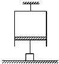

# Physics - 题目 543

**ID**: 89d58f61f8f54a62872b3248c3d96214
**年级**: Grade 11
**难度**: Medium-Hard
**题型**: Calculation

## 题目
如图所示，封闭有一定质量理想气体的汽缸开口向下竖直固定放置，活塞的截面积为S，质量为m_{0}，活塞通过轻绳连接了一个质量为m的重物。​​​​​​​‌若开始时汽缸内理想气体的温度为T_{0}，轻绳刚好伸直且对活塞无拉力作用，外界大气压强为p_{0}，一切摩擦均不计且m_{0}g＜p_{0}S。①求重物刚离地时汽缸内气体的压强；②若缓慢降低汽缸内气体的温度，最终使得汽缸内气体的体积减半，则最终气体的温度为多少？

## 解答

1. ①当轻绳刚好伸直且无拉力时，设此时汽缸内气体的压强为 $p{{}_{1}}$ 。由力的平衡条件可得
2. $m{{}_{0}}g+p{{}_{1}}S=p{{}_{0}}S$
3. 所以
4. $p{{}_{1}}=p{{}_{0}}-\frac {m{{}_{0}}g}{S}$
5. 当重物刚好离开地面时，设此时汽缸内气体的压强为 $p{{}_{2}}$ ，则有
6. $p{{}_{2}}S+(m+m{{}_{0}})g=p{{}_{0}}S$
7. 所以
8. $p{{}_{2}}=p{{}_{0}}-\frac {\left ({m{{}_{0}}+m}\right )g}{S}$
9. ②设重物刚好离开地面时汽缸内气体的温度为 $T{{}_{1}}$ ，此过程气体发生等容变化，由查理定律可得
10. $\frac {p{{}_{1}}}{T{{}_{0}}}=\frac {p{{}_{2}}}{T{{}_{1}}}$
11. 解得
12. $T{{}_{1}}=(1-\frac {mg}{p{{}_{0}}S-m{{}_{0}}g})T{{}_{0}}$
13. 设气体体积减半时汽缸内气体的温度为 $T{{}_{2}}$ ，此过程气体发生等压变化，由盖-吕萨克定律可得
14. $\frac {V}{T}{{}_{1}}=\frac {\frac {V}{2}}{T{{}_{2}}}$
15. 解得
16. $T{{}_{2}}=\frac {1}{2}T{{}_{1}}=\frac {1}{2}(1-\frac {mg}{p{{}_{0}}S-m{{}_{0}}g})T{{}_{0}}$

## 知识点

**中文**:
  - 一定质量的气体多过程状态变化问题
  - 假设法处理气体状态变化问题

**English**:
  - Multi-process State Changes of Fixed Mass Gas
  - Hypothesis Method in Gas Problems

---
