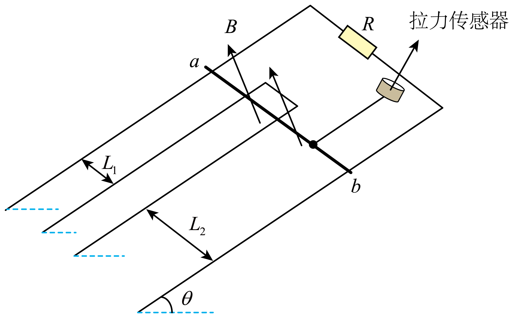

# Physics - 题目 674

**ID**: 8dabbe451fd34f768717f4bf71b0d987
**年级**: Grade 11
**难度**: Medium-Hard
**题型**: Calculation

## 题目
如图所示，同一平面内两组宽度分别为 $L{{}_{1}}=0.5{\rm{m}}$ 、 $L{{}_{2}}=1{\rm{m}}$ 的足够长光滑导体轨道倾斜固定，倾角为 $θ=30{^{\circ }}$ 。​​​​​​​‌金属杆a、b水平放置并与轨道垂直且接触良好，其中金属杆b通过平行于导轨的轻绳系在固定的拉力传感器上。定值电阻R=2Ω，其余部分电阻不计。整个装置处于磁感应强度大小为B=1T、方向垂直轨道平面向上的匀强磁场中。现将金属杆a由静止释放，沿轨道下滑一段距离后开始做匀速直线运动，该过程中定值电阻R上产生的焦耳热为Q=13.6J。已知金属杆a、b的质量分别为 $m{{}_{1}}=0.1{\rm{k}}{\rm{g}}$ 和 $m{{}_{2}}=0.2{\rm{k}}{\rm{g}}$ ，重力加速为 $g=10{\rm{m}}/{\rm{s}}{^{2}}$ 。求：（1）当金属杆a的速度为 $v{{}_{0}}=2{\rm{m}}/{\rm{s}}$ 时（未达到匀速状态），拉力传感器的示数；（2）金属杆a从释放到恰好达到匀速直线运动的过程所用时间t；（3）剪断轻绳，同时由静止释放两金属杆，求最终两杆的速度大小。

## 解答

1. （1）当金属杆a的速度为 $v{{}_{0}}=2{\rm{m}}/{\rm{s}}$ 时，产生的感应电动势
2. $E=BL{{}_{1}}v{{}_{0}}=1\times 0.5\times 2{\rm{V}}{\rm{=}}{{1}}{\rm{V}}$
3. 回路的电流
4. $I=\frac {E}{R}=0.5{\rm{A}}$
5. 对金属棒b分析可知
6. $T+BIL{{}_{2}}=m{{}_{2}}g\sin 30{^{\circ }}$
7. 解得拉力传感器的示数
8. $T=0.5{\rm{N}}$
9. （2）金属杆a恰好达到匀速直线运动时满足
10. $B\frac {BL{{}_{1}}v{{}_{{\rm{m}}}}}{R}L{{}_{1}}=m{{}_{1}}g\sin 30{^{\circ }}$
11. 解得
12. $v{{}_{{\rm{m}}}}=4{\rm{m}}{\rm{/}}{\rm{s}}$
13. 该过程由能量关系
14. $m{{}_{1}}gx\sin 30{^{\circ }}=Q+\frac {1}{2}m{{}_{1}}v{{}_{{\rm{m}}}^{2}}$
15. 可得
16. $x=28.8{\rm{m}}$
17. 由动量定理
18. $m{{}_{1}}g\sin 30{^{\circ }}t-B{\overline{I}}L{{}_{1}}t=m{{}_{1}}v{{}_{{\rm{m}}}}$
19. 其中
20. ${\overline{I}}t=\frac {{\overline{E}}}{R}t=\frac {ΔΦ}{R}=\frac {BL{{}_{1}}x}{R}=7.2{\rm{C}}$
21. 解得
22. $t=8{\rm{s}}$
23. （3）两棒一起下滑时，因电流方向相同，则受安培力方向均沿导轨向上，且b受安培力等于a的2倍，则由
24. $mg\sin θ-F{{}_{安}}=ma$
25. 因b的质量等于a的2倍，可知两棒加速度相等，最终一起达到最大速度，则对a棒
26. $B(\frac {BL{{}_{1}}v^{′}{{{}_{{\rm{m}}}}}}{R}+\frac {BL{{}_{2}}v^{′}{{{}_{{\rm{m}}}}}}{R})L{{}_{1}}=m{{}_{1}}g\sin 30{^{\circ }}$
27. 解得
28. $v^{′}{{{}_{{\rm{m}}}}}=\frac {4}{3}{\rm{m}}{\rm{/}}{\rm{s}}$
29. 同理对b棒
30. $B(\frac {BL{{}_{1}}v^{′′}{{{}_{{\rm{m}}}}}}{R}+\frac {BL{{}_{2}}v^{′′}{{{}_{{\rm{m}}}}}}{R})L{{}_{2}}=m{{}_{2}}g\sin 30{^{\circ }}$
31. 解得
32. $v^{′′}{{{}_{{\rm{m}}}}}=\frac {4}{3}{\rm{m}}{\rm{/}}{\rm{s}}$
33. 即最终两棒的速度均为 $\frac {4}{3}{\rm{m}}{\rm{/}}{\rm{s}}$ 。

## 知识点

**中文**:
  - 电磁感应现象中的功能问题

**English**:
  - Work-Energy Problems in EM Induction

---
