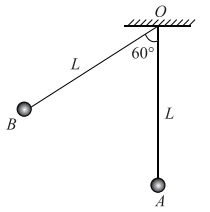

# Physics - 题目 769

**ID**: 8f144dd4681849cc9aeca6bf21476ac1
**年级**: Grade 11
**难度**: Medium-Hard
**题型**: Calculation

## 题目
如图所示，质量为 $3m$ 的小球A和质量为 $m$ 的小球B均用长为 $L$ 的细线悬挂于 $O$ 点，小球A处于静止状态，将小球B拉到一定的高度，使悬挂B球的细线与竖直方向的夹角为 $60{}\degree $ ，由静止释放小球B，小球B在竖直面内做圆周运动，小球B运动到最低点与小球A沿水平方向发生正碰，设A、B每次碰撞均为弹性碰撞，小球A、B均可视为质点，不计碰撞过程的时间，重力加速度为 $g$ ，求：(1)小球B与A第一次碰撞前瞬间，小球B的速度大小；(2)小球B与A第一次碰撞过程，B对A的冲量大小；(3)小球B与A第五次碰撞后，小球B上升的高度。​​​​​​​‌

## 解答

1. （1）设小球B与A第一次碰撞前的速度大小为 $v{{}_{0}}$ ，根据机械能守恒定律有 $mg\left ({L-L{\cos}60{}\degree }\right )=\frac {1}{2}mv{{}_{0}^{2}}$ ，解得 $v{{}_{0}}=\sqrt {gL}$ 。
2. （2）设A、B第一次碰撞后，A、B的速度大小分别为 $v{{}_{1}}、v{{}_{2}}$ ，根据动量守恒定律有 $mv{{}_{0}}=-mv{{}_{2}}+3mv{{}_{1}}$ ，根据能量守恒定律有 $\frac {1}{2}mv{{}_{0}^{2}}=\frac {1}{2}mv{{}_{2}^{2}}+\frac {1}{2}\times 3mv{{}_{1}^{2}}$ ，解得 $v{{}_{1}}=v{{}_{2}}=\frac {1}{2}\sqrt {gL}$ ，根据动量定理，B对A的冲量 $I=3mv{{}_{1}}=\frac {3}{2}m\sqrt {gL}$ 。
3. （3）由于第一次碰撞后，A、B的速度等大反向，因此A、B第二次碰撞的位置仍在悬点 $O$ 正下方，设第二次碰撞后，A、B的速度大小分别 $v{{}_{3}}、v{{}_{4}}$ ，根据动量守恒定律有 $3mv{{}_{1}}-mv{{}_{2}}=3mv{{}_{3}}+mv{{}_{4}}$ ，根据能量守恒定律有 $\frac {1}{2}\times 3mv{{}_{1}^{2}}+\frac {1}{2}mv{{}_{2}^{2}}=\frac {1}{2}\times 3mv{{}_{3}^{2}}+\frac {1}{2}mv{{}_{4}^{2}}$ ，解得 $v{{}_{3}}=0,v{{}_{4}}=\sqrt {gL}$ ，由此判断，第五次碰撞后，小球B的速度大小等于 $v{{}_{2}}=\frac {1}{2}\sqrt {gL}$ ，设小球上升的高度为 $h$ ，根据机械能守恒定律有 $mgh=\frac {1}{2}mv{{}_{2}^{2}}$ ，解得 $h=\frac {1}{8}L$ 。，

## 知识点

**中文**:
  - 动量守恒中的多次碰撞问题

**English**:
  - Multiple Collisions in Momentum Conservation

---
