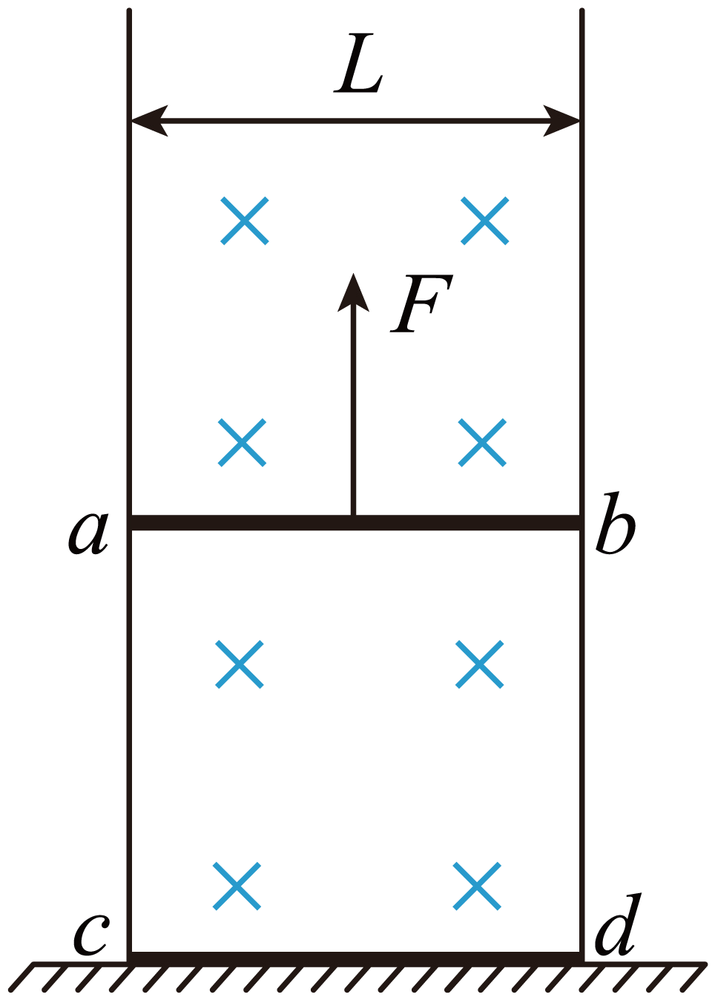

# Physics - 题目 471

**ID**: 930baa2971344b2d9821f6d1bfb5fc55
**年级**: Grade 11
**难度**: Medium-Hard
**题型**: Calculation

## 题目
如图所示，足够长的平行光滑金属导轨竖直固定放置，导轨间距L=0.2m。​​​​​​​‌完全相同的两金属棒ab、cd均垂直于导轨放置且与导轨接触良好，其长度恰好等于导轨间距，两棒的质量均为m=0.01kg，电阻均为R=0.2Ω，回路中其余电阻忽略不计。cd棒放置在水平绝缘平台上，整个装置处在垂直于导轨平面向里的匀强磁场中，磁感应强度B=1T。棒ab在恒力F作用下由静止开始向上运动。当棒ab运动的位移达到x=0.1m时，它达到最大速度，此时cd棒对绝缘平台的压力恰好为零。g取10m/s^{2}，求：（1）cd棒对绝缘平台的压力为零时，棒中的电流大小；（2）恒力F的大小及ab棒最大速度的大小；（3）在此过程中ab棒产生的焦耳热。

## 解答

1. （1）设cd棒受安培力为F_{1}，对cd棒受力分析有 $F{{}_{1}}=mg$ ， $F{{}_{1}}=BIL$
2. 解得 $I=\frac {mg}{BL}=0.5{\rm{A}}$
3. （2）对ab棒受力分析有 $F=F{{}_{1}}+mg$
4. 解得 $F=2mg=0.2{\rm{N}}$
5. 设ab棒最大速度为v，根据 $I=\frac {E}{2R}$ ， $E=BLv$
6. 解得 $ v=1{\rm{m}}{\rm{/}}{\rm{s}}$
7. （3）ab棒从开始到达到最大速度的过程中，根据功能关系有 $Fx=\frac {1}{2}mv{^{2}}+mgx+Q$
8. ab棒中产生的焦耳热为 $Q{{}_{ab}}=\frac {Q}{2}$
9. 代入数据解得 $Q{{}_{ab}}=2.5\times 10{^{-3}}{\rm{J}}$

## 知识点

**中文**:
  - 安培力作用下的运动问题
  - 电磁感应现象中的功能问题

**English**:
  - Motion under Ampere Force
  - Work-Energy Problems in EM Induction

---
