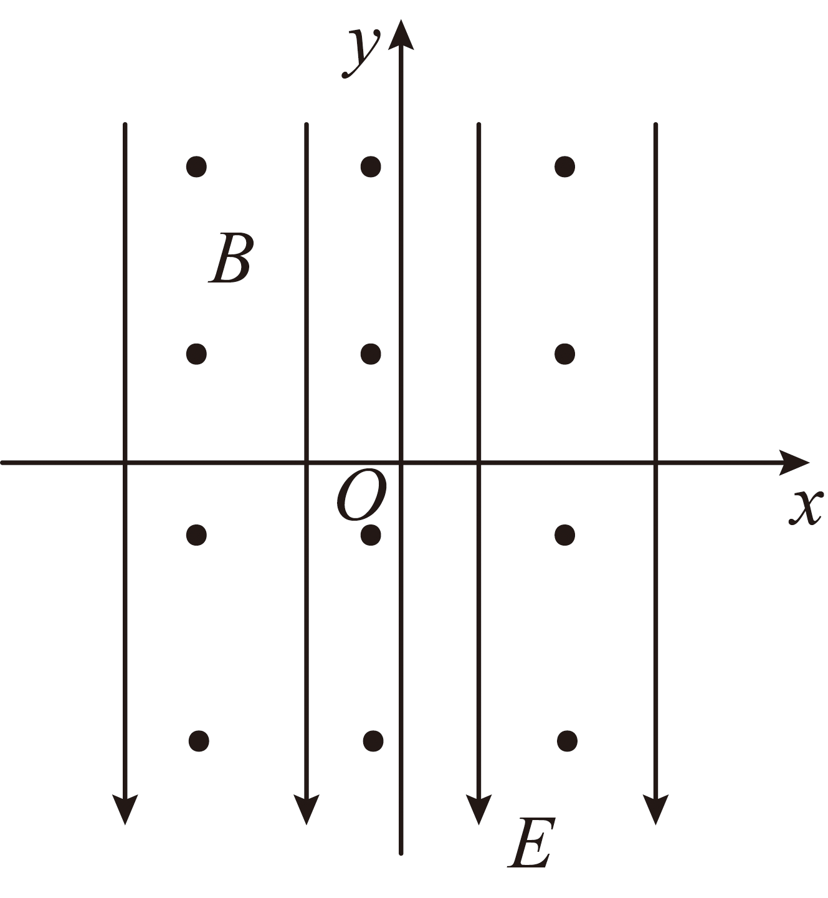
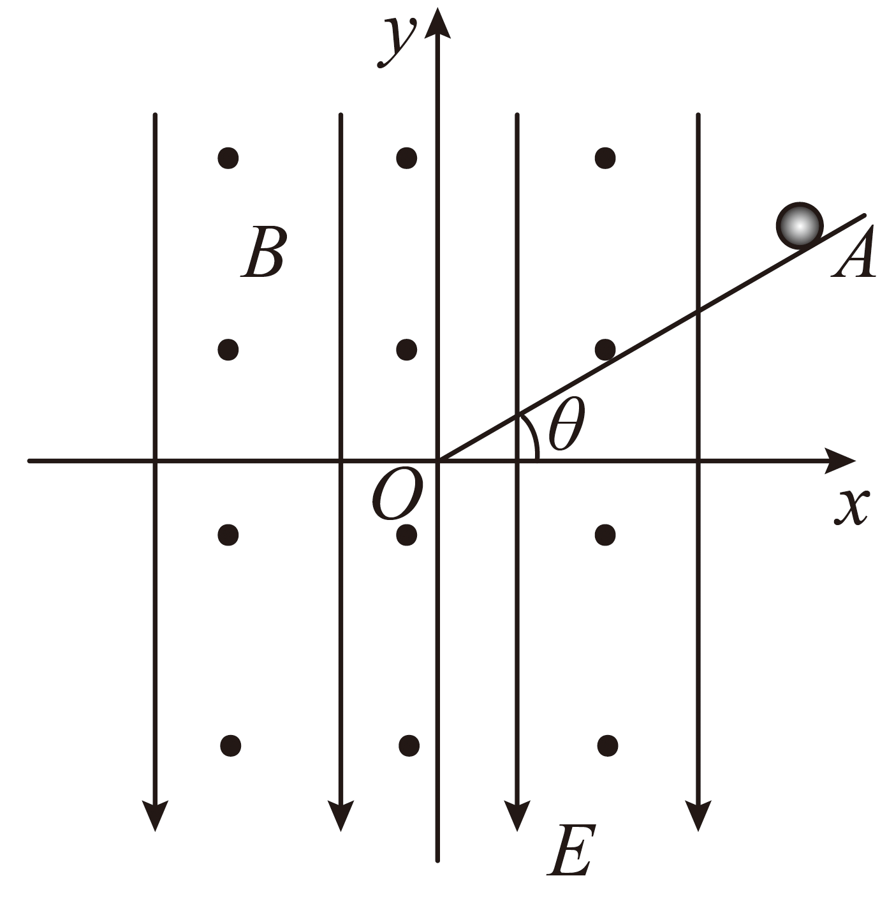

# Physics - 题目 2800

**ID**: 937b84f34b5348a7bab9af27b0e423a9
**年级**: Grade 11
**难度**: Medium-Hard
**题型**: Calculation

## 题目
如图所示竖直平面内，存在范围足够大的匀强磁场和匀强电场中，已知磁场的磁感应强度大小为B，方向垂直纸面向外，电场强度大小为E，电场方向竖直向下，一个质量为m，带电量为q（q>0）的小球，重力加速度为g，分析以下问题。​​​​​​​‌(1)若小球射入此复合场恰做匀速直线运动，求速度v_{1}大小和方向；(2)若直角坐标系第一象限固定放置一个光滑的绝缘斜面，其倾角为θ=30°，设斜面足够长，从斜面的最高点A由静止释放小球，如图所示，求小球滑离斜面时的速度v大小以及在斜面上运动的时间 $t$ ；(3)在（2）基础上，重新调整小球释放位置，使小球到达斜面底端O恰好对斜面的压力为零，小球离开斜面后的运动是比较复杂的摆线运动，可以看作一个匀速直线运动和一个匀速圆周运动的叠加，求：①小球离开斜面后运动过程中速度的最大值v_{m}②最大速度v_{m}所在位置的坐标。

## 解答

1. （1）小球的重力向下，电场力向下，则洛伦兹力方向向上，根据左手定则知，小球的速度方向水平向左，根据共点力平衡得  $mg+qE=qBv{{}_{1}}$
2. 解得 $v{{}_{1}}=\frac {mg+qE}{qB}$
3. （2）小球即将滑离斜面时，有 $qvB=(mg+qE){\cos}θ$
4. 解得 $v=\frac {\sqrt {3}}{2}\frac {\left ({mg+qE}\right )}{qB}$
5. 根据牛顿第二定律得 $\left ({mg+qE}\right )\sin 30{}\degree =ma$
6. 由v=at
7. 解得在斜面上运动的时间 $t=\frac {\sqrt {3}m}{qB}$
8. （3）将小球的速度分解为水平向左速度v_{1}和另一个分速度v_{2}；则一个分运动是以v_{1}做匀速直线运动，另一个分运动是以v_{2}做匀速圆周运动，如图
9. 
10. 由余弦定理可得 $v{{}_{2}}=\sqrt {v{{}_{1}^{2}}+v{^{2}}-2v{{}_{1}}v{\cos}θ}$
11. 联立解得 $v{{}_{2}}=\frac {mg+qE}{qB}\sin θ$
12. 对于匀速圆周运动的分运动，是顺时针的圆周运动，轨道半径为 $R=\frac {mv{{}_{2}}}{qB}$
13. 周期为 $T=\frac {2πm}{qB}$
14. 每次到达圆周运动的最低点时，两个分速度同向，合速度最大为 $v{{}_{{\rm{m}}}}=v{{}_{1}}+v{{}_{2}}$
15. 解得 $v{{}_{{\rm{m}}}}=\frac {3（mg+qE）}{2qB}$
16. 从离开斜面到第一次到达最低点过程，转过的角度为 $α=θ+\frac {π}{2}$
17. 竖直分位移坐标为 $y{{}_{1}}=-(R\sin θ+R)=-\frac {mv{{}_{2}}}{qB}(1{{+}}\sin θ)=-\frac {(mg+qE)m(1+\sin θ)\sin θ}{q{^{2}}B{^{2}}}$
18. 即y= $-\frac {3m（mg+qE）}{4q{^{2}}B{^{2}}}$
19. 经过的时间为 $t{{}_{1}}=\frac {θ+\frac {π}{2}}{2π}\cdot \frac {2πm}{qB}=\frac {(θ+\frac {π}{2})m}{qB}$
20. 合运动的水平分位移为 $x{{}_{{\rm{n}}}}=-\left [R{\cos}θ+v{{}_{1}}\left ({t{{}_{1}}+nT}\right )\right ],n=0,1,2...$
21. 解得 $x{{}_{{\rm{n}}}}=-\frac {（\frac {2π}{3}+2nπ+\frac {\sqrt {3}}{4}）m（mg+qE）}{q{^{2}}B{^{2}}},n=0,1,2...$
22. 最大值v_{m}所在位置的坐标为 $\left [-\frac {（\frac {2π}{3}+2nπ+\frac {\sqrt {3}}{4}）m（mg+qE）}{q{^{2}}B{^{2}}}，-\frac {3m（mg+qE）}{4q{^{2}}B{^{2}}}\right ]，n=0,1,2...$

## 知识点

**中文**:
  - 带电粒子在叠加场中的运动

**English**:
  - Motion in Superimposed Fields

---
