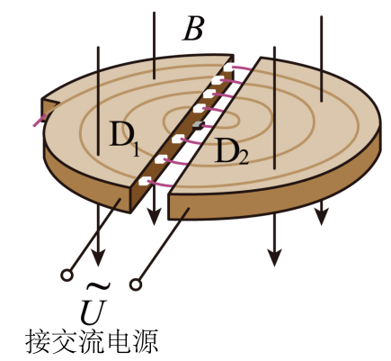

# Physics - 题目 796

**ID**: 93a4763e61d3481ca7c5f1cd0e4da967
**年级**: Grade 11
**难度**: Medium-Hard
**题型**: Calculation

## 题目
在某粒子物理实验室中，科研团队正在利用回旋加速器对微观粒子进行加速实验，以研究粒子的高能物理特性。​​​​​​​‌如图所示，回旋加速器两个D形金属盒分别与高频交流电源两极相连，放置在磁感应强度为B的匀强磁场中，磁场方向垂直于盒底面竖直向下，粒子源位于盒的圆心附近。已知被加速粒子的电荷量为q，质量为m，粒子最大回旋半径为R，两D形盒间加速电压为U，忽略粒子在两盒间加速的时间，不考虑相对论效应，忽略粒子重力。（1）若粒子从静止开始加速，求粒子能获得的最大速度 $v{{}_{{\rm{m}}}}$ ；（2）求粒子半径从 $r{{}_{1}}$ 加速到 $r{{}_{2}}(r{{}_{2}}>r{{}_{1}})$ 过程中，粒子在电场中加速的次数n；（3）若不计加速时间，考虑相对论效应，粒子质量与速度的关系为 $m=\frac {m{{}_{0}}}{\sqrt {1-(\frac {v}{c}){^{2}}}}$ （ $m{{}_{0}}$ 为静止质量，c为光速），试分析论证随着粒子速度增大，交流电源频率f应如何调整才能保证粒子持续被加速，需写出一定的论证过程。

## 解答

1. （1）粒子在磁场中做匀速圆周运动，当粒子运动半径最大时，其速度最大，洛伦兹力提供向心力则有 $Bqv{{}_{{\rm{m}}}}=m\frac {v{{}_{{\rm{m}}}^{2}}}{R}$
2. 解得 $v{{}_{{\rm{m}}}}=\frac {qBR}{m}$
3. （2）粒子的动能 $E{{}_{{\rm{k}}}}=\frac {1}{2}mv{^{2}}$
4. 结合 $Bqv=m\frac {v{^{2}}}{r}$
5. 解得 $E{{}_{{\rm{k}}}}=\frac {q{^{2}}B{^{2}}r{^{2}}}{2m}$
6. ，，粒子半径为 $r{{}_{1}}$ 时其动能 ${\rm{E}}{{}_{{\rm{k}}1}}=\frac {q{^{2}}B{^{2}}r{{}_{1}^{2}}}{2m}$
7. 粒子半径为 $r{{}_{2}}$ 时其动能 ${\rm{E}}{{}_{{\rm{k}}2}}=\frac {q{^{2}}B{^{2}}r{{}_{2}^{2}}}{2m}$
8. 每次加速电场力做功 $W=qU$
9. 设加速次数为 $n$ ，则有 $nW=E{{}_{{\rm{k}}2}}-E{{}_{{\rm{k}}1}}$
10. 解得 $n=\frac {qB{^{2}}\left ({r{{}_{2}^{2}}-r{{}_{1}^{2}}}\right )}{2mU}$
11. （3）粒子在磁场中运动的周期 $T=\frac {2πr}{v}$
12. 结合 $Bqv=m\frac {v{^{2}}}{r}$
13. 解得 $T=\frac {2{\rm{π}}m}{qB}$
14. 则频率 $f=\frac {1}{T}=\frac {qB}{2{\rm{π}}m}$
15. 若考虑相对论效应，粒子的运动质量 $m=\frac {m{{}_{0}}}{\sqrt {1-(\frac {v}{c}){^{2}}}}$ 会随着运动速度增大而增大，粒子在磁场中的频率则会减小。而只有粒子在磁场中运动频率与交变电流频率相等才能确保粒子持续被加速，，交流电源频率应变小。

## 知识点

**中文**:
  - 回旋加速器
  - 经典时空观与相对论时空观

**English**:
  - Cyclotron
  - Classical vs Relativistic Space-Time View

---
