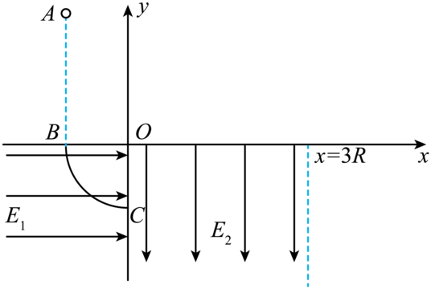

# Physics - 题目 1990

**ID**: 94411e6794ce49788413f5502aa13ddf
**年级**: Grade 11
**难度**: Medium-Hard
**题型**: Calculation

## 题目
如图所示，竖直平面直角坐标系 $xOy$ ，第Ⅲ象限内固定有半径为 $R$ 的四分之一光滑绝缘圆弧轨道BC，轨道的圆心在坐标原点O，B端在 $x$ 轴上，C端在 $y$ 轴上，同时存在大小为 $E{{}_{1}}=\frac {3mg}{4q}$ ，方向水平向右的匀强电场。​​​​​​​‌第Ⅳ象限 $x=0$ 与 $x=3R$ 之间有大小为 $E{{}_{2}}=\frac {2mg}{q}$ ，方向竖直向下的匀强电场。现将一质量为 $m$ ，电荷量为 $q$ 的带负电小球从B点正上方高 $2R$ 处的A点由静止释放，并从B点进入圆弧轨道，重力加速度用 $g$ 表示，求：（1）小球经过C点时的速度大小 $v{{}_{C}}$ ；（2）小球在第Ⅲ象限受到轨道支持力的最大值；（3）小球运动到 $y$ 轴右侧后与 $x$ 轴的交点坐标。

## 解答

1. （1）带负电小球从A点由静止释放到C点过程，根据动能定理可得 $mg\cdot 3R-qE{{}_{1}}R=\frac {1}{2}mv{{}_{C}^{2}}-0$ ，解得小球经过C点时的速度大小为 $v{{}_{C}}=\frac {3\sqrt {2gR}}{2}$ 。
2. （2）在电场 $E{{}_{1}}$ 中，带负电小球受到的重力和电场力的合力大小为 $F{{}_{合}}=\sqrt {(qE{{}_{1}}){^{2}}+(mg){^{2}}}=\frac {5}{4}mg$ ，设重力和电场力的合力与竖直方向的夹角为 $θ$ ，则有 ${\tan}θ=\frac {qE}{mg}=\frac {3}{4}$ ，可得 $θ=37{}\degree $ ，则当小球在第Ⅲ象限圆弧轨道BC上运动到D点与圆心连线沿重力和电场力的合力方向时，小球的速度最大，受到轨道的支持力最大，从A点由静止释放到D点过程，根据动能定理可得 $mg(2R+R{\cos}θ)-qE{{}_{1}}(R-R\sin θ)=\frac {1}{2}mv{{}_{D}^{2}}-0$ ，解得 $v{{}_{D}}=\sqrt {5gR}$ ，在D点，根据牛顿第二定律可得 $N{{}_{{\rm \max }}}-\frac {5}{4}mg=m\frac {v{{}_{D}^{2}}}{R}$ ，联立解得小球受到轨道支持力的最大值为 $N{{}_{{\rm \max }}}=\frac {25}{4}mg$ 。
3. （3）在第四象限电场中，小球受到的电场力竖直向上，大小为 $qE{{}_{2}}=2mg$ ，小球从C点以 $v{{}_{C}}=\frac {3\sqrt {2gR}}{2}$ 的速度进入第四象限内的电场 $E{{}_{2}}$ 中做类平抛运动，加速度大小为 $a=\frac {qE{{}_{2}}-mg}{m}=g$ ，方向竖直向上；设小球在电场 $E{{}_{2}}$ 中经过 $x$ 轴，则有 $R=\frac {1}{2}at{^{2}}$ ， $x=v{{}_{C}}t$ ，解得 $t=\sqrt {\frac {2R}{g}}$ ， $x=3R$ ，可知小球刚好从电场 $E{{}_{2}}$ 的右边界经过 $x$ 轴，此时小球竖直向上的分速度为 $v{{}_{y}}=at=\sqrt {2gR}$ ，小球进入第一象限后做斜抛运动，之后再次经过 $x$ 轴，根据斜抛运动规律有 $t^{′}=2\frac {v{{}_{y}}}{g}=2\sqrt {\frac {2R}{g}}$ ， $x^{′}=v{{}_{C}}t^{′}=6R$ ，则小球运动到 $y$ 轴右侧后与 $x$ 轴的交点坐标为（ $3R$ ， $0$ ）和（ $9R$ ， $0$ ）。

## 知识点

**中文**:
  - 匀强电场
  - 应用动能定理求解多阶段、多过程问题

**English**:
  - Uniform Electric Field
  - Multi-stage/Multi-process Problems

---
