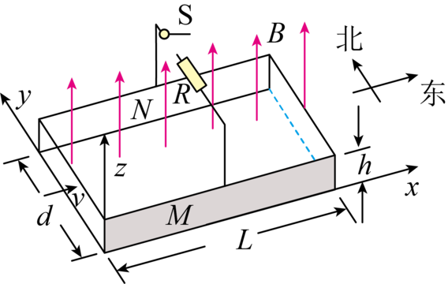

# Physics - 题目 1692

**ID**: 97548f4d3be94c00826b526c2fa47e27
**年级**: Grade 11
**难度**: Medium-Hard
**题型**: Calculation

## 题目
如图为利用海水流动发电的磁流体发电机原理示意图，其中的发电管道是长为L、宽为d、高为h的矩形水平管道。​​​​​​​‌发电管道的上、下两面是绝缘板，南、北两侧面M、N是电阻可忽略的导体板，两导体板与开关S和定值电阻R相连。整个管道置于方向竖直向上、磁感应强度大小为B的匀强磁场中。为了简化问题，可以认为：开关闭合前后，海水在发电管道内以恒定速率v朝正东方向流动，发电管道相当于电源，M、N两端相当于电源的两极，发电管道内海水的电阻为r（可视为电源内阻）。管道内海水所受的摩擦阻力保持不变，大小为f。不计地磁场的影响。（1）判断M、N两端哪端是电源的正极，并求出此发电装置产生的电动势；（2）由于管道内海水中有电流通过，求磁场对管道内海水作用力的大小；（3）发电管道进、出口两端压力差F的功率可视为该发电机的输入功率，定值电阻R消耗的电功率与输入功率的比值可定义为该发电机的效率。求开关闭合后，该发电机的效率η；在发电管道形状确定、海水的电阻r、外电阻R和管道内海水所受的摩擦阻力f保持不变的情况下，要提高该发电机的效率，简述可采取的措施。

## 解答

1. （1）由右手定则可知，海水中的正离子向M端偏转，负离子向N端偏转，M端电势高于N端，可知M端为电源的正极。
2. 当开关S断开时，MN两端的电压U等于电源的电动势E，即E=U，稳定后导电离子匀速通过管道，所受电场力与洛伦兹力等大反向，则有 $q\frac {U}{d}=qvB$
3. 解得E=U=Bdv
4. （2）开关闭合且稳定后，管道内的海水中有从N端到M端的电流I，根据闭合电路欧姆定律得 $I=\frac {E}{R+r}=\frac {Bdv}{R+r}$
5. 根据安培力的表达式可得磁场对管道内海水作用力的大小为 $F{{}_{安}}=BId=\frac {B{^{2}}d{^{2}}v}{R+r}$
6. （3）稳定后还有匀速通过管道，以发电管道内的海水为研究对象，其受力平衡，可得压力差满足：F=F_{安}+f
7. 由题意可得输入功率为 $P{{}_{入}}=Fv=fv+\frac {B{^{2}}d{^{2}}v{^{2}}}{R+r}$
8. 定值电阻R消耗的电功率为： $P{{}_{R}}=I{^{2}}R={\left({\frac {Bdv}{R+r}}\right)^{2}}R$
9. 该发电机的效率为： $η=\frac {P{{}_{R}}}{P{{}_{入}}}=\frac {B{^{2}}d{^{2}}v{^{2}}R}{B{^{2}}d{^{2}}v{^{2}}\left ({R+r}\right )+fv{\left({R+r}\right)^{2}}}$
10. 将发电机的效率η的表达式变形为： $η=\frac {d{^{2}}R}{d{^{2}}\left ({R+r}\right )+\frac {f{\left({R+r}\right)^{2}}}{B{^{2}}v}}$
11. 可见在d、r、R、f保持不变的情况下，可采取增大发电管道内海水的流速v和增强磁感应强度B可以提高发电机效率。

## 知识点

**中文**:
  - 磁流体发电机

**English**:
  - MHD Generator

---
