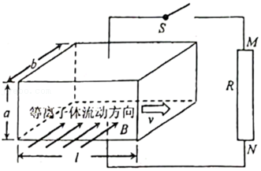

# Physics - 题目 2321

**ID**: 992c9732874544158e994e9626621427
**年级**: Grade 11
**难度**: Medium-Hard
**题型**: Calculation

## 题目
磁流体发电具有结构简单、启动快捷、环保且无需转动机械等优势。​​​​​​​‌如图所示，是正处于研究阶段的磁流体发电机的简易模型图，其发电通道是一个长方体空腔，长、高、宽分别为l、a、b，前后两个侧面是绝缘体，上下两个侧面是电阻可忽略的导体电极，这两个电极通过开关与阻值为R的某种金属直导体MN连成闭合电路，整个发电通道处于匀强磁场（磁场方向垂直由长l和高a组成的平面向里）中，磁感应强度的大小为B。高温等离子体保持以不变的速率v水平向右通过发电通道，发电机的等效内阻为r，忽略等离子体的重力、相互作用力及其他因素。当开关闭合后，整个闭合电路中就会产生恒定的电流。（1）求开关S闭合后，该磁流体发电机的电极间的电压U；（2）要使等离子体以不变的速率v通过发电通道，必须有推动等离子体在发电通道内前进的作用力。如果不计其他损耗，这个推力的功率P_{T}就应该等于该发电机的总功率P_{D}，请证明这个结论；（3）若以该金属直导体MN为研究对象，由于电场的作用，金属导体中自由电子定向运动的速率增加，但运动过程中会与导体内几乎不动的离子碰撞从而减速，因此自由电子定向运动的平均速率不随时间变化。设该金属导体的横截面积为S，电阻率为ρ，电子在金属导体中可认为均匀分布，每个电子的电荷量为e。①证明：金属导体中形成电流的电荷定向移动速度u与v成正比。②求金属导体中每个电子所受平均阻力f大小。

## 解答

1. （1）当外电路断开时，极板间的电压大小等于磁流体发电机的电动势E。此时，发电通道内电荷量为q的离子受力平衡，则有：
2. 解得：E＝Bav
3. 当开关S闭合后，由欧姆定律可得：
4. 电极间的电压U＝IR＝
5. （2）该电流在发电通道内受到的安培力大小为F_{A}＝BIa
6. 要使等离子体做匀速直线运动，所需的推力F_{T}＝F_{A}
7. 推力的功率为：P_{T}＝F_{T}v
8. 联立解得：
9. 闭合电路中电动机的总功率为P_{D}＝IE
10. 联立解得：
11. 则P_{T}＝P_{D}
12. （3）①金属导体中形成电流的电荷定向移动速度u，单位体积内的电子数为n，t时间内有N个电子通过电阻的横截面，则
13. N＝utSn
14. t时间内通过横截面的电荷量为Q＝Ne
15. 电流为
16. 联立解得：，故金属导体中形成电流的电荷定向移动速度u与v成正比。
17. ②设金属导体中的总电子数为N_{1}，长度为d，由于电子在金属导体内可视为匀速直线运动，所以电场力的功率应该等于所有电子克服阻力f做功的功率，即I^{2}R＝N_{1}fu
18. N_{1}＝dSn
19. 由电阻定律得：
20. 联立解得：

## 知识点

**中文**:
  - 磁流体发电机

**English**:
  - MHD Generator

---
