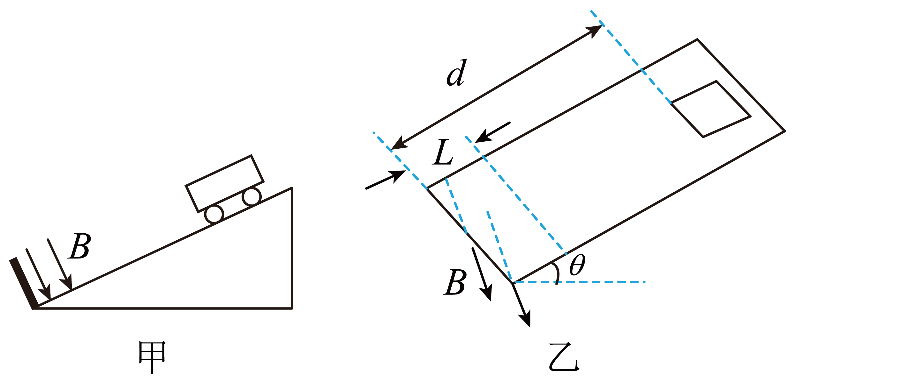

# Physics - 题目 927

**ID**: 9930d31f9e07486387f98c6e7ada6899
**年级**: Grade 11
**难度**: Medium-Hard
**题型**: Calculation

## 题目
一装有货物的小车从倾角 $θ$ 的光滑斜坡上下滑，撞击挡板后停下，货物被工人取走，如图甲所示。​​​​​​​‌为了减小小车对挡板的冲击，某同学设想了一个电磁缓冲装置，在小车底部固定与小车前端平齐、匝数为n、边长为L、总电阻为R的正方形线框；在斜坡的下端加上宽度也为L的匀强磁场，磁感应强度为B，方向垂直斜坡向下，如图乙所示（小车未画出）。若小车和货物的总质量为M，线框的质量为m。小车在线框的下边离底部挡板距离为d时静止释放，线框进入磁场后，小车立即做减速运动，已知小车撞击挡板前已经匀速运动，重力加速度为g。（1）求线框进入磁场时的速度v大小和小车匀速运动的速度 $v{{}_{1}}$ 大小；（2）小车运动过程中线框产生的焦耳热；（3）若采用适当粗些的导线绕制线框，保持匝数、边长、形状不变，能否减小小车运动速度，从而增大缓冲的效果？请说明理由（要有证明过程）

## 解答

1. （1）由机械能守恒定律得 $\left ({M+m}\right )g\left ({d-L}\right )\sin θ=\frac {1}{2}\left ({M+m}\right )v{^{2}}$
2. 解得，线框进入磁场时的速度为 $v=\sqrt {2g\left ({d-L}\right )\sin θ}$
3. 小车匀速运动时，则有 $\left ({M+m}\right )g\sin θ=nBIL$
4. 根据法拉第电磁感应定律有 $E=nBLv{{}_{1}}$
5. 根据闭合电路欧姆定律有 $I=\frac {nBLv{{}_{1}}}{R}$
6. 联立解得小车匀速运动时的速度为 $v{{}_{1}}=\frac {\left ({M+m}\right )gR\sin θ}{{\left({nBL}\right)^{2}}}$
7. （2）根据能量守恒定律有 $\left ({M+m}\right )gd\sin θ=\frac {1}{2}\left ({M+m}\right )v{{}_{1}^{2}}{{+}}Q$
8. 解得小车运动过程中线框产生的焦耳热为 $Q=\left ({M+m}\right )gd\sin θ-\frac {{\left({M+m}\right)^{3}}{\left({gR\sin θ}\right)^{2}}}{2{\left({nBL}\right)^{4}}}$
9. （3）设线框导体材料的横截面积为S、密度为 $ρ{{}_{0}}$ 、电阻率为 $ρ$ ，则线框质量为 $m=ρ{{}_{0}}nS4L$
10. 线框的电阻为 $R=ρ\frac {4L}{S}n$
11. 把质量与电阻的表达式代入 $v{{}_{1}}=\frac {\left ({M+m}\right )gR\sin θ}{{\left({nBL}\right)^{2}}}$
12. 可得 $v{{}_{1}}=\frac {4ρg\sin θ}{nB{^{2}}L}（4nρ{{}_{0}}L+\frac {M}{S}）$
13. 由此可知，线框导体材料截面积S变大，小车匀速运动的速度 $v{{}_{1}}$ 减小，从而增大缓冲效果‍。

## 知识点

**中文**:
  - 线框模型

**English**:
  - Wire Frame Model

---
