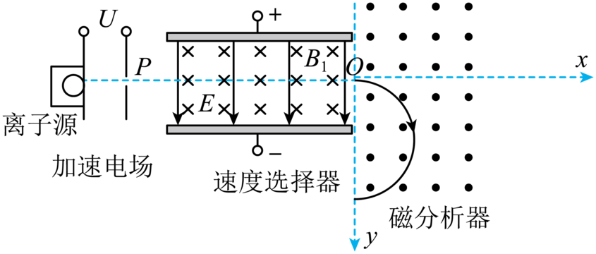

# Physics - 题目 2631

**ID**: 9aa6926007954dcea522e5de67a395fd
**年级**: Grade 11
**难度**: Medium-Hard
**题型**: Calculation

## 题目
核聚变的研究经常用到高速粒子束的分离，其原理如图所示，离子源不断的产生带电离子，经加速电场加速后进入速度选择器，再经右侧磁分析器偏转分离。​​​​​​​‌以速度选择器离子做直线运动的出口为坐标原点建立如图所示 $xOy$ 坐标系。已知带正电的离子，电荷量为 $q$ ，质量为 $m$ ，加速电场两极板间电压为 $u$ ，速度选择器间距为 $d$ ，极板长度为 $2d$ ，速度选择器内电场强度为 $E$ ，离子进入加速电场初速度可忽略不计，不考虑粒子间的相互作用以及相对论效应，重力忽略不计。（1）求离子经加速电场后获得的速度；（2）若粒子在速度选择器中做直线运动，求速度选择器中磁场磁感应强度 $B{{}_{1}}$ ；（3）若速度选择器中只有电场，磁分析器中磁场为匀强磁场，磁感应强度为 $B$ ，求离开速度选择器进入磁分析器的离子到达 $y$ 轴的位置坐标；（4）若在磁分析器中加一与 $x$ 轴平行的档板，图中未画出，已知档板距 $x$ 轴的距离为 $y=\frac {1}{B}\sqrt {\frac {2mu}{q}}$ ，磁分析器中磁场为匀强磁场，磁感应强度为 $B$ ，若单位时间内从粒子源发射的粒子数为 $N$ ，且打在档板上的所有粒子均被吸收（不反弹），求粒子对档板的平均作用力大小。

## 解答

1. （1）离子在加速电场中加速，由动能定理有 $qU=\frac {1}{2}mv{^{2}}$ ，得 $v=\sqrt {\frac {2qU}{m}}$
2. （2）通过速度选择器，由力的平衡条件有 $qE=qvB{{}_{1}}$ ，得 $B{{}_{1}}=E\sqrt {\frac {m}{2qU}}$
3. （3）若撤去极板间磁场 $B{{}_{1}}$ ，离子在电场中偏转距离 $y{{}_{1}}$ ，则 $y{{}_{1}}=\frac {1}{2}\times \frac {qE}{m}\times {\left({\frac {2d}{v}}\right)^{2}}$ ，得 $y{{}_{1}}=\frac {Ed{^{2}}}{U}$ ，进入右侧磁场速度为 $v{{}_{1}}$ 与x方向交角为 $θ$ ，圆周运动半径为 $R$ ，则 $qv{{}_{1}}B=m\frac {v{{}_{1}^{2}}}{R}$ ， $v{{}_{1}}{\cos}θ=v$ ，射入磁场位置到 $y$ 位置距离 $y{{}_{2}}=2R{\cos}θ$ ， $y{{}_{2}}=2\times \frac {mv}{qB}=\frac {2}{B}\sqrt {\frac {2mU}{q}}$ ，所以离子射到 $y$ 轴的位置 $y=y{{}_{1}}+y{{}_{2}}=\frac {Ed{^{2}}}{U}+\frac {2}{B}\sqrt {\frac {2mU}{q}}$ ，即离子射到 $y$ 轴的位置为 $\left ({0,\frac {Ed{^{2}}}{U}+\frac {2}{B}\sqrt {\frac {2mU}{q}}}\right )$
4. （4）粒子进入磁分析器：洛伦兹力提供向心力 $qBv=m\frac {v{^{2}}}{R}$ ， $R=\frac {mv}{qB}=\frac {1}{B}\sqrt {\frac {2mu}{q}}$ ，档板过圆心。由动量定理得 $-FΔt=Nm\left ({0-v}\right )$ ，所以 $F=Nmv=N\sqrt {2qmu}$ ，根据牛顿第三定律：粒子对档板的作用力为 $F\mathrm{′}=F=N\sqrt {2qmu}$

## 知识点

**中文**:
  - 速度选择器

**English**:
  - Velocity Selector

---
