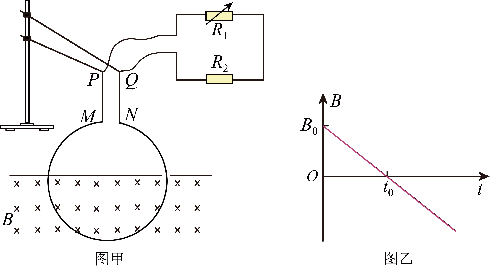

# Physics - 题目 868

**ID**: 9b66d859b72b4338a47959255975006a
**年级**: Grade 11
**难度**: Medium-Hard
**题型**: Calculation

## 题目
如图甲所示，将一单匝开口金属圆线圈从开口端 $M$ 、 $N$ 处用两段细导线悬于铁架台上两绝缘杆上的固定端点 $P$ 、 $Q$ ，圆线圈的质量为 $m$ ，电阻为 $R$ ，半径为 $r$ ，圆线圈处于竖直平面内，其下半部分处于匀强磁场中，上半部分位于磁场外，磁场的磁感应强度 $B$ 随时间 $t$ 变化的规律如图乙所示（磁场方向垂直纸面向里为正）。​​​​​​​‌用导线将一控制电路接在 $P$ 、 $Q$ 两点之间并保持导通，控制电路中的 $R{{}_{1}}$ 为变阻器，其调节范围为 $0\sim 2R$ ，定值电阻 $R{{}_{2}}=3R$ 。已知圆线圈一直处于静止状态，悬挂线圈的细导线处于竖直方向，除线圈、 $R{{}_{1}}$ 、 $R{{}_{2}}$ 外其余电阻不计，重力加速度为 $g$ 。（1） $t=0$ 时将 $R{{}_{1}}$ 调为0并保持不变，求 $0\sim t{{}_{0}}$ 时间内流过 $R{{}_{2}}$ 的电流大小和方向；（2） $t=0$ 时将 $R{{}_{1}}$ 调为0并保持不变，求 $t=\frac {t{{}_{0}}}{2}$ 时，圆线圈受到两根细导线的总拉力大小；（3）调节 $R{{}_{1}}$ ，求出 $R{{}_{1}}$ 消耗电功率的最大值。

## 解答

1. （1）在 $0\sim t{{}_{0}}$ 时间内，由楞次定律可知流过 $R{{}_{2}}$ 的电流方向： $M\to R{{}_{2}}\to N$ ，由题图乙可得磁感应强度变化率 $\frac {ΔB}{Δt}=\frac {B{{}_{0}}}{t{{}_{0}}}$ ，由法拉第电磁感应定律可得回路中的感应电动势为 $E=\frac {{\rm{Δ}}{\rm{Φ}}}{{\rm{Δ}}t}=\frac {{\rm{Δ}}B}{{\rm{Δ}}t}\cdot \frac {1}{2}{\rm{π}}r{^{2}}$ ，由闭合电路欧姆可知 $I=\frac {E}{3R+R}$ ，解得流过 $R{{}_{2}}$ 的电流大小 $I=\frac {{\rm{π}}B{{}_{0}}r{^{2}}}{8Rt{{}_{0}}}$ 。
2. （2）当 $t=\frac {t{{}_{0}}}{2}$ 时，对应磁感应强度为 $B=\frac {1}{2}B{{}_{0}}$ ，安培力大小为 $F{{}_{安}}=I\cdot 2rB$ ，设此时圆线圈受到两根细导线的总拉力为 $F$ ，根据平衡条件可得 $F=F{{}_{安}}+mg$ ，解得 $F=\frac {πB{{}_{0}^{2}}r{^{3}}}{8Rt{{}_{0}}}+mg$ 。
3. （3）将 $R{{}_{2}}$ 等效为电源内阻，可得等效电源内阻为 $r\prime =R+3R=4R$ ，可知 $R{{}_{1}}$ 的最大阻值小于电源的等效内阻，根据电路知识可得当 $R{{}_{1}}$ 调节到最大阻值时，其消耗电功率最大，即 $P{{}_{{\rm{m}}}}={\left({\frac {E}{r\prime +2R}}\right)^{2}}\cdot 2R$ ，解得 $P{{}_{{\rm{m}}}}=\frac {{\rm{π}}{^{2}}B{{}_{0}^{2}}r{^{4}}}{72Rt{{}_{0}^{2}}}$ 。

## 知识点

**中文**:
  - 安培力作用下的平衡问题
  - 电磁感应定律的应用

**English**:
  - Equilibrium under Ampere Force
  - Applications of Faraday's Law

---
