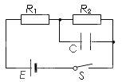

# Physics - 题目 912

**ID**: 9b910f1a6125466f851712103b116343
**年级**: Grade 11
**难度**: Medium-Hard
**题型**: Calculation

## 题目
如图所示的电路中，电源电动势E=6.​​​​​​​‌0V，其内阻可忽略不计．电阻的阻值分别为 $R{{}_{1}}=2.4{\rm{k}}Ω，R{{}_{2}}=4.8{\rm{k}}Ω$ ，电容器的电容 $C=4.7μ{\rm{F}}$ ．闭合开关S，待电流稳定后，用电压表测R_{1}两端电压，其稳定值为1.50V．（1）该电压表的内阻为多大？（2）由于电压表的接入，电容器的带电量变化了多少？

## 解答

1. （1）设电压表的内阻为R_{V}，测得R_{1}两端电压为U_{1}，R_{1}与R_{V}并联以后的总电阻为R，则有： $\frac {1}{R}=\frac {1}{R{{}_{V}}}+\frac {1}{R{{}_{1}}}$
2. 由串联电路的规律得： $\frac {R}{R{{}_{2}}}=\frac {U{{}_{1}}}{E-U{{}_{1}}}$
3. $R{{}_{V}}=4.8\,kΩ$ .
4. （2）电压表接入前，电容器上的电压U_{C}等于电阻R_{2}上的电压，R_{1}两端的电压为U_{R}，则：
5. $\frac {U{{}_{C}}}{U{{}_{R}}}=\frac {R{{}_{2}}}{R{{}_{1}}}$
6. 又E=U_{C}+U_{R}
7. 接入电压表后，电容器上的电压为： $U^{′}{{{}_{C}}}=E-U{{}_{1}}$
8. 由于电压表的接入，电容器带电量增加了： $ΔQ=C(U^{′}{{{}_{C}}}-U{{}_{C}})$
9. 联立以上各式可得： △Q=2.35×10^{-6 }C

## 知识点

**中文**:
  - 电容器与电容
  - 闭合电路的欧姆定律及其应用

**English**:
  - Capacitors and Capacitance
  - Ohm's Law for Closed Circuits and Applications

---
