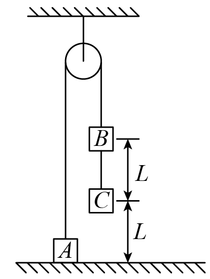

# Physics - 题目 735

**ID**: 9c7a419d1803431a92d59e4a2d9e72cd
**年级**: Grade 11
**难度**: Medium-Hard
**题型**: Calculation

## 题目
如图所示，物块A、B、C的质量分别为2 m、2 m、m,并均可视为质点，三个物块用轻绳通过轻质滑轮连接，在外力作用下现处于静止状态，此时物块A置于地面，物块B与C、C到地面的距离均是L，现将三个物块由静止释放．若C与地面、B与C相碰后速度立即减为零，A距离滑轮足够远且不计一切阻力，重力加速度为g.求：(1)刚释放时A的加速度大小及轻绳对A的拉力大小；(2)物块A由最初位置上升的最大高度；(3)若改变A的质量使系统由静止释放后物块C能落地且物块B与C不相碰，则A的质量应满足的条件。​​​​​​​‌

## 解答

1. 解：(1)刚释放时A、B、C的加速度大小为a，绳子对A拉力大小为F，由受力分析可知，对于A有 $F-2mg=2ma$ ，对于BC整体有 $3mg-F=3ma$ ，解得 $a=\frac {g}{5}$ ， $F=\frac {12}{5}mg=2.4mg$ 。
2. (2)C下落L后落地，由 $v{^{2}}=2ax$ 可知此时的速度 $v=\sqrt {\frac {2}{5}gL}$ ，由 $h=\frac {v{^{2}}}{2g}$ 得 $h=0.2L$ ，则物块由最初位置上升的最大高度 $H=2.2L$ 。
3. (3)若改变A的质量使系统由静止释放后物块C能落地，则A的质量需满足 $m{{}_{A}}<3m$ ，同时使得B与C不相碰，即C落地后B减速下降到地面时速度为0，从释放到C落地的过程中运用系统机械能守恒定律  $3mgL-m{{}_{A}}gL=\frac {1}{2}(3m+m{{}_{A}})v{^{2}}$ ，解得 $v=\sqrt {\frac {2(3m-m{{}_{A}})gL}{3m+m{{}_{A}}}}$ ，从C落地到B减速到地面速度为0的过程中运用系统机械能守恒定律 $2mgL+\frac {1}{2}(2m+m{{}_{{\rm{A}}}})v{^{2}}=m{{}_{{\rm{A}}}}gL$ ，解得 $m{{}_{{\rm{A}}}}=\sqrt {6}m$ ，即A的质量满足 $\sqrt {6}m<m{{}_{A}}<3m$ 系统由静止释放后物块C能落地且物块B与C不相碰。

## 知识点

**中文**:
  - 其他连接体问题中机械能守恒定律的应用

**English**:
  - Other Connected Body Problems

---
