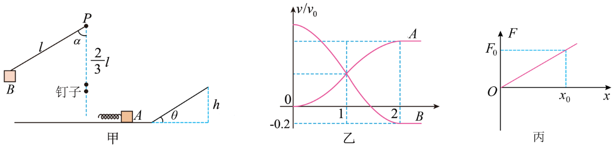

# Physics - 题目 1803

**ID**: 9e82148996e74901a6c10a50a3be5d3e
**年级**: Grade 11
**难度**: Medium-Hard
**题型**: Calculation

## 题目
如图甲，一质量为m的物块B用一长度为 $l=\frac {v{{}_{0}^{2}}}{g}$ 的轻绳悬挂于P点处，初始时其与竖直方向的夹角 $α=60{}\degree {\rm ，\mathit{P}}$ 点正下方 $\frac {2}{3}l$ 处有一钉子。​​​​​​​‌另一物块A与轻质小弹簧连接，静止于光滑水平面上。现自由释放物块B，当其运动至P点正下方时轻绳碰到钉子后立即断裂，之后物块B将在光滑水平面上匀速直线运动，直至接触弹簧（假定在物块B触地过程中机械能没有损失，轻绳在断裂后不影响物块B的后续运动）。记物块B第一次与弹簧接触的时刻为 $t=0$ ，第一次与弹簧分离的时刻为 $t=2t{{}_{0}}$ 。第一次碰撞过程中，A和B的 $v-t$ 图像如图乙所示。A和B分离后，A滑上粗糙斜面，然后滑下，与一直在水平面上运动的B再次碰撞。斜面倾角 $θ=37{}\degree $ ，高度 $h=\frac {v{{}_{0}^{2}}}{5g}$ ，与水平面光滑连接。已知弹簧始终处于弹性限度内，且弹力大小F与弹簧形变量x的关系如图丙所示，其中 $F{{}_{0}}$ 和 $x{{}_{0}}$ 为已知量，重力加速度记为 ${\rm \mathit{g}，}\sin 37{}\degree =0.6$ 。求（1）轻绳即将断裂时的张力T；（2）A的质量 $m{{}_{A}}$ ；（3）B第一次与弹簧作用过程中，弹簧的最大形变量x（用符号m、 $v{{}_{0}}$ 、 $F{{}_{0}}$ 和 $x{{}_{0}}$ 表示）；（4）物块A与斜面间的动摩擦因数 $μ$ 的取值范围。（可用分数表示）。

## 解答

1. （1）设B摆至最低点的速度为 $v{{}_{1}}$ ，根据动能定理有 $mgl\left ({1-{\cos}α}\right )=\frac {1}{2}mv{{}_{1}^{2}}-0$ ，解得 $v{{}_{1}}=v{{}_{0}}$ ，轻绳即将断裂时，对B受力分析有 $T-mg=\frac {mv{{}_{0}^{2}}}{R}$ ，又 $R=l-\frac {2}{3}l$ ，解得 $T=4mg$ 。
2. （2）设B与弹簧分离时A和B的速度分别为 $v{{}_{A}}$ 和 $v{{}_{B}}{\rm ，\mathit{B}}$ 第一次与弹簧作用过程，由动量守恒定律得 $mv{{}_{0}}=mv{{}_{B}}+m{{}_{A}}v{{}_{A}}$ ，由能量守恒定律得 $\frac {1}{2}mv{{}_{0}^{2}}=\frac {1}{2}mv{{}_{B}^{2}}+\frac {1}{2}m{{}_{A}}v{{}_{A}^{2}}$ ，又由图得 $v{{}_{B}}=-0.2v{{}_{0}}$ ，联立解得 $m{{}_{A}}=\frac {3}{2}m$ ， $v{{}_{A}}=0.8v{{}_{0}}$ 。
3. （3） $t=t{{}_{0}}$ 时弹簧具有最大弹性势能，设A和B的速度为v，由动量守恒定律可得 $mv{{}_{0}}=(m+m{{}_{A}})v$ ，由能量守恒定律可得 $E{{}_{{\rm{p}}}}=\frac {1}{2}mv{{}_{0}^{2}}-\frac {1}{2}\left ({m+m{{}_{A}}}\right )v{^{2}}$ ，由丙图得 $F=\frac {F{{}_{0}}}{x{{}_{0}}}x$ ，弹簧力F与形变量x成线性关系，有 $E{{}_{{\rm{p}}}}=\frac {0+F}{2}x$ ，联立可得 $x=\frac {v{{}_{0}}\sqrt {15mF{{}_{0}}x{{}_{0}}}}{5F{{}_{0}}}$ 。
4. （4）A若要与B发生二次碰撞，其不能越过斜面。若A在斜面顶端的速度恰为0，由动能定理得 $-m{{}_{A}}gh-{\rm μm}{{}_{A}}g{\cos}θ\frac {h}{\sin θ}=0-\frac {1}{2}m{{}_{A}}v{{}_{A}^{2}}$ ，解得 $μ=\frac {9}{20}$ ，所以要满足 $μ⩾\frac {9}{20}$ ；A若要与B发生二次碰撞，其除了不能越过斜面之外，其返回至水平面时速度大小必须比B的大。设此时A在斜面上的最大高度为 $h{{}_{{\rm{m}}}}$ ，则 $h{{}_{{\rm{m}}}}=h=\frac {v{{}_{0}^{2}}}{5g}$ ，返回水平面时的速度恰为 $0.2v{{}_{0}}$ ，根据动能定理得 $-m{{}_{A}}gh{{}_{{\rm{m}}}}-{\rm μm}{{}_{A}}g{\cos}θ\frac {h{{}_{{\rm{m}}}}}{\sin θ}=0-\frac {1}{2}m{{}_{A}}v{{}_{A}^{2}}$ ， $m{{}_{A}}gh{{}_{{\rm{m}}}}-{\rm μm}{{}_{A}}g{\cos}θ\frac {h{{}_{{\rm{m}}}}}{\sin θ}=\frac {1}{2}m{{}_{A}}{\left({0.2v{{}_{0}}}\right)^{2}}$ ，解得 $μ=\frac {45}{68}$ ，所以要满足 $μ<\frac {45}{68}$ ；最后，A能够从斜面上滑下必须满足条件 $m{{}_{A}}g\sin θ⩾{\rm μm}{{}_{A}}g{\cos}θ$ ，解得 $μ⩽\frac {3}{4}$ ，综上可得A与斜面间的动摩擦因数应满足 $\frac {9}{20}⩽μ<\frac {45}{68}$ 。

## 知识点

**中文**:
  - 动量守恒中的多次碰撞问题

**English**:
  - Multiple Collisions in Momentum Conservation

---
