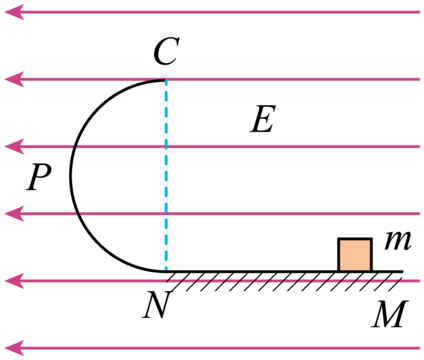

# Physics - 题目 1404

**ID**: 9ea8a28d66374a6eaef7bfa15d7ccc95
**年级**: Grade 11
**难度**: Medium-Hard
**题型**: Calculation

## 题目
如图所示，在水平向左匀强电场中，有一光滑半圆形绝缘轨道竖直放置，轨道与一水平绝缘轨道MN平滑连接，半圆形轨道所在竖直平面与电场线平行，其半径 $R=0.40{\rm{m}}$ 。​​​​​​​‌一带电荷量 $q=+1\times 10{^{-4}}{\rm{C}}$ 的小滑块质量为 $m=0.04{\rm{k}}{\rm{g}}$ ，与水平轨道间的动摩擦因数 $μ=0.5$ ，滑块从水平轨道上离N点的距离 $x{{}_{0}}=4{\rm{m}}$ 处由静止释放，小滑块恰好运动到半圆形轨道的最高点C。g取 ${{1}}{{0}}{\rm{m}}{\rm{/}}{\rm{s}}{^{{{2}}}}$ ，求：(1)小滑块在圆形轨道C点的速度大小；(2)小滑块运动至竖直轨道最低点N点时的速度大小和在N点时受到轨道的支持力大小；(3)匀强电场的电场强度大小；(4)小滑块在圆轨道上运动时的最大速率。

## 解答

1. （1）由题意知，小滑块在圆形轨道C点，仅由重力提供向心力，则有 $mg=m\frac {v{{}_{C}^{2}}}{R}$ ，解得 $v{{}_{C}}=2{\rm{m}}/{\rm{s}}$
2. （2）滑块从N点运动到C点过程，根据动能定理有 $-mg\times 2R=\frac {1}{2}mv{{}_{C}^{2}}-\frac {1}{2}mv{{}_{N}^{2}}$ ，解得 $v{{}_{N}}=2\sqrt {5}{\rm{m}}/{\rm{s}}$ ，在N点，根据牛顿第二定律有 $F{{}_{{\rm{N}}}}-mg=m\frac {v{{}_{N}^{2}}}{R}$ ，解得 $F{{}_{{\rm{N}}}}=2.4{\rm{N}}$
3. （3）滑块从开始运动到N点，根据动能定理有 $Eqx{{}_{0}}-{\rm μm}gx{{}_{0}}=\frac {1}{2}mv{{}_{N}^{2}}$ ，解得 $E=3\times 10{^{3}}{\rm{V}}{\rm{/}}{\rm{m}}$
4. （4）设小球运动到圆周B点时速度最大为 $v{{}_{{\rm{m}}}}$ ，此时OB与竖直线CN夹角设为 $α$ ，如图所示
5. 
6. 根据几何关系有 ${\tan}α=\frac {Eq}{mg}=\frac {3}{4}$ ，解得 $α=37{^{\circ }}$ ，即此时速度最大，设为 $v{{}_{{\rm{m}}}}$ ，则滑块从N点到B点，根据动能定理有 $EqR\sin α-mg\left ({R-R{\cos}α}\right )=\frac {1}{2}mv{{}_{{\rm{m}}}^{2}}-\frac {1}{2}mv{{}_{{\rm{N}}}^{2}}$ ，解得 $v{{}_{{\rm{m}}}}=\sqrt {22}{\rm{m}}/{\rm{s}}$

## 知识点

**中文**:
  - 匀强电场
  - 应用动能定理求解多阶段、多过程问题

**English**:
  - Uniform Electric Field
  - Multi-stage/Multi-process Problems

---
