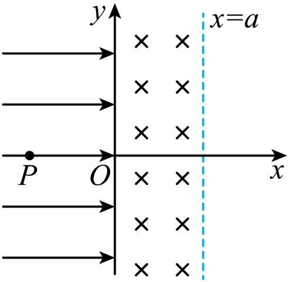

# Physics - 题目 958

**ID**: a32f4fd9915146118abde5e416c8dc45
**年级**: Grade 11
**难度**: Medium-Hard
**题型**: Calculation

## 题目
如图所示，在平面直角坐标系xOy的第二、三象限内，有沿x轴正方向的匀强电场，电场强度大小为E，在y轴与x=a之间（含边界）有垂直于坐标平面向里的匀强磁场，在x轴上坐标为（ $-a$ ，0）的P点由静止释放一个质量为m、电荷量为q的带正电粒子，粒子经电场加速后进入磁场，恰好不从x=a的边界射出磁场，不计粒子的重力，求：（1）匀强磁场的磁感应强度大小；（2）粒子从静止释放到第四次经过y轴所用的时间；（3）若使该粒子从P点以一定的初速度沿y轴负方向射出，粒子经电场、磁场偏转后，刚好垂直于x=a的边界射出磁场，则粒子从P点射出的初速度多大。​​​​​​​‌

## 解答

1. （1）设粒子进磁场时的速度大小为v_{1}，根据动能定理有
2. $qEa=\frac {1}{2}mv{{}_{1}^{2}}$
3. 解得
4. $v{{}_{1}}=\sqrt {\frac {2qEa}{m}}$
5. 由题意知粒子在磁场中做圆周运动的半径
6. $r{{}_{1}}=a$
7. 根据牛顿第二定律
8. $qv{{}_{1}}B=m\frac {v{{}_{1}^{2}}}{r{{}_{1}}}$
9. 解得
10. $B=\sqrt {\frac {2Em}{qa}}$
11. （2）设粒子第一次在电场中运动时间为t_{1}，则
12. $a=\frac {1}{2}\cdot \frac {qE}{m}t{{}_{1}^{2}}$
13. 解得
14. $t{{}_{1}}=\sqrt {\frac {2ma}{qE}}$
15. 设粒子每次在磁场中运动的时间为t_{1}，则
16. $t{{}_{2}}=\frac {1}{2}\cdot \frac {2πm}{qB}=π\sqrt {\frac {ma}{2qE}}$
17. 根据周期性与对称性可知，粒子从释放到第四次经过y轴所用时间
18. $t=3t{{}_{1}}+2t{{}_{2}}=(3+π)\sqrt {\frac {2ma}{qE}}$
19. （3）设粒子从P点射出的初速度大小为v_{0}，粒子进磁场时速度与y轴负方向夹角为θ，则
20. ${\tan}θ=\frac {v{{}_{1}}}{v{{}_{0}}}$
21. 设粒子在磁场中做圆周运动的半径为r_{2}，根据题意知
22. ${\cos}θ=\frac {a}{r{{}_{2}}}$
23. 粒子进磁场时的速度
24. $v{{}_{2}}=\frac {v{{}_{1}}}{\sin θ}$
25. 根据牛顿第二定律
26. $qv{{}_{2}}B=m\frac {v{{}_{2}^{2}}}{r{{}_{2}}}$
27. 解得
28. $v{{}_{0}}=\sqrt {\frac {2qEa}{m}}$

## 知识点

**中文**:
  - 带电粒子在有界匀强磁场中的运动
  - 带电粒子在组合场中的运动

**English**:
  - Motion in Bounded Uniform Magnetic Field
  - Motion in Combined Fields

---
