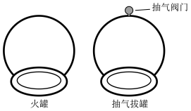

# Physics - 题目 2827

**ID**: b1ceb1bd6de646e497cc2812166bedd5
**年级**: Grade 11
**难度**: Medium-Hard
**题型**: Calculation

## 题目
中医拔罐的物理原理是利用玻璃罐内外的气压差使罐吸附在人体穴位上，进而治疗某些疾病。​​​​​​​‌常见拔罐有两种，如图所示，左侧为火罐，下端开口；右侧为抽气拔罐，下端开口，上端留有抽气阀门。使用火罐时，先加热罐中气体，然后迅速按到皮肤上，自然降温后火罐内部气压低于外部大气压，使火罐紧紧吸附在皮肤上。抽气拔罐是先把罐体按在皮肤上，再通过抽气降低罐内气体压强。某次使用火罐时，罐内气体初始压强与外部大气压相同，温度为450 K，最终降到300 K，因皮肤凸起，内部气体体积变为罐容积的 $\frac {20}{21}$ 。若换用抽气拔罐，抽气后罐内剩余气体体积变为抽气拔罐容积的 $\frac {20}{21}$ ，罐内气压与火罐降温后的内部气压相同。罐内气体均可视为理想气体，忽略抽气过程中气体温度的变化。求应抽出气体的质量与抽气前罐内气体质量的比值。

## 解答

1. 设火罐内气体初始状态参量分别为p_{1}、T_{1}、V_{1}，温度降低后状态参量分别为p_{2}、T_{2}、V_{2}，罐的容积为V_{0}，由题意知
2. p_{1}=p_{0}、T_{1}=450 K、V_{1}=V_{2}、T_{2}=300 K、V_{2}=20V_{0}/21       ①
3. 由理想气体状态方程得
4. $\frac {p{{}_{0}}V{{}_{0}}}{T{{}_{1}}}=\frac {p{{}_{2}}\cdot \frac {20}{21}V{{}_{0}}}{T{{}_{2}}}$                     ②
5. 代入数据得
6. p_{2}=0.7p_{0 }③
7. 对于抽气罐，设初态气体状态参量分别为p_{3}、V_{3}，末态气体状态参量分别为p_{4}、V_{4}，罐的容积为 $V{{}_{0}}{^{\prime }}$ ，由题意知
8. p_{3}=p_{0}、V_{3}= $V{{}_{0}}{^{\prime }}$ 、p_{4}=p_{2 }④
9. 由玻意耳定律得
10. $p{{}_{0}}V{{}_{0}}{^{\prime }}=p{{}_{2}}V{{}_{4}}$                     ⑤
11. 联立②⑤式，代入数据得
12. $V{{}_{4}}=\frac {10}{7}V{{}_{0}}{^{\prime }}$                     ⑥
13. 设抽出的气体的体积为ΔV，由题意知
14. ${\rm{Δ}}V=V{{}_{4}}-\frac {20}{21}V{{}_{0}}{^{\prime }}$                     ⑦
15. 故应抽出气体的质量与抽气前罐内气体质量的比值为
16. $\frac {{\rm{Δ}}m}{m}=\frac {{\rm{Δ}}V}{V{{}_{4}}}$                     ⑧
17. 联立②⑤⑦⑧式，代入数据得
18. $\frac {{\rm{Δ}}m}{m}=\frac {1}{3}$                     ⑨

## 知识点

**中文**:
  - 充气、抽气和灌气等问题
  - 变质量气体状态变化问题

**English**:
  - Inflation, Evacuation, and Filling Problems
  - Variable Mass Gas Problems

---
