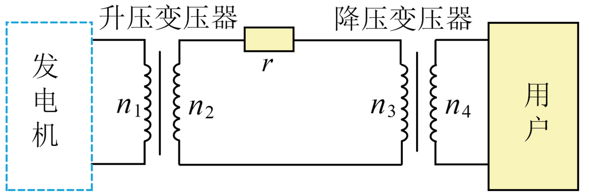

# Physics - 题目 2464

**ID**: b404c07e655f4254b52c0d56e82944d7
**年级**: Grade 11
**难度**: Medium-Hard
**题型**: Calculation

## 题目
某学校在供电异常时，会启用一台发电机来提供照明用电，输电过程如图所示，升压变压器原、副线圈匝数比为1∶10，输电线的总电阻为r=10 Ω。​​​​​​​‌全校共有550盏“220 V，40 W”的灯，全部电灯正常发光，输电线上损失的功率为1 kw，求：（1）降压变压器副线圈中的电流的大小；（2）降压变压器原、副线圈匝数比为；（3）升压变压器的输入电压的大小。

## 解答

1. （1）降压变压器副线圈中的电流为 $I{{}_{4}}=\frac {P{{}_{{\rm L}}}}{U{{}_{4}}}=\frac {40\times 550}{220}{\rm{\;}}{\rm A}=100{\rm{\;}}{\rm A}$ 。
2. （2）输电线上损失的功率为 $P{{}_{\mathrm{损}}}=I{{}_{3}}{^{2}}r$ ，
3. 解得降压变压器原线圈的电流为 $I{{}_{3}}=\sqrt {\frac {P{{}_{损}}}{r}}=\sqrt {\frac {1000}{10}}{\rm{\;}}{\rm A}=10{\rm{\;}}{\rm A}$ ，
4. 降压变压器原、副线圈匝数比为 $n{{}_{3}}:n{{}_{4}}=I{{}_{4}}:I{{}_{3}}=10:1$ 。
5. （3）降压变压器原、副线圈电压比为 $U{{}_{3}}:U{{}_{4}}=10:1$ ，
6. 降压变压器原线圈的电压为 $U{{}_{3}}=10U{{}_{4}}=2200{\rm{\;}}{\rm V}$ ，
7. 输电线上损失的电压为 $\Delta U=I{{}_{3}}r=10\times 10{\rm{\;}}{\rm V}=100{\rm{\;}}{\rm V}$ ，
8. 升压变压器的输出电压为 $U{{}_{2}}=U{{}_{3}}+\Delta U=2200{\rm{\;}}{\rm V}+100{\rm{\;}}{\rm V}=2300{\rm{\;}}{\rm V}$ ，
9. 升压变压器原、副线圈电压比为 $U{{}_{1}}:U{{}_{2}}=n{{}_{1}}:n{{}_{2}}$ ，
10. 解得升压变压器的输入电压为 $U{{}_{1}}=\frac {n{{}_{1}}}{n{{}_{2}}}U{{}_{2}}=\frac {1}{10}\times 2300{\rm{\;}}{\rm V}=230{\rm{\;}}{\rm V}$ 。

## 知识点

**中文**:
  - 电能的输送

**English**:
  - Transmission of Electrical Energy

---
