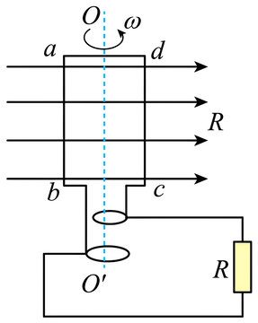

# Physics - 题目 1403

**ID**: b408991f1f55466eb95961ed8f8e7f93
**年级**: Grade 11
**难度**: Medium-Hard
**题型**: Calculation

## 题目
如图所示，匝数 $N=50$ 匝的矩形线圈，线圈总电阻 $r=1Ω$ ，边长为 $ab=25{\rm cm}$ ， $ad=20{\rm cm}$ 。​​​​​​​‌外电路电阻 $R=9Ω$ ，匀强磁场磁感应强度的大小 $B=0.4{\rm{T}}$ ，线圈绕垂直于磁感线的 $OO^{′}$ 轴以角速度 $ω=50π{\rm{r}}{\rm{a}}{\rm{d}}{\rm{/}}{\rm{s}}$ 匀速转动。试求：（1）电路中感应电动势的最大值；（2）从此位置开始转过 $\frac {π}{2}$ 的过程中，通过电阻R的电荷量q；（3）在时间 $t=1{\rm \min }$ 内R上消耗的电能；（取 $π{^{2}}{\rm{=}}10$ ）（4）从此位置开始计时，线圈ab边所受安培力的瞬时值表达式（取垂直于纸面向里为安培力的正方向）。

## 解答

1. （1）感应电动势的最大值 $E{{}_{{\rm m}}}=NBSω=50\times 0.4\times 0.25\times 0.2\times 50π{\rm{V}}{\rm{=}}{{5}}{{0}}π{\rm V}$ 。
2. （2）平均感应电动势 $\bar E=N\frac {ΔΦ}{{\rm{Δ}}t}$ ，
3. 平均电流 ${\overline{I}}=\frac {{\overline{E}}}{R+r}$ ，
4. 通过电阻R的电荷量 $q=\bar I\times {\rm{Δ}}t=N\frac {ΔΦ}{R+r}=50\times \frac {0.4\times 0.25\times 0.2}{9+1}{\rm{C}}=0.1{\rm{C}}$ 。
5. （3）感应电动势的有效值 $E=\frac {E{{}_{{\rm{m}}}}}{\sqrt {2}}=25\sqrt {2}π{\rm{V}}$ ，
6. 感应电流的有效值 $I=\frac {E}{R+r}=\frac {5\sqrt {2}π}{2}{\rm{A}}$ ，
7. 1 min内R上消耗的电能 $W=I{^{2}}Rt=67500{\rm{J}}$ 。
8. （4）从此位置开始计时，线圈中电动势的瞬时值表达式 $e=NBSω{\cos}ωt=50π{\cos}50πt\left ({{\rm V}}\right )$ ，
9. 电流的瞬时值表达式 $i=\frac {e}{R+r}=5π{\cos}50πt\left ({{\rm A}}\right )$ ，
10. 线圈ab边所受安培力的瞬时值表达式 $F=NBil{{}_{ab}}=25π{\cos}50πt\left ({{\rm N}}\right )$ 。

## 知识点

**中文**:
  - 交变电流的峰值和有效值
  - 正弦式交变电流的公式及图像

**English**:
  - Peak and RMS Values of AC
  - Formulas and Graphs of Sinusoidal AC

---
