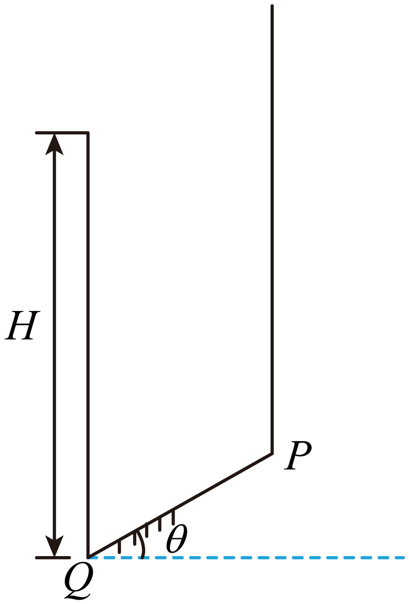

# Physics - 题目 406

**ID**: b5d48a84407946338493a8a07f379847
**年级**: Grade 11
**难度**: Medium-Hard
**题型**: Calculation

## 题目
为测试科创小组自主研发的一款接发球人工智能机器人（后简称“人机”）的性能，现将人机置于如图所示的场地。​​​​​​​‌倾角 $θ=37{}\degree $ 的固定斜面PQ长为 $L=2{\rm{m}}{\rm ，\mathit{Q}}$ 侧竖直墙壁高 $H=6{\rm{m}}{\rm ，\mathit{P}}$ 侧竖直墙壁足够高，墙壁均为弹性材质，对于碰到墙壁的小球，其竖直速度不变，水平速度等大反弹。碰到斜面的小球均被回收。现将人机放在Q点，不计人机和球的体积及空气阻力，重力加速度 $g=10{\rm{m}}/{\rm{s}}{^{2}}$ ．（已知 ${\rm{s}}{\rm{i}}{\rm{n}}37{}\degree =0.6$ ， ${\rm{c}}{\rm{o}}{\rm{s}}37{}\degree =0.8$ ）（1）为测试人机的接球能力，现从Q侧墙壁顶端水平射出小球A，其最终落点为P，小球发射瞬间人机开始沿斜面做匀加速直线运动恰好接到小球，求人机加速度大小a；（2）为测试人机的发球能力，现使人机从Q点发射小球B，使其能与P侧墙壁碰撞一次后垂直击中Q侧墙壁，求小球B初速度大小 $v{{}_{B}}$ 的取值范围。（3）小球在实际运动过程中会受到与运动方向相反的空气阻力，大小为 $f=kv$ ，其中v为小球运动中的速度，k为常量且满足 $k=\frac {mg}{v{{}_{0}}}$ （m为小球的质量）。现使人机以大小为 $\frac {9}{2}v{{}_{0}}$ 、方向与水平成 $53{}\degree $ 的初速度从Q点发射小球C，其与P侧墙壁碰撞一次后垂直击中Q侧墙壁，求 $v{{}_{0}}$ 的大小。（取 $\sqrt {28.45}=5.4$ ，最终结果可用根号表示）

## 解答

1. （1）A平抛 $H-L\sin θ=\frac {1}{2}gt{{}_{1}^{2}}$ ，解得 $t{{}_{1}}=\frac {2}{5}\sqrt {6}{\rm{s}}$ ，人机匀加速 $L=\frac {1}{2}at{{}_{1}^{2}}$ ，解得 $a=\frac {25}{6}{\rm{m}}/{\rm{s}}{^{2}}$
2. （2）设 $v{{}_{B}}$ 水平分量为 $v{{}_{x}}$ ，竖直分量为 $v{{}_{y}}$ ，水平方向 $2L{\cos}θ=v{{}_{x}}\cdot t$ ，竖直方向：不超过Q侧最高点 $\frac {1}{2}gt{^{2}}⩽H$ ，不碰斜面 $\frac {1}{2}gt{^{2}}-\frac {1}{2}g{\left({\frac {t}{2}}\right)^{2}}⩾L\sin θ$ ，可得 $0.32⩽t{^{2}}⩽1.2$ ， $v{{}_{B}^{2}}=v{{}_{x}^{2}}+v{{}_{y}^{2}}=v{{}_{t}^{2}}+(gt){^{2}}=\frac {3.2{^{2}}}{t{^{2}}}+100t{^{2}}$ ，当 $t{^{2}}=0.32$ 时， $v{{}_{B{\rm \min }}}=8{\rm{m}}/{\rm{s}}$ ，当 $t{^{2}}=1.2$ 时 $v{{}_{B{\rm \max }}}=2\sqrt {\frac {482}{15}}{\rm{m}}/{\rm{s}}$
3. （3）配速：竖直向下的 $v{{}_{0}}$ ，满足 $mg=kv{{}_{0}}$ ，向下匀速竖直向上的 $v{{}_{0}}$ 与 $4.5v{{}_{0}}$ 合成为 $v{{}_{1}}$ ， $v{{}_{1}}=\sqrt {v{{}_{0}^{2}}+{\left({4.5v{{}_{0}}}\right)^{2}}+2\times 4.5v{{}_{0}^{2}}{\cos}37}=\sqrt {28.45v{{}_{0}}}=5.4v{{}_{0}}$  ，与水平夹角为 $α$ ， ${\cos}α=\frac {4.5v{{}_{0}}{\cos}53{}\degree }{v{{}_{1}}}=\frac {1}{2}$ ， $\sin α=\frac {4.5v{{}_{0}}\sin 53{}\degree +v{{}_{0}}}{v{{}_{1}}}=\frac {23}{27}$ 【此处 $\sin α=\frac {\sqrt {3}}{2}$ 也可】，沿该方向做减速直线 $kv=ma$ ，在极短时间 $Δt$ 内满足 $kvΔt=maΔt$ ，即 $kΔs=mΔv$ ，垂直击中Q侧：末速度 $v{{}_{2}}=\frac {v{{}_{0}}}{\sin α}=\frac {27}{23}v{{}_{0}}$ 【此处 $v{{}_{2}}=\frac {2}{3}\sqrt {3}v{{}_{0}}$ 也可】，从发射到垂直击中Q侧 $k\frac {2L{\cos}θ}{{\cos}α}=m(v{{}_{1}}-v{{}_{2}})$ ，解得 $v{{}_{0}}=\frac {4}{9}\sqrt {\frac {230}{3}}{\rm{m}}/{\rm{s}}$ 【此处 $v{{}_{0}}=\frac {8}{\sqrt {5.4-\frac {2}{3}\sqrt {3}}}{\rm{m}}/{\rm{s}}$ 也可】

## 知识点

**中文**:
  - 运动的合成与分解

**English**:
  - Composition and Resolution of Motion

---
