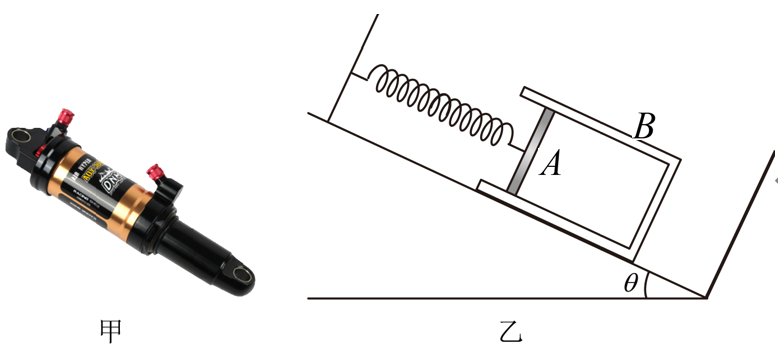

# Physics - 题目 139

**ID**: b602915874b743f7beb4ddf7bb0a83ca
**年级**: Grade 11
**难度**: Medium-Hard
**题型**: Calculation

## 题目
图甲为山地车的气压避震装置，主要由活塞、汽缸和弹簧组成。​​​​​​​‌某研究小组将其取出进行研究。如图乙所示，将带有活塞A的导热汽缸B放置在倾角为 $θ=30{}\degree $ 的光滑斜面上，活塞用另一端固定的轻弹簧拉住，轻弹簧平行于斜面，初始状态活塞到汽缸底部的距离为 $L{{}_{1}}=27{\rm{\;}}{\rm{c}}{\rm{m}}$ ，汽缸底部到斜面底端的挡板距离为 $L{{}_{2}}=1{\rm{\;}}{\rm{c}}{\rm{m}}$ ，汽缸内气体的初始温度为 $T{{}_{1}}=270{\rm{\;}}{\rm{K}}$ 。已知汽缸质量为M=0.6 kg，活塞的质量为 $m=0.2{\rm{\;}}{\rm{k}}{\rm{g}}$ ，横截面积为 $S=1.5{\rm{\;}}{\rm{c}}{\rm{m}}{^{2}}$ ，活塞与汽缸间密封一定质量的理想气体，活塞能无摩擦滑动，重力加速度为 $g=10{\rm{\;}}{\rm{m}}{\rm{/}}{\rm{s}}{^{2}}$ ，大气压为 $p{{}_{0}}=1.0\times 10{^{5}}{\rm{P}}{\rm{a}}$ 。（1）求初始状态下汽缸内气体压强 $p{{}_{1}}$ ；（2）对汽缸缓慢加热，汽缸内气体的温度从 $T{{}_{1}}$ 上升到 $T{{}_{2}}$ ，此时汽缸底部恰好接触到斜面底端的挡板。已知该封闭气体的内能 $U$ 与温度 $T$ 之间存在关系 $U=kT$ ， $k=2\times 10{^{-3}}{\rm{J}}{\rm{/}}{\rm{K}}$ ，求该过程中气体吸收的热量 $Q$ ；（3）该避震装置水平安装在山地车的座椅下方的光滑支架上，环境温度保持 $T{{}_{1}}$ 不变，某次骑行者骑山地车加速下坡（坡度为 $θ=30{}\degree $ ）时，产生的加速度大小为 $a=5{\rm{\;}}{\rm{m}}{\rm{/}}{\rm{s}}{^{2}}$ ，避震装置仍如图乙所示放置，发现此时活塞到汽缸底部的距离 $L{^{\prime }}=27{\rm{\;}}{\rm{c}}{\rm{m}}$ ，通过计算分析汽缸的气密性是否良好，若良好，请说明理由；若不良好，进气或漏气部分气体占原有气体的百分比为多少？

## 解答

1. （1）将A、B作为一个整体受力分析可知 $F{{}_{弹}}-(M+m)g\sin θ=0$ ，解得 $F{{}_{弹}}=4{\rm{\;}}{\rm{N}}$
2. 对A受力分析可得 $mg\sin θ+p{{}_{0}}S=p{{}_{1}}S+F{{}_{弹}}$ ，解得 $p{{}_{1}}=\frac {mg\sin θ-F{{}_{弹}}}{S}+p{{}_{0}}$ ，代入数据可得 $p{{}_{1}}=8\times 10{^{4}}{\rm{\;}}{\rm{P}}{\rm{a}}{\rm{\;}}$ 。
3. （2）汽缸内气体的温度从 $T{{}_{1}}$ 上升到 $T{{}_{2}}$ ，汽缸底部恰好接触到斜面底端的挡板的过程中，可以看成等压变化，根据盖-吕萨克定律可知 $\frac {V{{}_{1}}}{T{{}_{1}}}=\frac {V{{}_{2}}}{T{{}_{2}}}$ ，其中 $V{{}_{1}}=L{{}_{1}}S$ ， $V{{}_{2}}=(L{{}_{1}}+L{{}_{2}})S$ ，解得 $T{{}_{2}}=\frac {V{{}_{2}}}{V{{}_{1}}}T{{}_{1}}=\frac {28}{27}\times {{2}}{{7}}{{0}}{\rm{K}}{\rm{=}}{{2}}{{8}}{{0}}{\rm{K}}$ ，所以气体内能的变化 $ΔU=kT{{}_{2}}-kT{{}_{1}}=2\times 10{^{-2}}{\rm{\;}}{\rm{J}}$ ，气体对外界所做的功 $W=-p{{}_{1}}(V{{}_{2}}-V{{}_{1}})=-0.12{\rm{\;}}{\rm{J}}$ ，根据热力学第一定律 $ΔU=W+Q$ ，可得 $Q=\Delta U-W$ ，代入数据 $Q={{0}}{{.}}{{1}}{{4}}{\rm{J}}$ 。
4. （3）将A、B作为一个整体受力分析可知 $(M+m)g\sin θ-F{{}_{弹}}=(M+m)a$ ，解得 $F{{}_{弹}}=(M+m)g\sin θ-(M+m)a=0$ ，对A受力分析可得 $p{{}_{0}}S+mg\sin θ=p{{}_{2}}S$
5. 解得 $p{{}_{2}}=p{{}_{0}}+\frac {mg\sin θ}{S}=1.067\times 10{^{5}}{\rm{P}}{\rm{a}}$ ；
6. 由于环境的温度不变，此过程是等温过程，根据玻意耳定律 $p{{}_{1}}V{{}_{1}}=p{{}_{2}}V{{}_{2}}$
7. 解得 $V{{}_{2}}=0.75V{{}_{1}}$
8. 而此时，汽缸内气体的体积依然没变，故气密性不好，有漏气的现象，漏掉气体占原体积的百分比为 $\frac {V{{}_{1}}-V{{}_{2}}}{V{{}_{1}}}\times 100\%=25\%$

## 知识点

**中文**:
  - 热力学第一定律与理想气体状态方程的综合应用

**English**:
  - Integrated Application of 1st Law and Ideal Gas Law

---
