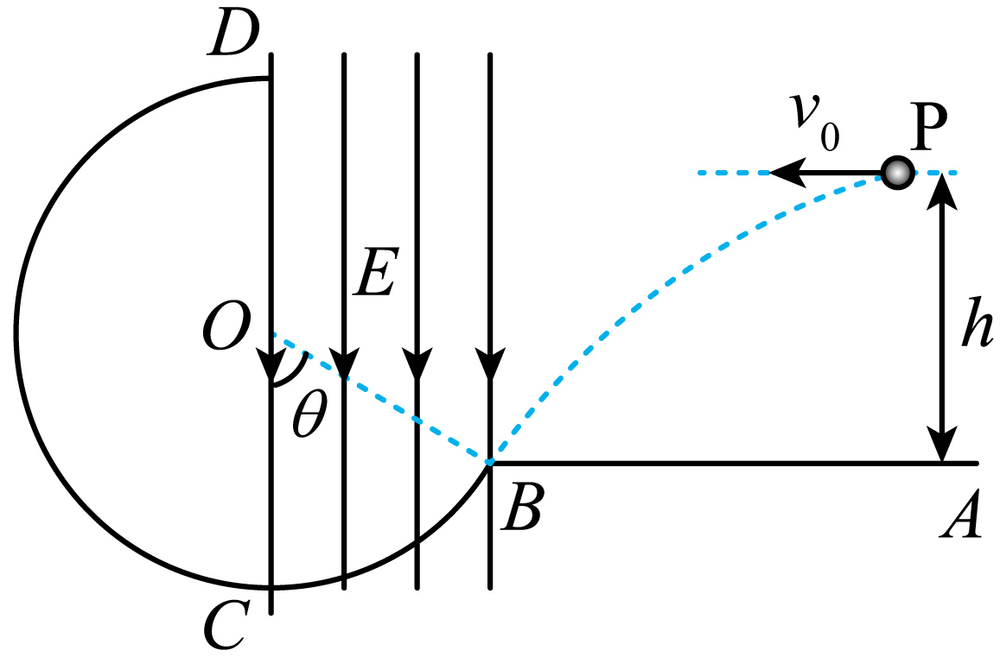

# Physics - 题目 863

**ID**: b73ea9520eab44a78a2cbe4d380d0932
**年级**: Grade 11
**难度**: Medium-Hard
**题型**: Calculation

## 题目
如图所示， $BCD$ 是光滑绝缘的、竖直固定的半径 $r=2.0{\rm{\;}}{\rm{m}}$ 的圆轨道的一部分， $CD$ 为竖直直径，仅在 $BC$ 间有方向竖直向下、高度足够高的匀强电场 $E$ ， $\angle BOC=θ=53{}\degree $ 。​​​​​​​‌当一质量 $m=0.5{\rm{\;}}{\rm{k}}{\rm{g}}$ 的带电小球（可看成质点） $P$ 从距水平面 $AB$ 高为 $h$ 的地方以 $v{{}_{0}}=7.2{\rm{\;}}{\rm{m}}/{\rm{s}}$ 的初速度水平抛出恰能无碰撞的从 $B$ 点进入圆轨道，并从 $D$ 点离开圆轨道，取 $g=10{\rm{\;}}{\rm{m}}/{\rm{s}}{^{2}}$ ，已知 $\sin 53{}\degree =0.8$ ， ${\cos}53{}\degree =0.6$ 。（1）试求：小球从 $B$ 点进入电场时的速度大小 $v{{}_{B}}$ ；（2）若小球沿BC轨道的运动是匀速圆周运动。试问：①小球刚到达 $D$ 点时，小球对轨道的压力？②小球离开 $D$ 点再经多长的时间到达水平面 $AB$ ？

## 解答

1. （1）带电小球水平抛出恰能无碰撞的从 $B$ 点进入圆轨道，即带电小球在 $B$ 点的速度方向与 $OB$ 垂直，则有 $v{{}_{B}}=\frac {v{{}_{0}}}{{\cos}53{}\degree }=\frac {7.2}{0.6}{\rm{\;}}{\rm{m}}/{\rm{s}}=12{\rm{\;}}{\rm{m}}/{\rm{s}}$ 。
2. （2）①小球沿 $BC$ 轨道的运动是匀速圆周运动，可知小球在 $C$ 点的速度大小为 $12{\rm{\;}}{\rm{m}}/{\rm{s}}$ ，小球从 $C$ 到 $D$ 的过程，根据动能定理可得 $-mg\cdot 2r=\frac {1}{2}mv{{}_{D}^{2}}-\frac {1}{2}mv{{}_{C}^{2}}$ ，解得 $v{{}_{D}}=8{\rm{\;}}{\rm{m}}/{\rm{s}}$ ，小球在 $D$ 点，根据牛顿第二定律可得 $mg+F=m\frac {v{{}_{D}^{2}}}{r}$ ，联立解得 $F=11{\rm{\;}}{\rm{N}}$ ，根据牛顿第三定律可知小球刚到达 $D$ 点时，小球对轨道的压力大小为 $11{\rm{\;}}{\rm{N}}$ ，方向竖直向上；
3. ②小球通过 $D$ 点后，在匀强电场中，由于电场力与重力平衡，小球在水平方向做匀速直线运动，设小球通过电场的时间为 $t{{}_{1}}$ ，则有 $t{{}_{1}}=\frac {r\sin 53{}\degree }{v{{}_{D}}}=\frac {2\times 0.8}{8}{\rm{\;}}{\rm{s}}=0.2{\rm{\;}}{\rm{s}}$ ，带电小球通过匀强电场后做平抛运动，竖直方向做自由落体运动，则有 $r+r{\cos}53{}\degree =\frac {1}{2}gt{{}_{2}^{2}}$ ，解得 $t{{}_{2}}=\sqrt {\frac {2(r+r{\cos}53{}\degree )}{g}}{\rm{\;}}{\rm{s}}=0.8{\rm{\;}}{\rm{s}}$ ，小球离开 $D$ 点到达水平面 $AB$ 的时间为 $t=t{{}_{1}}+t{{}_{2}}=0.2{\rm{\;}}{\rm{s}}+0.8{\rm{\;}}{\rm{s}}=1{\rm{\;}}{\rm{s}}$ 。

## 知识点

**中文**:
  - 匀强电场
  - 应用动能定理求解多阶段、多过程问题

**English**:
  - Uniform Electric Field
  - Multi-stage/Multi-process Problems

---
