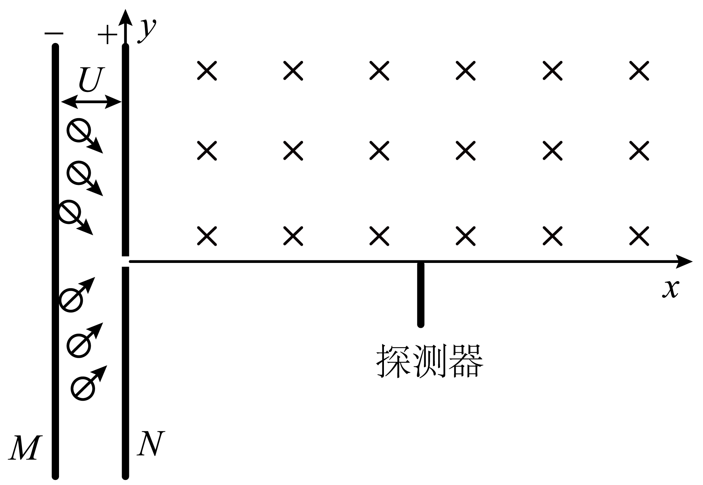

# Physics - 题目 841

**ID**: b8abfc2c7e884206af63d03e1c8978aa
**年级**: Grade 11
**难度**: Medium-Hard
**题型**: Calculation

## 题目
如图为研究光电效应装置示意图，该装置可用于分析光子的信息。​​​​​​​‌在xOy平面（纸面）内，垂直纸面的金属薄板M、N与y轴平行放置，板N中间有一小孔O。x轴上方存在垂直xOy平面向内、磁感应强度大小为B的匀强磁场，x轴上有可移动的探测器。当频率为 $ν$ 的光照射板M时，光电子逸出后经极板间电压为U加速（板间电场视为匀强电场）。已知电子质量为m、电荷量为e，板M的逸出功为 $W{{}_{0}}$ ，普朗克常量为h。忽略电子的重力及电子间的作用力。求（1）逸出光电子的最大初动能 $E{{}_{{\rm{k}}{\rm{m}}}}$ ；（2）光电子从O点射出时的速度 $v{{}_{0}}$ 的大小范围；（3） $x=2L$ 处的探测器接收到的光电子，从O点射出沿y轴的分速度 $v{{}_{y}}$ ；（4）能探测到光电子，探测器移动范围。

## 解答

1. （1）由光电效应方程可知 $E{{}_{{\rm{k}}{\rm{m}}}}=hν-W{{}_{0}}$
2. （2）由动能定理可知 $eU=\frac {1}{2}mv{{}_{0}^{2}}-E{{}_{{\rm{k}}}}$
3. 解得 $v{{}_{0}}=\sqrt {\frac {2\left ({eU+E{{}_{{\rm{k}}}}}\right )}{m}}$
4. 当 $E{{}_{{\rm{k}}}}=0$ 时， $v{{}_{0}}=\sqrt {\frac {2eU}{m}}$
5. 当 $E{{}_{{\rm{k}}}}=E{{}_{{\rm{k}}{\rm{m}}}}$ 时， $v{{}_{0}}=\sqrt {\frac {2\left ({eU+hν-W{{}_{0}}}\right )}{m}}$
6. $v{{}_{0}}$ 的大小范围为 $\sqrt {\frac {2eU}{m}}⩽v{{}_{0}}⩽\sqrt {\frac {2\left ({eU+hν-W{{}_{0}}}\right )}{m}}$
7. （3）某光电子从 $O$ 点射出，到达 $x=2L$ 处被探测器接收。设该光电子从 $O$ 点射出时速度与 $x$ 轴的夹角为 $θ$ 。运动轨迹如图所示
8. 
9. 则有 $ev{{}_{0}}B=m\frac {v{{}_{0}^{2}}}{r}$ ， $v{{}_{y}}=v{{}_{0}}\sin θ$ ， $\sin θ=\frac {L}{r}$
10. 联立解得 $v{{}_{y}}=\frac {eBL}{m}$
11. （4）光电子进入磁场后做匀速圆周运动，有 $ev{{}_{0}}B=m\frac {v{{}_{0}^{2}}}{r}$
12. 解得 $r=\frac {mv{{}_{0}}}{eB}$
13. 由于光电子从 $O$ 点射入磁场时速度大小和方向都不定，则光电子在磁场中运动的范围应在光电子做圆周运动的最大半径所形成的半圆内，如下图所示
14. 
15. 由于光电子质量、电荷量一定，光电子的偏转半径与速度 $v{{}_{0}}$ 成正比，则最大半径为 $r{{}_{{\rm{m}}{\rm{a}}{\rm{x}}}}=\frac {m}{eB}\sqrt {\frac {2\left ({eU+hν-W{{}_{0}}}\right )}{m}}$
16. 能探测到光电子，探测器移动范围为 $0⩽x⩽\frac {2m}{eB}\sqrt {\frac {2\left ({eU+hν-W{{}_{0}}}\right )}{m}}$

## 知识点

**中文**:
  - 光电效应规律的综合应用
  - 带电粒子在有界磁场中运动的临界极值问题
  - 动能定理的简单应用

**English**:
  - Comprehensive Application of Photoelectric Effect
  - Critical Extremum Problems in Bounded Magnetic Fields
  - Simple Applications of Work-Energy Theorem

---
