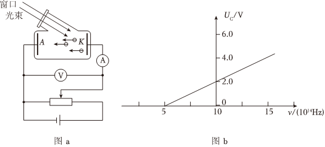

# Physics - 题目 2111

**ID**: b976065851ad4a8f922e953d63bee23b
**年级**: Grade 11
**难度**: Medium-Hard
**题型**: 三．计算题

## 题目
19世纪末、20世纪初，通过对光电效应的研究，加深了对光的本性的认识。​​​​​​​‌科学家利用如图a所示的电路研究光电效应，图中K、A是密封在真空玻璃管中的两个电极，K极受到光照时可能发射电子。（1）使用普通光源进行实验时，电子在极短时间内只能吸收一个光子的能量。某小组用图a电路研究光电效应现象，开始时滑动变阻器滑片置于最左端，用频率为ν单色光照射K板时，可以发生光电效应。当向右调节滑片电压达到某一数值时，电流表示数为零，此时电压为遏止电压，记为U_{c}。不断改变照射光频率，记录相应的遏止电压U_{c}，得到如图b所示的图像。a.从图中直接读出K极板金属所对应的截止频率ν_{c}；b.若已知电子电量为e=1.6×10^{-19}C，请你根据图b中的图线，推算普朗克常数h的大小。（结果保留两位有效数字）（2）随着科技的发展，强激光的出现丰富了人们对光电效应的认识，用强激光照射金属，一个电子在极短时间内吸收到多个光子成为可能。某同学为了解为什么使用普通光源进行光电效应实验时一个电子在极短时间内不能吸收多个光子，他查阅资料获得以下信息：原子半径大小数量级为10^{-10}m；若普通光源的发光频率为6×10^{14}Hz,其照射到金属表面的光强度为100W/cm^{2}；若电子吸收第一个光子能量不足以脱离金属表面时，在不超过10^{-8}s的时间内电子将该能量释放给周围原子而恢复到原状态。为了进一步分析，他建构了简单模型：假定原子间没有缝隙，一个原子范围内只有一个电子，且电子可以吸收一个原子范围内的光子。已知普朗克常数h=6.6×10^{-34}J•s,请利用以上资料和他建构的模型：a.估算一个电子在10^{-8}s内吸收一个光子的几率；b.分析一个电子在极短时间内不能吸收多个光子的原因。

## 解答

1. （1）根据动能定理和光电效应方程有：eU_{c}=E_{k}=hν-W_{0}，变形后有： $U{{}_{c}}=\frac {h}{e}\times v-\frac {W{{}_{0}}}{e}$
2. a、当U_{c}=0时，能使K极发生光电效应的激光的最低频率，从题图横截距可知：ν_{0}=5×10^{14}Hz；
3. b、U_{c}-ν直线物斜率 $k=\frac {h}{e}$ ，所以： $h=ke=\frac {2.0-0}{(10-5)\times 10{^{14}}}\times 1.6\times 10{^{-19}}J\cdot s=6.4\times 10{^{-34}}J\cdot s$
4. （2）a、普通光子的能量为：E_{1}=hν_{1}
5. 在1s内垂直照射到原子上的光的能量约为：E_{2}=E_{0}S
6. 若中面积：S=πr^{2}
7. 则1s内照射到一个原子范围的光子个数 $n^{′}=\frac {E{{}_{2}}}{E{{}_{1}}}$
8. 所以在t=10-8s时间内吸收光子的几率：ξ=n′t
9. 联立代入数据解得：ξ=2.5×10^{-4}
10. b、假设光子流密度均匀，相邻两个光子到达同一个原子范围内的时间为t'，则 $\frac {1}{n^{′}}$
11. 代入数据解得：t'=1.26×10^{-5}s＞10^{-8}s,所以对于普通光源，一个电子在极短时间内不能吸收多个光子。

## 知识点

**中文**:
  - 光电效应规律的综合应用

**English**:
  - Comprehensive Application of Photoelectric Effect

---
