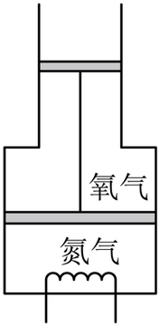

# Physics - 题目 2036

**ID**: b9dceab13ccb49c294a8a42b7e229e01
**年级**: Grade 11
**难度**: Medium-Hard
**题型**: Calculation

## 题目
如图，上端开口的竖直汽缸由小、大两个同轴圆筒组成，两圆筒高均为L。​​​​​​​‌两圆筒中各有一个厚度不计的活塞，小活塞的横截面积为S、质量为m；大活塞的横截面积为3S、质量为3m。两活塞用长为L的刚性杆连接，两活塞间充有氧气，大活塞下方充有氮气。小活塞的导热性能良好，汽缸及大活塞绝热，开始时，氮气和外界环境的温度均为 $T{{}_{0}}$ ，大活塞处于大圆筒的中间位置，且刚性杆上恰无弹力。重力加速度用g表示，外界的大气压强恒为 $\frac {4mg}{S}$ ，氧气和氮气均可看做理想气体。（1）开始时氮气的压强是多少？（2）通过电阻丝缓慢加热氮气，当大活塞刚上升 $\frac {L}{2}$ 时，氮气的温度是多少？（3）当大活塞刚上升 $\frac {L}{2}$ 时，设平均每个氮气分子对容器壁撞击力为 $F{{}_{1}}$ ，继续加热氮气，当氮气的温度上升到 $\frac {28}{3}T{{}_{0}}$ 时，设平均每个氮气分子对容器壁撞击为 $F{{}_{2}}$ ，试分析 $\frac {F{{}_{1}}}{F{{}_{2}}}$ 比 $\frac {1}{3}$ 大还是小？

## 解答

1. （1）以两活塞和杆为整体受力分析可得 $4mg+p{{}_{0}}S+p{{}_{1}}3S=p{{}_{1}}S+p{{}_{2}}3S$ ，对上方小活塞受力分析可得 $mg+p{{}_{0}}S=p{{}_{1}}S$ ，联立可得，氮气的压强为 $p{{}_{2}}=\frac {6mg}{S}$ ；
2. （2）对于氧气，温度不变，初状态 $p{{}_{1}}=\frac {5mg}{S}$ ， $V{{}_{1}}=\frac {1}{2}L\cdot 3S+\frac {1}{2}L\cdot S=2LS$ ，末状态设压强为 $p^{′}{{{}_{1}}}$ ，体积为 $V{{}_{1}}{^{\prime }}=LS$ ，根据玻意耳定律知 $p{{}_{1}}V{{}_{1}}=p{{}_{1}}{^{\prime }}V{{}_{1}}{^{\prime }}$ ，代入数据解得 $p^{′}{{{}_{1}}}=\frac {10mg}{S}$ ，以两活塞和杆为整体受力分析可得 $4mg+p{{}_{0}}S+p^{′}{{{}_{1}}}3S=p^{′}{{{}_{1}}}S+p^{′}{{{}_{2}}}3S$ ，可得 $p^{′}{{{}_{2}}}=\frac {28mg}{3S}$ ，根据理想气体状态方程知 $\frac {p{{}_{2}}V{{}_{2}}}{T{{}_{0}}}=\frac {p^{′}{{{}_{2}}}V^{′}{{{}_{2}}}}{T}$ ，代入数据解得 $T=\frac {28}{9}T{{}_{0}}$ ；
3. （3）当大活塞刚上升 $\frac {L}{2}$ 后，继续增加温度，氮气的体积不变，氮气做等容变化，根据 $\frac {p^{′}{{{}_{2}}}}{T}=\frac {p{{}_{3}}}{T^{′}}$
4. 可得 $p{{}_{3}}=3p^{′}{{{}_{2}}}$ ，可知温度为 $\frac {28}{3}T{{}_{0}}$ 时的压强为温度为 $\frac {28}{9}T{{}_{0}}$ 的3倍，但由于氮气气体分子的温度升高，平均速率变大，所以单位时间内撞击容器壁的次数变多，所以每一次的撞击力小于3倍，即 $\frac {F{{}_{1}}}{F{{}_{2}}}$ 大于 $\frac {1}{3}$ 。

## 知识点

**中文**:
  - 等容变化——气缸问题

**English**:
  - Isochoric Change: Cylinder Problems

---
