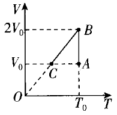

# Physics - 题目 1434

**ID**: bb26f606e2314ee7b17408a545b146e7
**年级**: Grade 11
**难度**: Medium-Hard
**题型**: Calculation

## 题目
一定质量的理想气体体积V与热力学温度T的关系图像如图所示，气体在状态A时的压强 $p{{}_{A}}=p{{}_{0}}$ ，温度 $T{{}_{A}}=T{{}_{0}}$ ，线段AB与V轴平行，BC的延长线过原点。​​​​​​​‌求：（1）气体在状态B时的压强 $p{{}_{B}}$ ；（2）气体从状态A变化到状态B的过程中，对外界做的功为10 J，该过程中气体吸收的热量为多少；（3）气体在状态C时的压强 $p{{}_{C}}$ 和温度 $T{{}_{C}}$ ；（4）气体从状态B变化到状态C的过程中，外界对气体做了多少功？

## 解答

1. （1）气体从状态A到状态B发生等温变化，根据玻意耳定律有 $p{{}_{A}}V{{}_{A}}=p{{}_{B}}V{{}_{B}}$
2. 解得 $p{{}_{B}}=\frac {p{{}_{0}}}{2}$
3. （2）气体从状态A至状态B过程发生等温变化，气体内能不变，即 $ΔU=0$ ，气体对外界做功，则 $W=-10{\rm{J}}$ ，根据热力学第一定律有 $ΔU=W+Q$
4. 解得 $Q=-W=10{\rm{J}}$
5. 即气体从外界吸收的热量为10 J。
6. （3）由于 $V-T$ 图像中，BC的延长线过原点，气体从状态B到状态C发生等压变化，则 $p{{}_{C}}=p{{}_{B}}=\frac {p{{}_{0}}}{2}$
7. 根据盖—吕萨克定律得 $\frac {V{{}_{B}}}{T{{}_{B}}}=\frac {V{{}_{C}}}{T{{}_{C}}}$
8. 解得 $T{{}_{C}}=\frac {T{{}_{0}}}{2}$
9. （4）气体从状态B到状态C发生等压变化，外界对气体做的功 $W=p{{}_{B}}\cdot ΔV=\frac {p{{}_{0}}V{{}_{0}}}{2}$ 。

## 知识点

**中文**:
  - 气体的V-T（V-t）图像问题
  - 气体等温变化与玻意耳定律
  - 气体的等压变化与盖—吕萨克定律
  - 热力学第一定律及其应用

**English**:
  - V-T (V-t) Graph Problems
  - Isothermal Change and Boyle's Law
  - Isobaric Change and Gay-Lussac's Law
  - First Law of Thermodynamics and Applications

---
