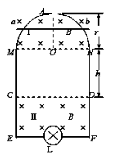

# Physics - 题目 2190

**ID**: c1ee49a737254541b67da4a9072fb02e
**年级**: Grade 11
**难度**: Medium-Hard
**题型**: Calculation

## 题目
如图所示，竖直平面内有两个半径为r、光滑的 $\frac {1}{4}$ 圆弧形金属环，在M、N处分别与距离为2r、足够长的平行光滑金属导轨ME、NF相接，金属环最高点A处断开不接触.金属导轨ME、NF的最远端EF之间接有电阻为R的小灯泡L在MN上方及CD下方有垂直纸面向里的匀强磁场Ⅰ和Ⅱ，磁感应强度大小均为B，磁场Ⅰ和Ⅱ之间的距离为h.现有质量为m的导体棒ab，从金属环的最高点A处由静止下落，在下落过程中导体棒始终保持水平，与金属环及轨道接触良好。​​​​​​​‌已知导体棒下落 $\frac {1}{2}$ 时向下的加速度为a。导体棒进入磁场Ⅱ后小灯泡亮度始终不变.重力加速度为g。导体棒、轨道、金属环的电阻均不计。求：（1）导体棒从A处下落 $\frac {r}{2}$ 时的速度 $v{{}_{1}}$ 的大小；（2）导体棒下落到MN处时的速度 $v{{}_{2}}$ 的大小；（3）将磁场Ⅱ的CD边界下移一段距离，分析导体棒进入磁场Ⅱ后小灯泡的亮度变化情况，并说明原因。

## 解答

1. （1）导体棒从A处下落 $\frac {r}{2}$ 时，导体棒切割磁感线的有效长度为 $\sqrt {3}r$ ，导体棒内产生的感应电动势
2. $E=BLv=\sqrt {3}Brv{{}_{1}}$
3. 回路中产生的感应电流
4. $I=\frac {E}{R}=\frac {\sqrt {3}Brv{{}_{1}}}{R}$
5. 根据牛顿第二定律有
6. $mg-BI\cdot \sqrt {3}r=ma$
7. 解得
8. $v{{}_{1}}=\frac {m(g-a)R}{3B{^{2}}r{^{2}}}$ .
9. （2）导体棒进入磁场Ⅱ后小灯泡亮度始终不变，说明导体棒在磁场Ⅱ中受力平衡，匀速下落，设此时导体棒的速度为 $v{{}_{3}}$ ，则有
10. $mg=F{{}_{安}}=B\frac {B\cdot 2r\cdot v{{}_{3}}}{R}\cdot 2r=\frac {4B{^{2}}r{^{2}}v{{}_{3}}}{R}$
11. 解得
12. $v{{}_{3}}=\frac {mgR}{4B{^{2}}r{^{2}}}$
13. 从MN下落到CD，导体棒下落过程只受重力作用，则
14. $v{{}_{2}^{2}}+2gh=v{{}_{3}^{2}}$
15. 得
16. $v{{}_{2}}=\sqrt {v{{}_{3}^{2}}-2gh}=\sqrt {{\left({\frac {mgR}{4B{^{2}}r{^{2}}}}\right)^{2}}-2gh}$
17. （3）CD边界下移一段距离，导体棒ab进入磁场Ⅱ时的速度大于 $v{{}_{3}}$ ， $mg<F{{}_{安}}$ ，导体棒做加速度逐渐减小的减速运动，速度逐渐减小，感应电动势逐渐减小，感应电流逐渐减小，小灯泡亮度逐渐减小，最后 $mg=F{{}_{安}}$ ，导体棒做匀速运动，小灯泡亮度不变.

## 知识点

**中文**:
  - 单杆模型
  - 电磁感应现象中的功能问题

**English**:
  - Single Rod Model
  - Work-Energy Problems in EM Induction

---
