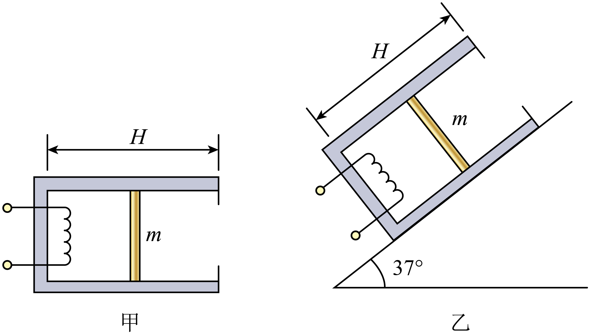

# Physics - 题目 540

**ID**: c20fe8245dc846ce980c946f7d2df200
**年级**: Grade 11
**难度**: Medium-Hard
**题型**: Calculation

## 题目
如图甲所示，深度为 $H$ 的圆柱形绝热汽缸底部安装有电热丝（体积可忽略），可以通过加热来改变缸内的温度。​​​​​​​‌汽缸口有固定卡销。汽缸内用质量为 $m=\frac {5p{{}_{0}}S}{g}$ 、横截面积为 ${\rm{S}}$ 的活塞封闭了一定质量的理想气体，此时活塞刚好在汽缸口，汽缸内气体温度为 $T{{}_{0}}$ ，压强为 $p{{}_{0}}$ 。如图乙所示，保持气体温度不变，将汽缸固定在倾角为 $37{^{\circ }}$ 的斜面上。大气压强恒为 $p{{}_{0}}$ ，重力加速度为 $g$ 。不计活塞及固定卡销厚度，活塞可沿汽缸壁无摩擦滑动且不漏气， ${\rm{s}}{\rm{i}}{\rm{n}}37{^{\circ }}$  $=0.6,{\rm{c}}{\rm{o}}{\rm{s}}37{^{\circ }}=0.8$ 。（1）求斜面上活塞距汽缸底部的距离 $h$ ；（2）汽缸在斜面上放置时，接通汽缸底部的电热丝缓慢给气体加热，一直到气体温度升高到 $5T{{}_{0}}$ ，加热过程中通过电热丝的电流恒为 $I$ ，电热丝电阻为 $R$ ，加热时间为 $t$ 。若电热丝产生的热量全部被气体吸收，求温度 $5T{{}_{0}}$ 时汽缸内气体的压强及气体温度从 $T{{}_{0}}$ 升高到 $5T{{}_{0}}$ 的过程中增加的内能。

## 解答

1. （1）初始时，对封闭气体，压强体积分别为 $p{{}_{1}}=p{{}_{0}}$ ， $V{{}_{1}}=SH$
2. 斜面上，初始时活塞受力平衡，则 $p{{}_{2}}S=p{{}_{0}}S+mg{\rm{s}}{\rm{i}}{\rm{n}}37{^{\circ }}$
3. 解得 $p{{}_{2}}=4p{{}_{1}}$
4. 根据玻意耳定律有 $p{{}_{1}}SH=p{{}_{2}}Sh$
5. 解得 $h=\frac {1}{4}H$
6. （2）假设活塞刚好到达汽缸口时，气体温度为 $T$ ，结合上述，根据查理定律有 $\frac {p{{}_{1}}}{T{{}_{0}}}=\frac {p{{}_{2}}}{T}$
7. 解得 $T^{′}=4T{{}_{0}}<5T{{}_{0}}$
8. 此后气体体积不再变化，根据查理定律有 $\frac {p{{}_{2}}}{T^{′}}=\frac {p{{}_{3}}}{5T{{}_{0}}}$
9. 解得 $p{{}_{3}}=5p{{}_{0}}$
10. 电热丝产生的热量 $Q=I{^{2}}Rt$
11. 气体对外做功 $W=p{{}_{2}}S\left ({H-h}\right )$
12. 气体增加内能 ${\rm{Δ}}U=Q-W$
13. 解得 ${\rm{Δ}}U=I{^{2}}Rt-3p{{}_{0}}SH$

## 知识点

**中文**:
  - 气体的等容变化与查理定律
  - 气体等温变化与玻意耳定律
  - 热力学第一定律及其应用

**English**:
  - Isochoric Change and Charles's Law
  - Isothermal Change and Boyle's Law
  - First Law of Thermodynamics and Applications

---
