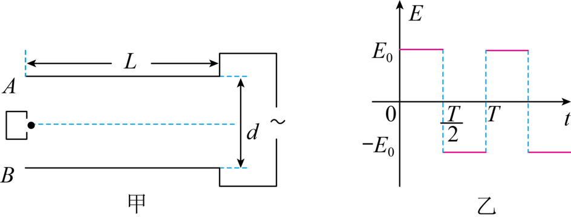

# Physics - 题目 1677

**ID**: c270f72697514e6289ab4bc43abe6eb4
**年级**: Grade 11
**难度**: Medium-Hard
**题型**: Calculation

## 题目
如图甲，一长为 $L$ 、板间距离为 $d$ 的平行板电容器水平放置，一正离子源放置在电容器左端中轴线处，离子源能够源源不断地在单位时间内释放相同数目、速度方向均沿中轴线水平向右、速度大小为 $v{{}_{0}}$ 的正离子，正离子的质量为 $m$ 、电荷量为 $q$ 。​​​​​​​‌从 $t=0$ 时刻起加一如图乙所示的周期性电场，此时A板电势高于B板。已知 $L=v{{}_{0}}T$ ，且 $d=\frac {qE{{}_{0}}T{^{2}}}{4m}$ ，不计离子的重力，不考虑电容器边缘效应，（其中 $\sqrt {2}$ 取1.414）。求：（1） $t=0$ 时刻进入的正离子击中B板什么位置，离B板右端点的距离 $x$ ；（2） $t=\frac {T}{4}$ 时刻进入的正离子在A、B两板间运动过程中距离A板的最大距离 $y$ ；（3）离子源发射的正离子被平行板电容器收集的比例 $η$ 。（结果保留三位有效数字）

## 解答

1. （1） $t=0$ 时刻进入的正离子运动的 $v\sim t$ 如图线1所示，其偏移量为 $\frac {d}{2}=\frac {1}{2}\frac {qE{{}_{0}}}{m}t{{}_{0}^{2}}$
2. 解得 $t{{}_{0}}=\frac {T}{2}$ ， $x=v{{}_{0}}\cdot \frac {T}{2}=\frac {L}{2}$
3. 离子击中B板的中点，离 $B$ 板右端点的距离 $x=\frac {1}{2}L$
4. （2） $t=\frac {T}{4}$ 时刻进入的正离子的 $v\sim t$ 如图线2所示，距离A板的最大距离 $y{{}_{2}}=\frac {1}{2}d+2\times \frac {1}{2}\frac {qE{{}_{0}}}{m}{\left({\frac {T}{4}}\right)^{2}}=\frac {3}{4}d$
5. （3）根据题意可知， $t=\frac {3}{8}T$ 时刻进入的正离子的 $v\sim t$ 如图线3所示， $y{{}_{2}}=-2\times \frac {1}{2}\frac {qE}{m}{\left({\frac {3T}{8}}\right)^{2}}+2\times \frac {1}{2}\frac {qE}{m}{\left({\frac {T}{8}}\right)^{2}}=-\frac {qET{^{2}}}{8m}=-\frac {d}{2}$
6. 即 $t=\frac {3}{8}T$ 时刻进入的正离子击中金属板A的右端点。
7. 设 $t=t{{}_{0}}$ 时刻进入电场的离子刚好打到 $B$ 板上的 $v\sim t$ 如图线4所示，则 $\frac {d}{2}=2\times \frac {1}{2}\frac {qE}{m}{\left({\frac {T}{2}-t{{}_{0}}}\right)^{2}}$
8. 解得 $t{{}_{0}}=\frac {2-\sqrt {2}}{4}T$
9. 又因为 $t=\frac {3}{8}T$ 时刻进入电容器的离子刚好打到 $A$ 板右端点，所以能够击中电容器两极板的离子进入电容器的百分比为 $η=\frac {\frac {1}{2}-\left ({\frac {3}{8}-\frac {2-\sqrt {2}}{4}}\right )}{\frac {1}{2}}\times 100{\rm{\%}}=54.3{\rm{\%}}$
10. 

## 知识点

**中文**:
  - 带电粒子在交变电场中的运动

**English**:
  - Motion in Alternating Electric Field

---
