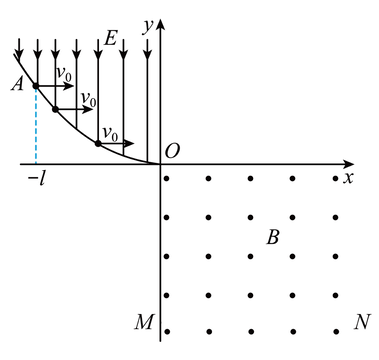

# Physics - 题目 2318

**ID**: c4083e9e46b04580877be67d391ae050
**年级**: Grade 11
**难度**: Medium-Hard
**题型**: Calculation

## 题目
如图所示，一抛物线的方程为 $y=\frac {x{^{2}}}{2l}\left ({x⩽0}\right )$ ，在抛物线的上方有竖直向下的匀强电场。​​​​​​​‌抛物线上每个位置可连续发射质量为m、电荷量为q的粒子，粒子均以大小为v_{0}的初速度水平向右射入电场，所有粒子均能到达原点O。第四象限内（含x边界）存在垂直于纸面向外、磁感应强度大小 $B=\frac {\sqrt {2}mv{{}_{0}}}{ql}$ 的匀强磁场，不计粒子重力及粒子间的相互作用。（1）求电场强度的大小E；（2）求从抛物线上横坐标 $x=-l$ 的A点发射的粒子射出磁场时的坐标；

## 解答

1. （1）粒子在电场中做类平抛运动。
2. 水平方向 $\left |{x}\right |=v{{}_{0}}t$ ，
3. 竖直方向有 $y=\frac {1}{2}\cdot \frac {qE}{m}\cdot t{^{2}}$ ，其中 $y=\frac {x{^{2}}}{2l}$ ，
4. 解得 $E=\frac {mv{{}_{0}^{2}}}{ql}$ 。
5. （2）在电场中，水平方向有 $l=v{{}_{0}}t{{}_{1}}$ ，
6. 竖直方向有 $v{{}_{y}}=\frac {qE}{m}t{{}_{1}}$ ，
7. 则 $v=\sqrt {v{{}_{0}^{2}}+v{{}_{y}^{2}}}$ ，
8. 设粒子进入磁场时速度v与竖直方向的夹角为θ，则 $\sin θ=\frac {v{{}_{0}}}{v}$ ，
9. 解得 $θ=45{}\degree $ ，
10. 由牛顿第二定律得 $qvB=m\frac {v{^{2}}}{R{{}_{1}}}$ ，
11. 由几何关系知 $d=2R{{}_{1}}\sin θ$ ，
12. 解得 $d=\sqrt {2}l$ ，
13. 射出磁场时的位置坐标为 $\left ({0,-\sqrt {2}l}\right )$ 。
14. 

## 知识点

**中文**:
  - 带电粒子在叠加场中的运动
  - 带电粒子在组合场中的运动

**English**:
  - Motion in Superimposed Fields
  - Motion in Combined Fields

---
