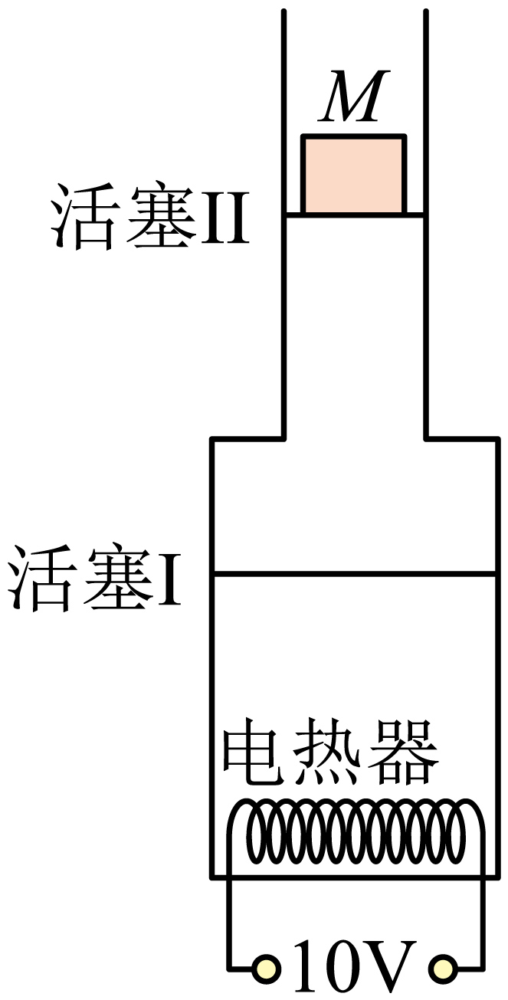

# Physics - 题目 2952

**ID**: cd3cf22215a64995a438b12028bf6ef5
**年级**: Grade 11
**难度**: Medium-Hard
**题型**: Calculation

## 题目
固定竖直汽缸，由上下两个横截面积不同、相互连通的绝热圆筒组成。​​​​​​​‌上下两圆筒中均封闭有一定质量的理想气体，如图所示。下部圆筒高h=16cm，内有一质量m=1kg、面积S=100cm²、厚度d=1cm绝热活塞Ⅰ，上部圆筒足够高，内有一质量为 $\frac {m}{2}$ 、面积为 $\frac {S}{2}$ 的活塞Ⅱ，活塞Ⅱ上面放置质量为M=10kg的重物。开始时活塞Ⅰ被锁定在其下表面距离圆筒底l=12cm的位置，活塞Ⅰ下方气体处于温度T_{1}=280K的状态1。现启动装置，位于圆筒下部的电热器开始缓慢加热，当气体温度升高到T_{2}=300K的状态2时解锁活塞Ⅰ，活塞Ⅰ恰好保持静止。继续加热气体，活塞Ⅰ上升到最高点后经历一段时间关闭电热器，当下方气体温度达到T_{3}=400K时为状态3。已知整个过程中活塞Ⅰ下方气体内能增加了ΔU=813.4J。两活塞均能缓慢无摩擦滑动，活塞Ⅱ上方大气压强 $p{{}_{0}}=1.0\times 10{^{{{5}}}}{\rm{P}}{\rm{a}}$ ，活塞Ⅰ下方理想气体物质的量为n=0.002mol，阿伏加德罗常数 $N{{}_{{\rm{A}}}}=6.0\times 10{^{23}}\cdot {\rm{m}}{\rm{o}}{\rm{l}}{^{{{-}}{{1}}}}$ 。已知额定电压为10V的电热器正常工作的阻值为10Ω，热效率为100％，重力加速度g取10m/s²。求：（1）活塞Ⅰ下方气体在状态2的压强；（2）在状态2时活塞Ⅰ下方气体分子之间的平均距离；（3）活塞Ⅰ下方气体在状态3的压强；（结果保留2位小数）（4）活塞Ⅰ下方气体从状态1到状态3的过程中电热器加热时间。

## 解答

1. （1）对活塞Ⅱ，根据平衡条件可得 $p{{}_{0}}\frac {S}{2}+\frac {mg}{2}+Mg=p^{′}{\frac {S}{2}}$
2. 对活塞Ⅰ，根据平衡条件可得 $p^{′}S+mg=p{{}_{2}}S$
3. 解得 $p{{}_{2}}=1.22\times 10{^{5}}{\rm{P}}{\rm{a}}$
4. （2）活塞Ⅰ下方气体分子数为 $N=nN{{}_{{\rm{A}}}}=1.2\times 10{^{21}}$ 个
5. 在状态2时活塞Ⅰ下方气体体积 $V=lS=0.12\times 100\times 10{^{-4}}{\rm{m}}{^{3}}=1.2\times 10{^{-3}}{\rm{m}}{^{3}}$
6. 平均每个分子所占体积 $V{{}_{1}}=\frac {V}{N}=1.0\times 10{^{-24}}{\rm{m}}{^{3}}$
7. 分子之间的平均距离 $a=\sqrt[3]{V{{}_{1}}}=1.0\times 10{^{-8}}{\rm{m}}$
8. （3）电热器缓慢加热，当气体温度达到 $T{{}_{2}}=300{\rm{K}}$ 的状态2后，活塞Ⅰ下方气体发生等压变化，一直到活塞Ⅰ到达最上端，设活塞Ⅰ到达最上端时气体温度为 $T{{}_{2}}^{′}$ ，由盖吕萨克定律，有 $\frac {lS}{T{{}_{2}}}=\frac {\left ({h-d}\right )S}{T{{}_{2}^{^{′}}}}$
9. 解得 $T{{}_{2}^{^{′}}}=375{\rm{K}}$
10. 之后气体体积不变，继续加热到 $T{{}_{3}}$ ，根据查理定律，有 $\frac {p{{}_{2}}}{T{{}_{2}}}=\frac {p{{}_{3}}}{T{{}_{3}}}$
11. 解得 $p{{}_{3}}\approx 1.30\times 10{^{5}}{\rm{P}}{\rm{a}}$
12. （4）电热器工作电压 $U=10{\rm{V}}$ ，电热器功率 $P=\frac {U{^{2}}}{R}=10{\rm{W}}$
13. 对下部气体，根据热力学第一定律可得 $ΔU=Q+W$
14. 气体对外界做功 $W=p{{}_{2}}S\left ({h-l-d}\right )=36.6{\rm{J}}$
15. 解得电热器传递给气体热量 $Q=813.4{\rm{J}}+36.6{\rm{J}}=850{\rm{J}}$
16. 由 $Q=Pt$
17. 解得加热时间 $t=85{\rm{s}}$ 。

## 知识点

**中文**:
  - 热力学第一定律与理想气体状态方程的综合应用

**English**:
  - Integrated Application of 1st Law and Ideal Gas Law

---
