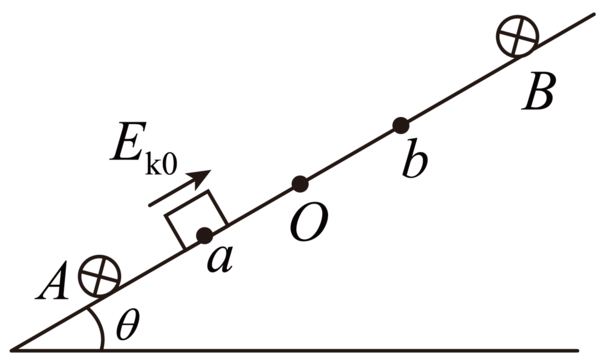

# Physics - 题目 1765

**ID**: cdbbcdaa0f654300955b133960e223a4
**年级**: Grade 11
**难度**: Medium-Hard
**题型**: Calculation

## 题目
如图所示，在倾角为θ的绝缘斜面上，有相距为L的A、B两点，分别固定着两个带电量均为Q的正点电荷。​​​​​​​‌O为AB连线的中点，a、b是AB连线上两点，其中 $Aa=Bb=\frac {L}{4}$ 。一质量为m、电荷量为+q的小滑块（可视为质点）以初动能 $E{{}_{{\rm{k}}{{}_{0}}}}$ 从a点出发，沿AB直线向b点运动，其中小滑块第一次经过O点时的动能为 $2E{{}_{{\rm{k}}{{}_{0}}}}$ ，第一次到达b点时的动能恰好为零，已知静电力常量为 $k$ ．求：（1）两个带电量均为Q的正点电荷在a点处的合场强大小和方向；（2）小滑块由a点向b点运动的过程中受到的滑动摩擦力大小；（3）aO两点间的电势差．

## 解答

1. （1）根据真空中点电荷的电场强度的表达式
2. $E=\frac {kQ}{r{^{2}}}{\rm \mathit{A}}$ 点处电荷在a处场强 $E{{}_{1}}=k\frac {Q}{(\frac {L}{4}){^{2}}}=\frac {16kQ}{L{^{2}}}$
3. 方向沿斜面向上,B点处电荷在a处场强 $E{{}_{2}}=k\frac {Q}{(\frac {3L}{4}){^{2}}}=\frac {16kQ}{9L{^{2}}}$
4. 方向沿斜面向下,根据电场的叠加原理，可知，在a点处的合场强大小和方向分别是 $E=E{{}_{1}}-E{{}_{2}}=\frac {128kQ}{9L{^{2}}}$
5. 方向沿斜面向上。
6. （2）由
7. $Aa=Bb=\frac {L}{4}{\rm \mathit{O}}$ 为AB连线的中点得，a、b关于O点对称，根据等量同种电荷的电势分布情况可知，a点与b点电势相等，则 $U{{}_{ab}}=0$
8. 小滑块从a点运动到b点的过程中，电场力做功 $W{{}_{电}}=qU{{}_{ab}}=0$
9. 设小滑块与水平面间的摩擦力大小为 $f$ ，小滑块从a点运动到b点的过程中根据动能定理有 $-mg\sin θ\frac {L}{{{2}}}-f\frac {L}{{{2}}}=0-E{{}_{{\rm{k}}{{}_{0}}}}$
10. 解得 $f=\frac {2E{{}_{{\rm{k}}{{}_{0}}}}}{L}-mg\sin θ$
11. （3）小滑块从a点运动到O点的过程中，根据动能定理 $qU{{}_{aO}}-mg\sin θ\frac {L}{{{4}}}-f\frac {L}{{{4}}}=2E{{}_{{\rm{k}}{{}_{0}}}}-E{{}_{{\rm{k}}{{}_{0}}}}$
12. 得 $U{{}_{aO}}=\frac {3E{{}_{{\rm{k}}{{}_{0}}}}}{2q}$

## 知识点

**中文**:
  - 带电体在库仑力作用下的运动问题
  - 应用动能定理求解多阶段、多过程问题

**English**:
  - Motion under Coulomb Force
  - Multi-stage/Multi-process Problems

---
