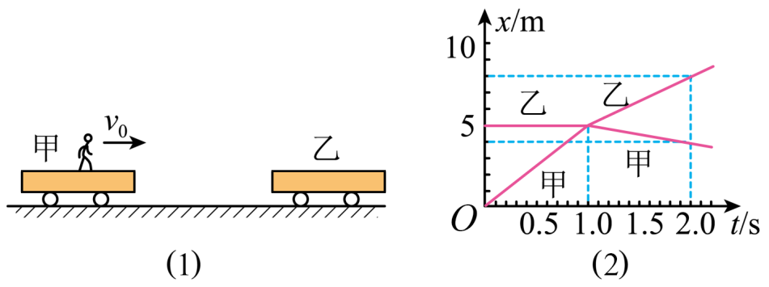

# Physics - 题目 2720

**ID**: ce43f37419104a1d860305cf5f232ce8
**年级**: Grade 11
**难度**: Medium-Hard
**题型**: Calculation

## 题目
如图(1)所示，在光滑的水平面上有甲、乙两辆小车，质量为30 kg的小孩乘甲车以5 m/s的速度水平向右匀速运动，甲车的质量为15 kg，乙车静止于甲车滑行的前方，两车碰撞前后的位移随时间变化图像如图(2)所示，求：（1）甲乙两车碰撞后的速度大小；​​​​​​​‌（2）乙车的质量；（3）为了避免甲、乙两车相撞，小孩至少以多大的水平速度从甲车跳到乙车上？

## 解答

1. （1）在位移—时间图像中，图线斜率的绝对值表示速度的大小，由图(2)可知，碰撞后甲车的速度大小为 $v{{}_{1}}=1{\rm{m}}{\rm{/}}{\rm{s}}$ ，乙车的速度大小为v_{2}=3 m/s。
2. （2）在碰撞过程中，三者组成的系统满足动量守恒，根据动量守恒定律有 $(m{{}_{人}}+m{{}_{甲}})v{{}_{0}}=(m{{}_{人}}+m{{}_{甲}})v{{}_{1}}+m{{}_{乙}}v{{}_{2}}$ ，解得 $m{{}_{乙}}=90{\rm{k}}{\rm{g}}$ 。
3. （3）设人跳向乙车的速度为v_{人}，由动量守恒定律可得人跳离甲车 $(m{{}_{人}}+m{{}_{甲}})v{{}_{0}}=m{{}_{人}}v{{}_{人}}+m{{}_{甲}}v{{}_{3}}$ ，人跳至乙车 $m{{}_{人}}v{{}_{人}}=(m{{}_{人}}+m{{}_{乙}})v{{}_{4}}$ ，为使二车避免相撞，应满足 $v{{}_{3}}\leqslant v{{}_{4}}$ ，相等时人跳离甲车的速度最小，解得 $v{{}_{人}}=\frac {20}{3}{\rm{m}}{\rm{/}}{\rm{s}}=6.7{\rm{m}}{\rm{/}}{\rm{s}}$ 。

## 知识点

**中文**:
  - 人船模型

**English**:
  - Man-Boat Model

---
